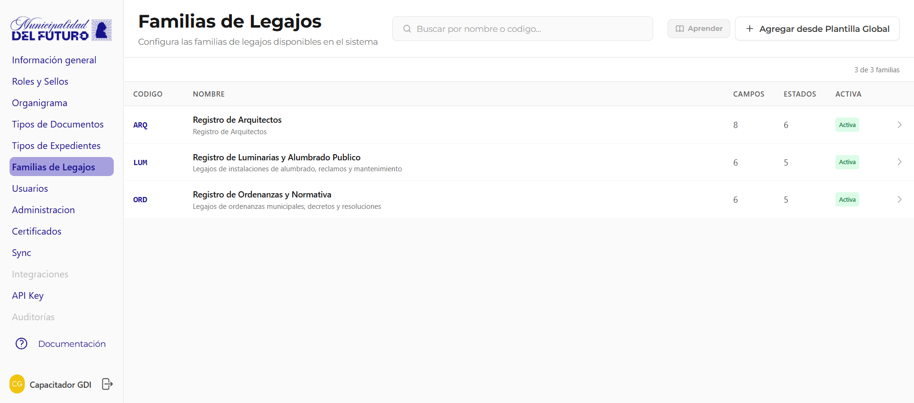
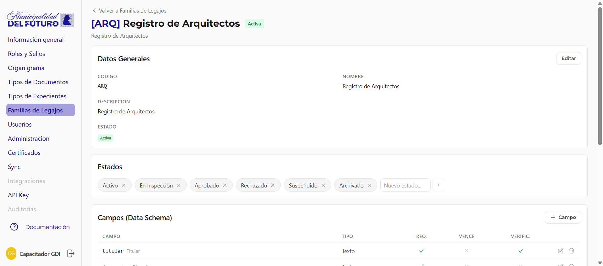

# Familias de Registro (RLM)

Gestiona las familias de registro del sistema. Las familias son plantillas que definen la estructura de los legajos: que campos tiene cada tipo de legajo, que sectores pueden operar con él, y que estados puede atravesar.

!!! video "Video tutorial"
    **GDI BackOffice — Familias de legajos: plantillas de registros**

    
<iframe src="https://www.youtube-nocookie.com/embed/9_3wrjRskhk?list=PLbbUEsKhLkuc" title="GDI BackOffice — Familias de legajos: plantillas de registros" loading="lazy" allow="accelerometer; autoplay; clipboard-write; encrypted-media; gyroscope; picture-in-picture; web-share" allowfullscreen></iframe>

---

## Qué es una Familia de Registro

Una familia de registro es una **plantilla reutilizable** que define cómo se estructura un tipo de legajo. Pensala como un formulario modelo: establece que datos se cargan, quien puede acceder y que ciclo de vida sigue el legajo.

!!! example "Ejemplo práctico"
    La familia **ARQ** (Arquitectura) podría definir qué cada legajo de obra debe tener: nombre del titular, número de plano, fecha de presentación, superficie en m2, y un campo de observaciones. Solo los sectores de Obras Privadas y Catastro pueden crear y ver estos legajos.

Cada familia tiene un **código único** de entre 3 y 8 caracteres (ej: `ARQ`, `LUM`, `ORD`, `HABCOM`) que la identifica en todo el sistema.

---

## Familias Globales vs Personalizadas

El sistema maneja dos tipos de familias:

| Tipo | Descripción |
|------|-------------|
| **Global** | Viene del catálogo global de GDI. Disponible para todas las organizaciones. No se puede modificar su estructura base |
| **Personalizada** | Creada por la organización para necesidades específicas del municipio. Totalmente configurable |

!!! info "Catálogo global"
    Las familias globales son mantenidas por GDI Latam y representan los tipos de legajo más comunes en la gestión municipal. Tu organización puede habilitarlas desde el catálogo y ajustar los permisos por sector.

---

## Listado de Familias

La tabla muestra todas las familias habilitadas para la organización.

| Columna | Descripción |
|---------|-------------|
| **Código** | Código único de la familia (3-8 caracteres, ej: `ARQ`, `LUM`) |
| **Nombre** | Nombre descriptivo de la familia |
| **Campos** | Cantidad de campos configurados en el esquema de datos |
| **Sectores** | Cantidad de sectores con permisos asignados |
| **Estado** | `Activo` o `Inactivo` |

### Acciones del listado

| Acción | Descripción |
|--------|-------------|
| **+ Nueva Familia** | Crear una familia personalizada |
| **+ Catálogo Global** | Habilitar una familia del catálogo global |

---

## Crear una Familia

Hay dos formas de crear una familia:

### Opción A: Desde el catálogo global

1. Presiona **"+ Catálogo Global"**
2. Se muestra la lista de plantillas globales disponibles (las que ya están habilitadas aparecen marcadas)
3. Selecciona la plantilla que querés habilitar
4. Se crea la familia con los campos y estados predefinidos de la plantilla
5. Ajusta los permisos por sector según tu organización

### Opción B: Familia personalizada

1. Presiona **"+ Nueva Familia"**
2. Completa el formulario:

| Campo | Descripción |
|-------|-------------|
| **Código** | Código único de 3 a 8 caracteres. Solo letras mayúsculas y números. No se puede cambiar después de creado |
| **Nombre** | Nombre descriptivo de la familia (ej: *Legajo de Obra Privada*) |
| **Descripción** | Texto opcional que explica el uso de la familia |

!!! warning "El código es permanente"
    Una vez creada la familia, el código no se puede modificar. Elegí un código claro y representativo. Ejemplos: `ARQ` para Arquitectura, `LUM` para Luminarias, `ORD` para Ordenanzas, `HABCOM` para Habilitaciones Comerciales.

Si no definís estados al crear, el sistema asigna por defecto: *Activo* e *Inactivo*.

---

## Editar una Familia

Desde el detalle de la familia podés modificar:

| Campo | Editable | Descripción |
|-------|:--------:|-------------|
| **Código** | No | El código es permanente, no se puede cambiar |
| **Nombre** | Sí | Nombre descriptivo de la familia |
| **Descripción** | Sí | Texto que explica el uso de la familia |
| **Estado** | Sí | Activar o desactivar la familia (ver [Desactivar una familia](#desactivar-una-familia)) |

---

## Configurar Campos (Data Schema)

Cada familia define un esquema de datos: los campos que va a tener cada legajo creado con esa familia.

### Agregar un campo

1. En el detalle de la familia, busca la sección **Campos**
2. Presiona **"+ Agregar campo"**
3. Completa las propiedades del campo:

| Propiedad | Descripción |
|-----------|-------------|
| **Clave** | Identificador interno del campo (minúsculas, números y guion bajo). No se puede cambiar después |
| **Nombre** | Nombre del campo tal como lo ve el usuario (ej: *Nombre del titular*, *Superficie m2*). Máximo 100 caracteres |
| **Tipo** | Tipo de dato del campo (ver tabla de tipos) |
| **Obligatorio** | Si el campo es requerido al crear o editar el legajo |
| **Vencimiento** | Si el campo tiene fecha de vencimiento asociada |
| **Verificación** | Si el campo requiere verificación por un usuario autorizado |

### Editar un campo

1. Hace click en el campo que querés modificar
2. Podés cambiar: nombre, obligatoriedad, vencimiento y verificación
3. Guarda los cambios

!!! warning "El tipo no se puede cambiar"
    Una vez creado el campo, no se puede cambiar su tipo (text, number, date, etc.). Si necesitás un tipo diferente, crea un campo nuevo y elimina el anterior.

### Eliminar un campo

1. Hace click en el icono de eliminar junto al campo
2. Confirma la eliminación

!!! warning "Campos con datos"
    No se puede eliminar un campo si hay legajos que ya tienen datos cargados en ese campo. El sistema muestra cuántos legajos están afectados. Para eliminar el campo, primero hay que limpiar los datos de esos legajos.

### Tipos de campo disponibles

| Tipo | Descripción | Ejemplo de uso |
|------|-------------|----------------|
| **text** | Texto corto, una línea | Nombre del titular, Número de plano |
| **number** | Valor numérico | Superficie en m2, Cantidad de pisos |
| **date** | Fecha con selector de calendario | Fecha de presentación, Fecha de vencimiento |
| **textarea** | Texto largo, múltiples líneas | Observaciones, Descripción de la obra |
| **select** | Lista desplegable con opciones predefinidas | Estado de la obra (En curso, Finalizada, Paralizada) |
| **boolean** | Casilla de verificación (si/no) | Tiene plano aprobado, Requiere inspección |
| **file** | Archivo adjunto | Plano aprobado, Foto del frente, Certificado escaneado |

!!! tip "Campo tipo select"
    Para campos de tipo `select`, se configura la lista de opciones disponibles. Por ejemplo, para un campo "Estado de obra" las opciones podrían ser: *En curso*, *Finalizada*, *Paralizada*, *Demolición*.

!!! tip "Campos con vencimiento"
    Cuando marcás un campo como "con vencimiento", el sistema muestra visualmente cuando la fecha cargada en ese campo está próxima a vencer o ya venció. Esto es útil para habilitaciones, certificados o permisos temporales.

!!! info "Campos con verificación"
    Un campo marcado como "requiere verificación" necesita que un usuario con permiso `can_verify` lo valide adjuntando un documento oficial. Hasta que no se verifique, el campo queda marcado como pendiente.

---

## Permisos por Sector

Cada familia define qué sectores pueden operar con sus legajos y con que nivel de acceso.

### Agregar un sector

1. En el detalle de la familia, busca la sección **Permisos**
2. Presiona **"+ Agregar sector"**
3. Selecciona el sector de la lista
4. Configura los permisos que correspondan
5. Guarda

!!! warning "Un sector por vez"
    Cada sector solo puede aparecer una vez en la lista de permisos. Si el sector ya está agregado, editalo en lugar de intentar agregarlo de nuevo.

### Permisos disponibles

Cada sector recibe una combinación de los siguientes permisos:

| Permiso | Descripción | Por defecto |
|---------|-------------|:-----------:|
| **can_view** | Puede ver y consultar los legajos | Sí |
| **can_create** | Puede crear nuevos legajos de esta familia | No |
| **can_edit** | Puede editar los datos de legajos existentes | No |
| **can_verify** | Puede verificar campos que requieren verificación | No |

### Editar permisos de un sector

1. Busca el sector en la tabla de permisos
2. Modifica los checkboxes de permisos
3. Guarda los cambios

Los cambios de permisos aplican inmediatamente para todos los usuarios de ese sector.

### Quitar un sector

1. Busca el sector en la tabla de permisos
2. Presiona el botón de eliminar
3. Confirma la eliminación

!!! warning "Quitar permisos"
    Al quitar un sector, todos los usuarios de ese sector pierden acceso a los legajos de esta familia inmediatamente. Los legajos no se eliminan, solo dejan de ser visibles para esos usuarios.

!!! example "Ejemplo de configuración de permisos"
    Para la familia **ARQ** (Arquitectura):

    | Sector | can_create | can_edit | can_view | can_verify |
    |--------|:----------:|:--------:|:--------:|:----------:|
    | Obras Privadas | Sí | Sí | Sí | Sí |
    | Catastro | No | No | Sí | Sí |
    | Mesa de Entradas | Sí | No | Sí | No |
    | Intendencia | No | No | Sí | No |

    En este ejemplo, Obras Privadas tiene control total. Mesa de Entradas puede crear legajos nuevos y verlos, pero no editarlos ni verificar campos. Catastro puede ver y verificar. Intendencia solo puede consultar.

!!! tip "Permisos del usuario"
    Si un usuario pertenece a múltiples sectores (sector principal + sectores adicionales), el sistema evalua los permisos de **todos** sus sectores. Si cualquiera de sus sectores tiene el permiso, se le autoriza la acción.

---

## Estados Configurables

Cada familia puede definir sus propios **estados** que representan el ciclo de vida de un legajo.

### Configurar estados

Los estados se configuran al **editar la familia**:

1. Abrí el detalle de la familia
2. Edita el campo **Estados**
3. Agrega, quita o reordena los estados de la lista
4. Guarda los cambios

!!! example "Ejemplo de estados"
    La familia **HABCOM** (Habilitaciones Comerciales) podría tener los siguientes estados:

    - Ingresado
    - En revisión
    - Observado
    - Aprobado
    - Rechazado
    - Vencido

!!! info "Sin restricciones de transición"
    Los usuarios con permiso de edición pueden cambiar el estado de un legajo a cualquier otro estado de la lista. No hay restricciones de transición (ej: no se fuerza un orden). Cada cambio de estado queda registrado en el historial del legajo.

!!! tip "Estados por defecto"
    Si no definís estados al crear una familia, el sistema asigna por defecto: *Activo* e *Inactivo*. Podés cambiarlos en cualquier momento.

Los estados permiten hacer seguimiento del progreso de cada legajo y filtrar legajos por su situación actual.

---

## Desactivar una familia

Si una familia ya no se usa, podés desactivarla:

1. Abrí el detalle de la familia
2. Presiona **Desactivar**
3. Confirma la acción

!!! warning "Solo si no hay legajos activos"
    No se puede desactivar una familia si tiene legajos creados. El sistema muestra cuántos legajos están asociados. Para desactivar, primero hay que archivar o eliminar los legajos de esa familia.

La desactivación es un **soft delete**: la familia no se elimina, solo se marca como inactiva. Los legajos existentes siguen siendo consultables pero no se pueden crear nuevos.

---

## Resumen de configuración

Para dejar una familia lista para usar, segui estos pasos:

1. **Crear la familia** con código, nombre y descripción (o habilitarla desde el catálogo global)
2. **Definir los campos** del esquema de datos (clave, tipo, obligatoriedad, vencimiento, verificación)
3. **Agregar sectores** con sus permisos específicos (can_view, can_create, can_edit, can_verify)
4. **Configurar los estados** del ciclo de vida del legajo

!!! tip "Orden recomendado"
    Es más fácil configurar primero los campos y estados, y luego asignar los permisos por sector. Así cuando pruebes con un usuario, ya va a ver la estructura completa del legajo.
