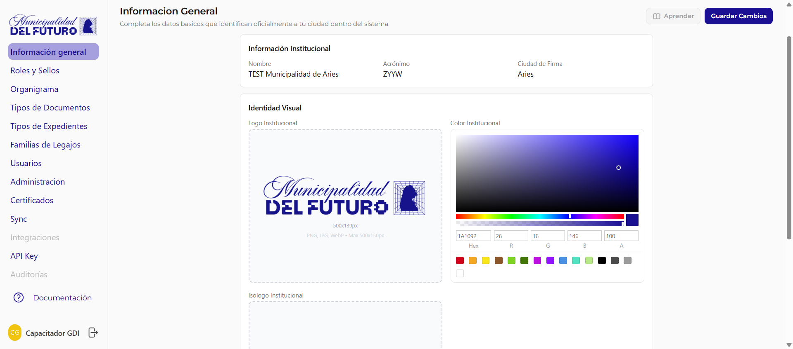

# Información General

Configura los datos básicos que identifican oficialmente a tu organización dentro del sistema.

!!! video "Video tutorial"
    **GDI BackOffice — Datos e identidad del municipio**

    
<iframe src="https://www.youtube-nocookie.com/embed/9Gn2_AASUPs?list=PLbbUEsKhLkuc" title="GDI BackOffice — Datos e identidad del municipio" loading="lazy" allow="accelerometer; autoplay; clipboard-write; encrypted-media; gyroscope; picture-in-picture; web-share" allowfullscreen></iframe>

---

## Información Institucional

Datos principales de la organización.

| Campo | Descripción |
|-------|-------------|
| **Nombre** | Nombre completo de la organización (ej: *Municipalidad del Futuro*) |
| **Acrónimo** | Sigla corta que identifica al tenant (ej: *TXST*). Se usa en la numeración de documentos y expedientes |
| **Ciudad de Firma** | Ciudad que aparece en los sellos de firma digital (ej: *LATAM*) |

---

## Identidad Visual

Personalización gráfica de la organización.

| Elemento | Descripción | Especificaciones |
|----------|-------------|------------------|
| **Logo Institucional** | Imagen principal de la organización. Aparece en el sidebar y en los PDFs generados | PNG, JPG o WebP. Max 500x150px |
| **Color Institucional** | Color primario de la organización. Se aplica en la interfaz del BackOffice | Selector de color con valor Hex y RGBA |
| **Isologo Institucional** | Versión compacta del logo para espacios reducidos | PNG, JPG o WebP. Max 500x150px |

---

## Acciones

| Acción | Descripción |
|--------|-------------|
| **Guardar Cambios** | Guarda todas las modificaciones realizadas en la página |
