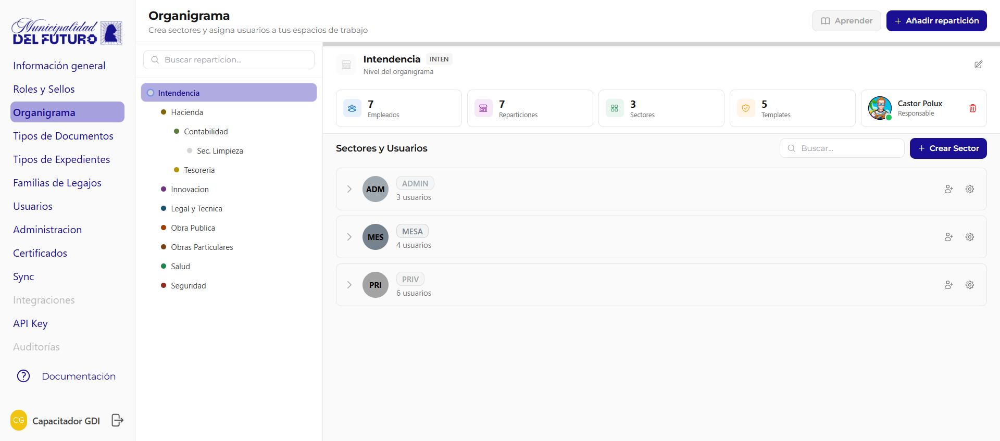
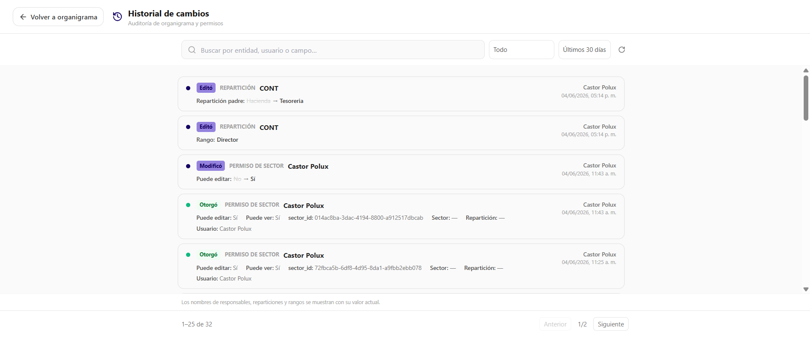

# Organigrama

Crea nuevos sectores y asigna usuarios a tus espacios de trabajo. El organigrama define la estructura organizativa de la organización: reparticiones (departamentos) y sectores.

!!! video "Video tutorial"
    **GDI BackOffice — Organigrama: reparticiones y sectores**

    
<iframe src="https://www.youtube-nocookie.com/embed/hclnkyEnSDs?list=PLbbUEsKhLkuc" title="GDI BackOffice — Organigrama: reparticiones y sectores" loading="lazy" allow="accelerometer; autoplay; clipboard-write; encrypted-media; gyroscope; picture-in-picture; web-share" allowfullscreen></iframe>

---

## Diseño general

La pantalla tiene tres zonas principales:

| Zona | Descripción |
|------|-------------|
| **Panel izquierdo** | Árbol **ESTRUCTURA** con todas las reparticiones (colapsable y redimensionable). Muestra la cantidad total de reparticiones y la jerarquía (repartición padre -> sub-reparticiones) |
| **Panel derecho** | Detalle de la repartición seleccionada: nombre, rango, acrónimos, tarjeta de responsable, stats, sectores y sub-reparticiones |
| **Modales centrados** | Crear repartición, crear sector, detalle de sector y detalle de repartición se abren como diálogos modales |

Arriba a la derecha de la página hay tres botones:

| Botón | Que hace |
|-------|----------|
| **Exportar** | Exporta la estructura del organigrama |
| **Audit** | Abre la auditoría legible de organigrama y permisos (ver [Auditoría de organigrama](#auditoria-de-organigrama-audit)) |
| **Nueva repartición** | Crea una nueva repartición |

El panel izquierdo se puede colapsar con el botón lateral y redimensionar arrastrando el borde.

---

## Árbol de Reparticiones (ESTRUCTURA)

El panel izquierdo muestra todas las reparticiones de la organización en formato jerárquico, con la cantidad total de reparticiones en el encabezado. Cada repartición tiene un **color** identificatorio y puede contener sub-reparticiones anidadas (repartición padre -> sub-reparticiones).

Al seleccionar una repartición, el panel derecho se actualiza con su detalle.

---

## Detalle de Repartición

Al seleccionar una repartición, el panel derecho muestra:

- **Nombre** de la repartición
- **Rango** jerárquico asociado
- **Acrónimos**: lista de siglas de los sectores de la repartición (por ejemplo `INTEN2#ADMIN`, `INTEN2#PRIV`, etc.)
- Tarjeta **RESPONSABLE** con la persona asignada y un botón para cambiar responsable
- Botón **Editar Repartición** para abrir el modal de detalle/edicion
- Contadores **N Empleados** | **N Tipos de exp.**

### Responsable

Cada repartición puede tener un responsable (titular del departamento). El botón de la tarjeta **RESPONSABLE** permite:

| Acción | Descripción |
|--------|-------------|
| **Asignar responsable** | Buscar y seleccionar un usuario activo. Al asignarlo, se lo mueve automáticamente al sector PRIV del departamento y se le asigna el sello del rango del departamento |
| **Cambiar responsable** | Si ya hay un responsable asignado, se puede reemplazar. El sistema pide confirmación antes de hacer el cambio |
| **Quitar responsable** | Quita al responsable actual. El departamento queda sin titular asignado |

!!! warning "Una persona, una sola repartición a cargo"
    Una persona puede ser responsable de **una sola** repartición. Si ya es responsable de otra, al asignarla aparece el aviso *"La persona ya es responsable de otro sector. Debe quitarlo primero."* y no se hace el cambio.

    Para asignarla: abrí la otra repartición, usa **Quitar responsable** y después volve a asignarla acá.

---

## Estadísticas de la Repartición

El detalle de la repartición muestra contadores con los totales de la repartición seleccionada:

| Estadística | Descripción |
|-------------|-------------|
| **Empleados** | Cantidad total de usuarios asignados |
| **Tipos de exp.** | Cantidad de tipos de expediente habilitados para la repartición |

---

## Sectores y Sub-Reparticiones

Debajo del detalle hay dos pestañas:

| Pestaña | Contenido |
|---------|-----------|
| **Sectores (N)** | Lista de sectores de la repartición, con un botón **Nuevo Sector** |
| **Sub-Reparticiones (N)** | Sub-reparticiones como tarjetas clicables (color, acrónimo, nombre y cantidad de empleados). Hacer clic en una sub-reparticion la selecciona en el árbol |

### Vista "Por sector" / "Por usuario"

Dentro de la pestaña **Sectores** hay un toggle de vista que cambia como se listan los datos:

| Vista | Que muestra |
|-------|-------------|
| **Por sector** | Agrupa por sector. Cada sector lista los usuarios que tiene asignados. Es la vista para administrar los integrantes y permisos de cada sector |
| **Por usuario** | Agrupa por usuario. Permite ver de un vistazo en que sectores está cada persona |

### Detalle de Sector

Al hacer clic en **Configurar sector** se abre un modal con:

| Dato | Descripción |
|------|-------------|
| **Acrónimo** | Sigla del sector. Editable (excepto en el sector PRIV, que es de sistema) |
| **Color del sector** | Selector de color con paleta predefinida |
| **Usuarios asignados** | Cantidad de usuarios en el sector |

!!! info "Sector PRIV (privado)"
    El sector **PRIV** es el sector de sistema (privado) que se crea automáticamente al crear una repartición. Solo se puede cambiar su color; el acrónimo está fijo. Además, el responsable de la repartición **no se puede quitar** del sector Privado.

---

## Multi-admin: varios usuarios por sector

Un mismo sector puede tener **varios usuarios** asignados. En la vista **Por sector**, cada sector lista sus integrantes con su permiso:

| Marca | Significado |
|-------|-------------|
| **Principal** | Es el responsable del sector. Cada sector tiene un único usuario con el badge **Principal** |
| **Ver + Editar** | Resto de usuarios del sector. Tienen permiso de ver y editar, controlado por el toggle **EDITAR** de cada usuario |

### Acciones sobre los usuarios del sector

| Acción | Descripción |
|--------|-------------|
| **Asignar usuario** | Suma un usuario nuevo al sector |
| **EDITAR** (toggle) | Activa o desactiva el permiso de edición del usuario en el sector |
| **Configurar sector** | Abre el detalle del sector (acrónimo, color) |
| **Quitar del sector** | Quita al usuario del sector |

!!! warning "Quitar al usuario Principal"
    No se puede quitar directamente al usuario **Principal** de un sector. Primero hay que reasignar el principal: el propio botón lo indica con el texto **"Quitar del sector (requiere reasignar el sector principal)"**. En el sector PRIV (privado), el responsable de la repartición no se puede quitar.

---

## Crear Repartición

El botón **Nueva repartición** (en el header de la página) o **+ Agregar sub-reparticion** (dentro de Sub-Reparticiones) abre un modal:

| Campo | Obligatorio | Descripción |
|-------|:-----------:|-------------|
| **Repartición padre** | Sí | Repartición a la que pertenece |
| **Rango** | No | Rango jerárquico del responsable |
| **Nombre** | Sí | Nombre completo (2-100 caracteres) |
| **Acrónimo** | Sí | Solo letras y números, max 20 caracteres, único |

Al crear la repartición, el sistema genera automáticamente un sector **PRIV** para ella.

!!! info "El acrónimo es solo una etiqueta; la numeración va por repartición"
    El acrónimo de una repartición se puede cambiar, pero **cambiarlo no reinicia el contador de los números especiales**. Los documentos de [numeración especial](tipos-de-documentos.md) (contador propio, ej: Decretos, Resoluciones, Disposiciones) llevan un contador atado a la **repartición**, no a su acrónimo: al renombrar el acrónimo el contador **sigue la misma secuencia** (…7, 8, 9). Los documentos ya emitidos conservan en su número el acrónimo con el que se emitieron (registro histórico), y los nuevos salen con el acrónimo nuevo, continuando la misma serie.

    **Si necesitás una numeración que arranque desde 1, tenés que crear una repartición nueva** (no alcanza con cambiar el acrónimo de una existente).

---

## Crear Sector

El botón **Nuevo Sector** abre un modal:

| Campo | Obligatorio | Descripción |
|-------|:-----------:|-------------|
| **Repartición** | Sí | Repartición a la que pertenece (pre-seleccionada si se usa el botón de la repartición activa) |
| **Acrónimo** | Sí | Solo letras y números, max 10 caracteres, único dentro de la repartición |
| **Color** | No | Color identificatorio con paleta predefinida |

---

## Auditoría de organigrama (Audit)

El botón **Audit** en el header de la página abre la vista **"Historial de cambios — Auditoría de organigrama y permisos"**. Es una bitácora legible de todas las operaciones registradas automáticamente sobre reparticiones, sectores y permisos de usuario.

### Buscador y filtros

| Control | Descripción |
|---------|-------------|
| **Buscar** | Caja "Buscar por entidad, usuario o campo" |
| **Filtro por entidad** | `Todo`, `Reparticiones`, `Sectores` o `Permisos de usuario` |
| **Filtro por fecha** | `Ultimos 30 dias`, `Ultimos 7 dias` o `Todo` |
| **Recargar** | Vuelve a cargar el historial |

### Entradas del historial

Cada entrada del historial muestra:

| Dato | Descripción |
|------|-------------|
| **Acción** | Verbo de la operación: `Edito`, `Modifico`, `Otorgo`, `Quito` o `Creo` |
| **Entidad** | Objeto afectado: `REPARTICION`, `SECTOR` o `PERMISO DE SECTOR` |
| **Campo y valores** | Campo cambiado con valor anterior -> nuevo. Por ejemplo `Puede editar: No -> Si`, `Responsable: X -> Y`, `Color: ... -> ...` |
| **Quien** | Nombre del usuario que hizo el cambio |
| **Cuando** | Fecha y hora del cambio |

El historial está **paginado**.

!!! info "Auditoría legible"
    Los nombres de responsables, reparticiones y rangos se muestran con su **valor actual**, para que el historial sea fácil de leer aunque la entidad haya cambiado de nombre después.

---

## Color de Departamento

Al editar el detalle de una repartición se puede modificar su **color primario**. El color se aplica a la barra superior del header y al avatar de la repartición. También se puede ajustar el color individual de cada sector hijo desde el mismo panel.

---

## Preguntas frecuentes

??? question "¿Cuántos usuarios puede tener un sector?"
    Varios. Un sector tiene un único usuario **Principal** (responsable del sector) y puede tener otros usuarios con permiso **Ver + Editar**. Se suman con **Asignar usuario**.

??? question "¿Qué es el badge Principal?"
    Marca al responsable del sector. Es único por sector. Para quitarlo del sector primero hay que reasignar el principal a otro usuario.

??? question "¿Para qué sirve la vista Por sector / Por usuario?"
    Son dos formas de leer lo mismo. **Por sector** agrupa los usuarios dentro de cada sector (ideal para administrar permisos). **Por usuario** agrupa por persona para ver en que sectores está cada una.

??? question "¿Por qué no puedo quitar a un usuario del sector PRIV?"
    PRIV es el sector privado de sistema y el responsable de la repartición no se puede quitar de él. Si es el Principal de otro sector, primero hay que reasignar ese principal.

??? question "¿Qué registra la Auditoría (Audit)?"
    Cambios en reparticiones, sectores y permisos de sector: quien los hizo, cuando, y el campo modificado con su valor anterior y nuevo. Se puede filtrar por entidad y por fecha, y buscar por texto.

??? question "Si cambio el acrónimo de una repartición, ¿se reinicia la numeración?"
    No. En los tipos con [numeración especial](tipos-de-documentos.md) (contador propio, como Decretos, Resoluciones o Disposiciones) el contador está atado a la **repartición**, no a su acrónimo. Al cambiar el acrónimo la secuencia **continua** donde estaba: los documentos ya emitidos mantienen el acrónimo viejo en su número (registro histórico) y los nuevos salen con el acrónimo nuevo, dentro de la misma serie. **Para tener una numeración que empiece desde 1 hay que crear una repartición nueva.**
