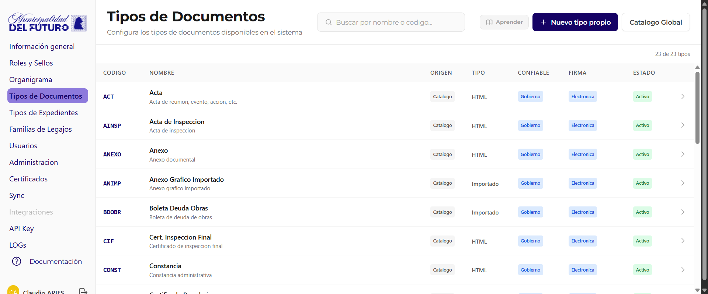
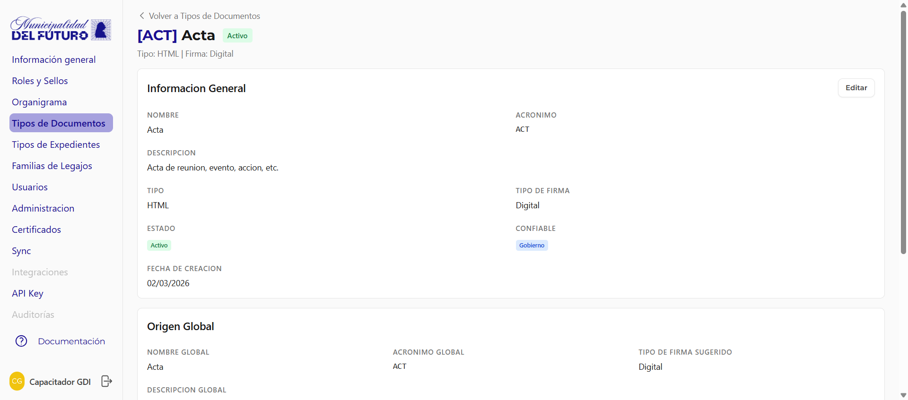
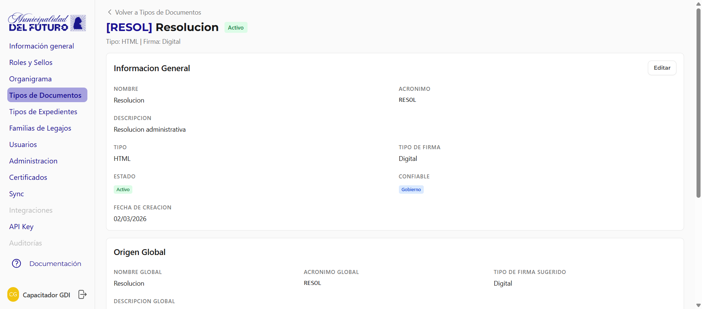
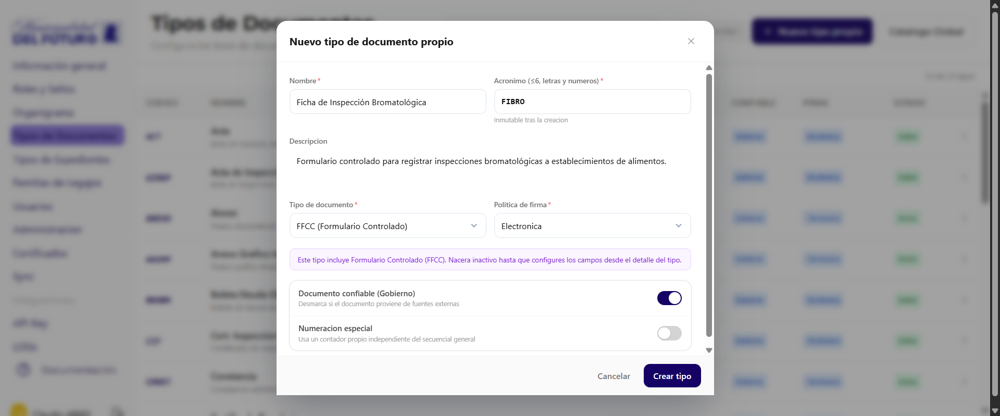
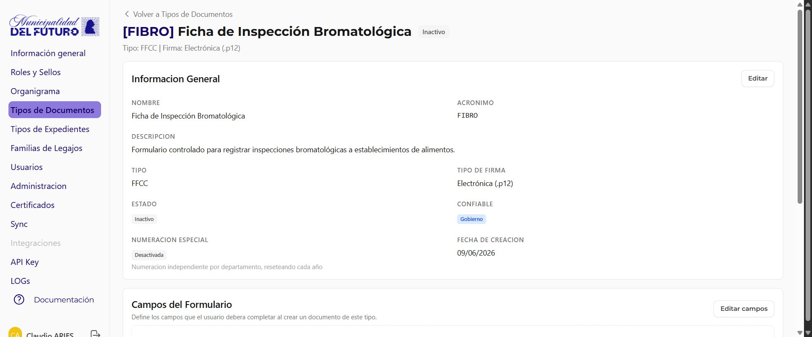
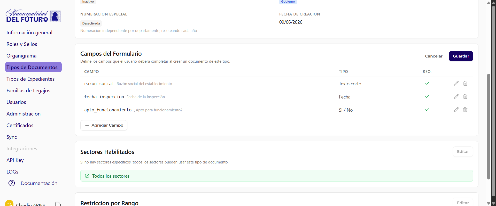
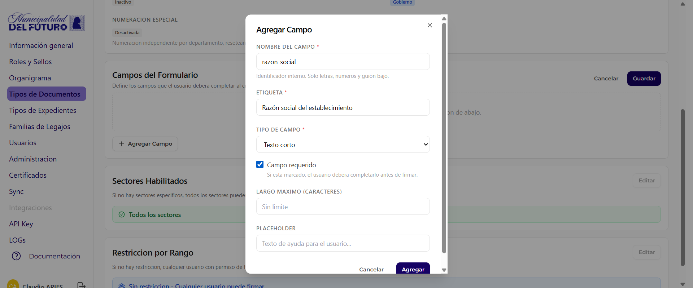
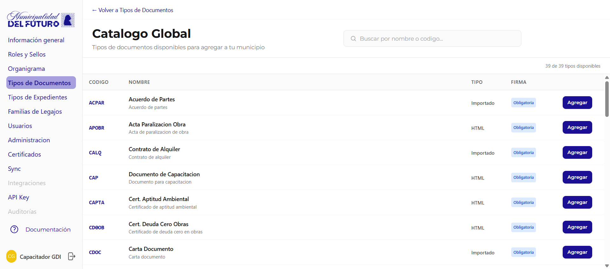

# Tipos de Documentos

Configura los tipos de documentos disponibles en el sistema. Cada organización puede **adoptar** tipos del catálogo global o **crear tipos propios** del municipio, y personalizar sus restricciones.

Arriba del listado hay dos botones:

- **Nuevo tipo propio**: crea un tipo de documento exclusivo de tu organización.
- **Catálogo Global**: adopta un tipo del catálogo global compartido.

!!! video "Video tutorial"
    **GDI BackOffice — Tipos de documento**

    
<iframe src="https://www.youtube-nocookie.com/embed/N7i6mrLaC80?list=PLbbUEsKhLkuc" title="GDI BackOffice — Tipos de documento" loading="lazy" allow="accelerometer; autoplay; clipboard-write; encrypted-media; gyroscope; picture-in-picture; web-share" allowfullscreen></iframe>

---

## Listado de Tipos

La tabla muestra todos los tipos de documento habilitados para la organización.

| Columna | Descripción |
|---------|-------------|
| **Código** | Acrónimo único del tipo (ej: *ACT*, *AINSP*, *ANEXO*) |
| **Nombre** | Nombre completo del tipo y descripción |
| **Origen** | `Catalogo` (adoptado del catálogo global) o `Propio` (creado por la organización) |
| **Tipo** | `HTML` (redactado en editor), `Importado` (PDF cargado), `NOTA`, `MEMO` o `FFCC` (Formulario Controlado) |
| **Confiable** | Nivel de confiabilidad: `Gobierno` (documento oficial) |
| **Firma** | `Electronica`, `Digital (num.)` (solo numeradores) o `Digital (todos)` |
| **Estado** | `Activo` o `Inactivo` |

---

## Detalle de un Tipo de Documento

Al hacer clic en un tipo se muestra su ficha completa:

### Información General

| Campo | Descripción |
|-------|-------------|
| **Nombre** | Nombre del tipo |
| **Acrónimo** | Código único |
| **Descripción** | Descripción del propósito del tipo |
| **Tipo** | HTML, Importado, NOTA, MEMO o FFCC |
| **Tipo de Firma** | Electrónica o Digital |
| **Estado** | Activo / Inactivo |
| **Confiable** | Gobierno |
| **Numeración Especial** | `Activada` o `Desactivada`. Ver *Numeración especial vs. secuencial general* más abajo |
| **Archivos Embebidos** | `Permite adjuntos` o `Sin adjuntos`. Ver [Archivos embebidos y firma por TAD](#archivos-embebidos-y-firma-por-tad) |
| **Firmable por ciudadanos (TAD)** | `Firmable TAD` o `No firmable TAD`. Ver [Archivos embebidos y firma por TAD](#archivos-embebidos-y-firma-por-tad) |
| **Visibilidad** | `Interno`, `Reservado` o `Público`. Se define al crear el tipo y no se puede cambiar. Ver [Reservados](reservados.md) y [Documentos Públicos](documentos-publicos.md) |
| **Fecha de Creación** | Fecha en que se agregó a la organización |

### Archivos embebidos y firma por TAD

Los dos interruptores se cambian con el lápiz de *Información General*.

**Archivos Embebidos** (*Permite adjuntar archivos embebidos*). Habilita el panel para adjuntar archivos que viajan **incrustados dentro del PDF firmado**. Ejemplo: un plano o una planilla que acompana a una resolución y queda dentro del mismo PDF.

- Se puede activar también en tipos **Importado**, firmables por TAD o no.
- Los tipos NOTA y MEMO **no** soportan archivos embebidos. Si se activa en uno de ellos, la pantalla avisa: *"Los tipos NOTA y MEMO no soportan archivos embebidos en esta versión: el backend va a rechazar la subida de adjuntos."*

**Firmable por ciudadanos (TAD)** (*Habilita firma vía API TAD (Trámites a Distancia)*). Permite que un ciudadano (sin usuario GDI) cree y firme este tipo de documento desde el portal TAD del municipio.

- Solo se activa en tipos con firma **Electrónica (.p12)**: un ciudadano nunca firma con token.
- Solo se activa en tipos Importado, HTML o FFCC. NOTA y MEMO no soportan firma TAD.
- Con el tipo ya guardado como firmable TAD, aparece el botón **Descargar esquema para API**. Es el archivo que necesita quien conecta el portal TAD con GDI.

!!! tip "Importado + TAD + embebidos"
    Un tipo **Importado** firmable por TAD **también puede aceptar archivos embebidos**. Antes eran excluyentes y la pantalla no dejaba activar los dos. Ahora GDI incrusta los adjuntos dentro del PDF importado cuando empieza la firma, y el esquema para API los incluye.

### Origen Global

Solo para tipos adoptados del catálogo. Muestra los datos del tipo en el catálogo global (nombre, acrónimo, descripción y tipo de firma sugerido).

### Sectores Habilitados

Define qué sectores pueden crear documentos de este tipo.

- **Todos los sectores**: Cualquier sector puede usar este tipo
- **Sectores específicos**: Solo los sectores listados pueden usarlo

### Restricción por Rango

Define qué rango mínimo necesita un funcionario para **numerar** (firmar como numerador) documentos de este tipo.

- **Sin restricción**: Cualquier usuario con permiso de firma puede firmar
- **Nivel N - Rango**: Solo funcionarios con ese rango o superior (ej: *Nivel 2 - Secretario*)

---

## Crear un tipo propio (Nuevo tipo propio)

Además de adoptar tipos del catálogo global, podés crear tipos de documento **propios** de tu municipio. El botón **Nuevo tipo propio** abre el modal *Nuevo tipo de documento propio*.

| Campo | Obligatorio | Descripción |
|-------|-------------|-------------|
| **Nombre** | Sí | Nombre completo del tipo |
| **Acrónimo** | Sí | Hasta 6 caracteres, letras y números. **Inmutable** tras la creación. No puede coincidir con un acrónimo del catálogo global |
| **Descripción** | No | Detalle del propósito del tipo |
| **Tipo de documento** | Sí | `HTML`, `NOTA`, `NOTA FFCC`, `MEMO`, `MEMO FFCC`, `FFCC (Formulario Controlado)` o `Importado` |
| **Política de firma** | Sí | `Electronica`, `Digital (todos)` o `Digital (numerados)` |
| **Documento confiable (Gobierno)** | No | Switch que marca el tipo como documento oficial de gobierno |
| **Numeración especial** | No | Switch: *Usa un contador propio independiente del secuencial general* |

Al completar los datos, el botón **Crear tipo** da de alta el tipo en tu organización.

!!! info "Numeración especial vs. secuencial general"
    Con **Numeración especial** desactivada, el tipo usa la **secuencia general** de la organización (un único correlativo por año compartido entre todos los tipos). Con **Numeración especial** activada, el tipo lleva un **contador propio, independiente por repartición**.

    Ese contador propio está atado a la **repartición**, no a su acrónimo. Por eso **cambiar el acrónimo de una repartición no reinicia el contador de los números especiales**: la secuencia continua donde estaba y solo cambia el texto del acrónimo en los documentos nuevos (los ya emitidos conservan el acrónimo con el que salieron). **Si necesitás una numeración que arranque desde 1, tenés que crear una repartición nueva.** (El acrónimo del *tipo de documento*, en cambio, es inmutable, ver abajo.)

!!! warning "El acrónimo es inmutable"
    Elegí el acrónimo con cuidado: una vez creado el tipo **no se puede cambiar**. Además, no puede coincidir con el acrónimo de ningún tipo del catálogo global.

!!! info "Tipos FFCC nacen inactivos"
    Cuando elegís un tipo FFCC (FFCC, NOTA FFCC o MEMO FFCC) aparece la nota: *"Este tipo incluye Formulario Controlado (FFCC). Nacerá inactivo hasta que configures los campos desde el detalle del tipo."* El tipo recién se puede activar cuando tiene sus campos configurados.

---

## Formularios Controlados (FFCC)

Un tipo **FFCC** (Formulario Controlado) presenta al usuario un **formulario de campos controlados** (campo:valor) en lugar de un editor de texto libre. Sirve para capturar datos estructurados: fichas, formularios de inspección, planillas, etc.

Hay tres variantes:

- **FFCC**: documento que es puramente un formulario controlado.
- **NOTA FFCC**: una NOTA con campos controlados.
- **MEMO FFCC**: un MEMO con campos controlados.

!!! note "Ciclo de vida de un tipo FFCC"
    Un tipo FFCC **nace inactivo**. Recién se puede **activar** cuando configuraste al menos sus campos del formulario desde el detalle del tipo.

### Campos del Formulario

En el detalle de un tipo FFCC, además de *Información General*, *Sectores Habilitados* y *Restricción por Rango*, aparece la sección **Campos del Formulario**: *"Define los campos que el usuario deberá completar al crear un documento de este tipo."*

Con los botones **Editar campos** y **Agregar Campo** administrás la lista. Los campos se muestran en una tabla:

| Columna | Descripción |
|---------|-------------|
| **Campo** | Nombre interno del campo y su etiqueta |
| **Tipo** | Tipo de dato del campo |
| **Req.** | Indica si el campo es requerido |

### Agregar Campo

El diálogo **Agregar Campo** define cada campo del formulario.

| Campo | Obligatorio | Descripción |
|-------|-------------|-------------|
| **Nombre del campo** | Sí | Identificador interno. Solo letras, números y guion bajo (ej: *razon_social*) |
| **Etiqueta** | Sí | Texto visible para el usuario al completar el documento |
| **Tipo de campo** | Sí | `Texto corto`, `Texto largo`, `Email`, `Numero`, `Fecha`, `Seleccion (lista)`, `Si / No` o `Documento adjunto` |
| **Campo requerido** | No | Checkbox: obliga a completar el campo |
| **Largo máximo (caracteres)** | No | Límite de caracteres del campo |
| **Placeholder** | No | Texto de ayuda que se muestra dentro del campo |

??? question "Cómo creo un tipo FFCC de punta a punta?"
    1. Click en **Nuevo tipo propio**.
    2. Carga *Nombre*, *Acrónimo* (≤6, inmutable) y *Descripción*.
    3. En *Tipo de documento* elegí una variante FFCC (FFCC, NOTA FFCC o MEMO FFCC). El tipo nacerá **inactivo**.
    4. Click en **Crear tipo**.
    5. Abrí el detalle del tipo y, en **Campos del Formulario**, agrega los campos con **Agregar Campo**.
    6. Cuando los campos estén listos, **activa** el tipo para que quede disponible para los usuarios.

??? question "Ejemplo: Ficha de Inspección Bromatológica"
    Un tipo propio *Ficha de Inspección Bromatológica* (acrónimo **FIBRO**), de tipo FFCC, puede tener campos como *razon_social* (texto corto), *fecha_inspeccion* (fecha) y *apto_funcionamiento* (Si / No). Al crear un documento de este tipo, el usuario completa el formulario en vez de redactar texto libre.

---

## Catálogo Global

Botón **Catálogo Global** muestra todos los tipos disponibles para adoptar en la organización.

| Columna | Descripción |
|---------|-------------|
| **Código** | Acrónimo del tipo en el catálogo global |
| **Nombre** | Nombre y descripción |
| **Tipo** | HTML o Importado |
| **Firma** | Obligatoria u Opcional |
| **Agregar** | Botón para habilitar el tipo en la organización |
