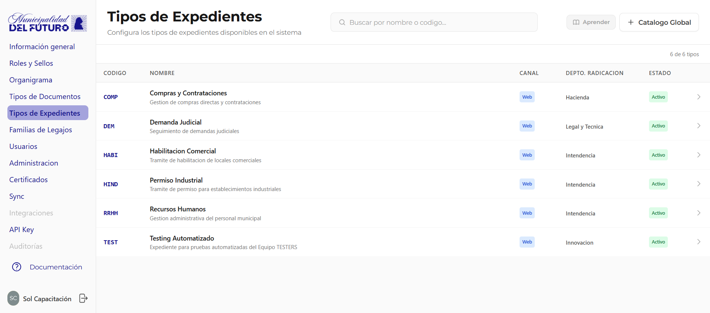
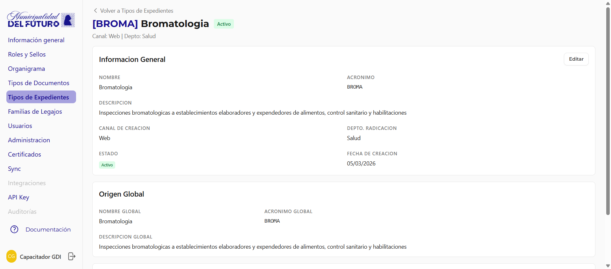
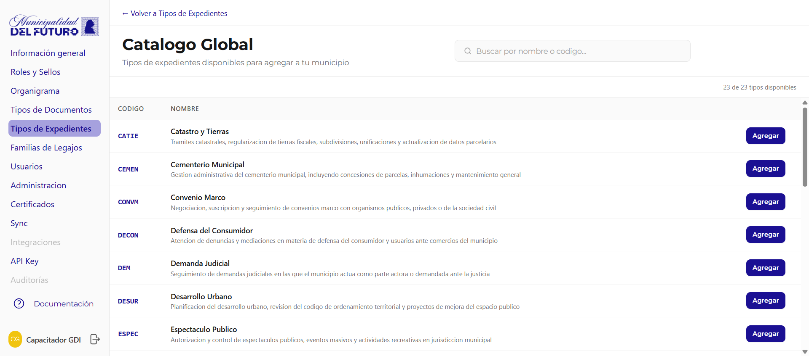

# Tipos de Expedientes

Configura los tipos de expedientes disponibles en el sistema. Cada organización selecciona del catálogo global los tipos de expediente que necesita.



!!! video "Video tutorial"
    **GDI BackOffice — Tipos de expediente**

    <div class="video-embed"><iframe src="https://www.youtube-nocookie.com/embed/h1Rj1y41ydk?list=PLbbUEsKhLkuc" title="GDI BackOffice — Tipos de expediente" loading="lazy" allow="accelerometer; autoplay; clipboard-write; encrypted-media; gyroscope; picture-in-picture; web-share" allowfullscreen></iframe></div>


---

## Listado de Tipos

La tabla muestra todos los tipos de expediente habilitados para la organización.

| Columna | Descripción |
|---------|-------------|
| **Código** | Acrónimo único del tipo (ej: *COMP*, *DEM*, *HABI*) |
| **Nombre** | Nombre completo y descripción |
| **Canal** | Canal de creación: `Web` (desde la aplicación) |
| **Depto. Radicación** | Departamento responsable de radicar expedientes de este tipo |
| **Estado** | `Activo` o `Inactivo` |

---

## Detalle de un Tipo de Expediente

Al hacer clic en un tipo se muestra su ficha completa:



### Información General

| Campo | Descripción |
|-------|-------------|
| **Nombre** | Nombre del tipo de expediente |
| **Acrónimo** | Código único |
| **Descripción** | Descripción del propósito |
| **Canal de Creación** | Web |
| **Depto. Radicación** | Departamento donde se radican los expedientes |
| **Estado** | Activo / Inactivo |
| **Fecha de Creación** | Fecha en que se agregó a la organización |

### Objetivo

El **objetivo** es el instructivo del trámite: para qué sirve, qué documentos lleva y cuándo termina. Es **opcional**: un tipo de expediente sin objetivo se crea y se guarda sin problema.

Dónde se usa:

- Se ve en cada expediente de este tipo, en la tarjeta **Objetivo** del panel de atributos (pestaña **Historial y Atributos**). Lo ven todos los que pueden ver el expediente.
- Lo leen **Tu Asistente** y el **resumen del expediente** hecho por IA, para saber qué trámite es y qué documentos le faltan.

Cómo cargarlo:

1. Abrí el tipo de expediente.
2. En el bloque **Objetivo**, escribí el texto. El contador muestra cuántos caracteres llevás (hasta **4.000**).
3. Tocá **Guardar**.

Por ejemplo, para *Habilitación Comercial* en la **Municipalidad del Futuro**:

```text
Habilitar un local comercial en el municipio.

Documentos que lleva:
- Solicitud del titular
- Plano aprobado
- Informe de Bromatología
- Pago de la tasa

Termina con el certificado de habilitación.
```

!!! info "Texto plano, con formato Markdown"
    El objetivo se escribe como texto. Podés usar formato **Markdown** sencillo: listas con `-`, **negrita** con `**texto**`. **No se admite HTML**: si el texto tiene etiquetas como `<b>` o `<script>`, el sistema no lo guarda y te avisa.

!!! warning "Un cambio afecta a todos los expedientes del tipo"
    El objetivo no tiene versiones. Si lo cambiás, el texto nuevo se ve enseguida en todos los expedientes de ese tipo, también en los que están en trámite.

!!! tip "El objetivo no da permisos"
    El asistente de IA lee el objetivo como información del trámite. No cambia sus reglas ni lo que cada persona puede hacer, aunque el texto lo pida.

### Origen Global

Muestra los datos del tipo en el catálogo global (nombre, acrónimo y descripción global).

### Departamentos Permitidos

Define qué departamentos pueden crear expedientes de este tipo.

- **Todos los departamentos**: Cualquier departamento puede crear expedientes de este tipo
- **Departamentos específicos**: Solo los departamentos listados

---

## Catálogo Global

Botón **+ Catálogo Global** muestra todos los tipos de expediente disponibles para agregar.



| Columna | Descripción |
|---------|-------------|
| **Código** | Acrónimo del tipo en el catálogo global |
| **Nombre** | Nombre y descripción |
| **Agregar** | Botón para habilitar el tipo en la organización |

!!! info "Departamento de Radicación"
    Al agregar un tipo de expediente desde el catálogo global, el sistema solicita seleccionar el **Departamento de Radicación** antes de confirmar. Este departamento será donde se radiquen los expedientes de este tipo.
