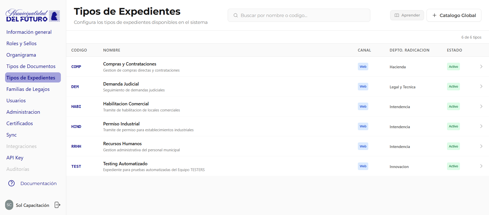
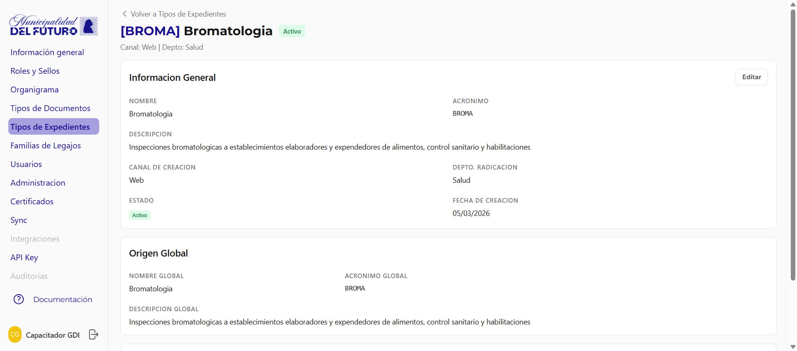
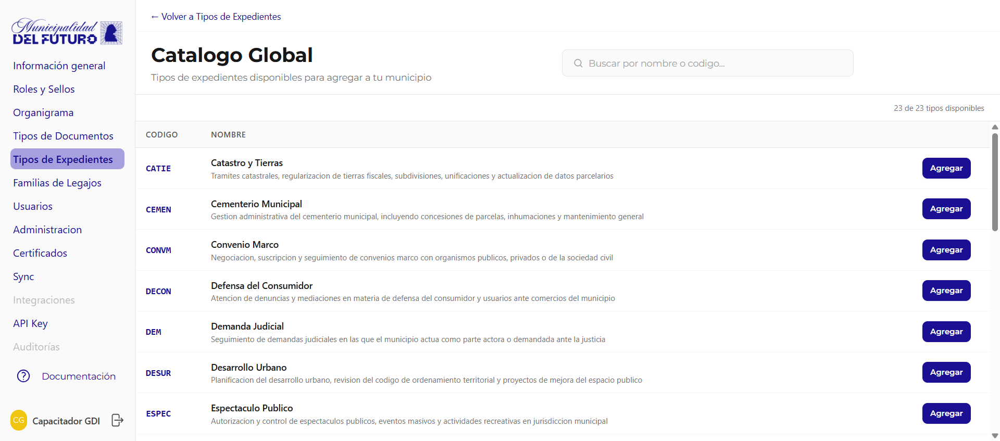

# Tipos de Expedientes

Configura los tipos de expedientes disponibles en el sistema. Cada organización selecciona del catálogo global los tipos de expediente que necesita.

!!! video "Video tutorial"
    **GDI BackOffice — Tipos de expediente**

    
<iframe src="https://www.youtube-nocookie.com/embed/h1Rj1y41ydk?list=PLbbUEsKhLkuc" title="GDI BackOffice — Tipos de expediente" loading="lazy" allow="accelerometer; autoplay; clipboard-write; encrypted-media; gyroscope; picture-in-picture; web-share" allowfullscreen></iframe>

---

## Listado de Tipos

La tabla muestra todos los tipos de expediente habilitados para la organización.

| Columna | Descripción |
|---------|-------------|
| **Código** | Acrónimo único del tipo (ej: *COMP*, *DEM*, *HABI*) |
| **Nombre** | Nombre completo y descripción |
| **Canal** | Canal de creación: `Web` (desde la aplicación) |
| **Depto. Radicación** | Departamento responsable de radicar expedientes de este tipo |
| **Estado** | `Activo` o `Inactivo` |

---

## Detalle de un Tipo de Expediente

Al hacer clic en un tipo se muestra su ficha completa:

### Información General

| Campo | Descripción |
|-------|-------------|
| **Nombre** | Nombre del tipo de expediente |
| **Acrónimo** | Código único |
| **Descripción** | Descripción del propósito |
| **Canal de Creación** | Web |
| **Depto. Radicación** | Departamento donde se radican los expedientes |
| **Estado** | Activo / Inactivo |
| **Fecha de Creación** | Fecha en que se agregó a la organización |

### Origen Global

Muestra los datos del tipo en el catálogo global (nombre, acrónimo y descripción global).

### Departamentos Permitidos

Define qué departamentos pueden crear expedientes de este tipo.

- **Todos los departamentos**: Cualquier departamento puede crear expedientes de este tipo
- **Departamentos específicos**: Solo los departamentos listados

---

## Catálogo Global

Botón **+ Catálogo Global** muestra todos los tipos de expediente disponibles para agregar.

| Columna | Descripción |
|---------|-------------|
| **Código** | Acrónimo del tipo en el catálogo global |
| **Nombre** | Nombre y descripción |
| **Agregar** | Botón para habilitar el tipo en la organización |

!!! info "Departamento de Radicación"
    Al agregar un tipo de expediente desde el catálogo global, el sistema solicita seleccionar el **Departamento de Radicación** antes de confirmar. Este departamento será donde se radiquen los expedientes de este tipo.
