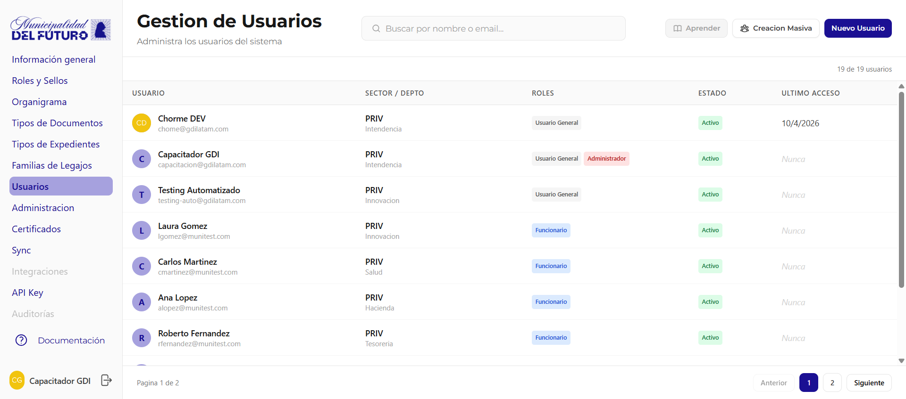
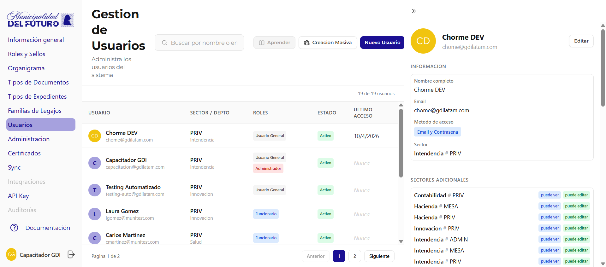

# Gestión de Usuarios

Administra los usuarios del sistema: crear, editar, asignar sectores, roles, sellos y permisos.



!!! video "Video tutorial"
    **GDI BackOffice — Usuarios: crear y gestionar el equipo**

    <div class="video-embed"><iframe src="https://www.youtube-nocookie.com/embed/pd5OhkuvX1g?list=PLbbUEsKhLkuc" title="GDI BackOffice — Usuarios: crear y gestionar el equipo" loading="lazy" allow="accelerometer; autoplay; clipboard-write; encrypted-media; gyroscope; picture-in-picture; web-share" allowfullscreen></iframe></div>


---

## Listado de Usuarios

La tabla muestra todos los usuarios de la organización.

| Columna | Descripción |
|---------|-------------|
| **Usuario** | Avatar con inicial (o foto de perfil), nombre completo y email. Si el usuario es titular de una repartición, se muestra la etiqueta **Titular** |
| **Repartición / Sector** | Repartición y acrónimo del sector principal al que pertenece |
| **Rol** | Rol principal asignado (ej: `Funcionario`, `Administrador`) |
| **Estado** | `Activo`, `Pendiente` (cuenta creada pero no activada) o `Inactivo` |
| **Último acceso** | Fecha del último login (*nunca* si no ha ingresado) |

### Filtros y acciones del listado

| Acción | Descripción |
|--------|-------------|
| **Buscar** | Filtrar por nombre o email |
| **Filtro por repartición** | Mostrar solo usuarios de una repartición específica |
| **Filtro por estado** | Mostrar solo Activos, Inactivos o Pendientes |
| **Creación masiva** | Crear múltiples usuarios a la vez (icono de lista) |
| **Nuevo usuario** | Crear un usuario individual (botón primario) |

### Detalle del usuario (drawer)

Al hacer clic en cualquier fila de la tabla se abre un **drawer lateral** (panel deslizable sobre la derecha del contenedor) con el detalle completo del usuario. El drawer no empuja el contenido: se superpone sobre la tabla.

---

## Crear Usuario

Al presionar **Nuevo usuario** se abre un **modal** con el formulario de creación.

### Campos del formulario

| Campo | Descripción |
|-------|-------------|
| **Email** | Correo electrónico del usuario (ej: `usuario@municipio.gob.ar`) |
| **Nombre completo** | Nombre y apellido |
| **Sello** | Sello de firma a asignar (obligatorio) |
| **Método de acceso** | Como va a iniciar sesión el usuario (ver abajo) |
| **Sector** | Sector principal al que se asigna |

### Método de acceso

Al crear un usuario se elige cómo va a iniciar sesión:

| Método | Descripción |
|--------|-------------|
| **Login Social (Google / Microsoft)** | El usuario ingresa con su cuenta de Google o Microsoft. Ideal para emails institucionales con Google Workspace o Microsoft 365. Es la opción por defecto |
| **Email y Contraseña** | El usuario recibe un email con un link de activación para crear su contraseña. El link vence en 5 días. Usar para emails que no son Google ni Microsoft |

!!! tip "Cuándo usar cada método"
    - **Login Social**: Para la mayoría de los casos. Si el email es de Google (`@gmail.com`, dominios con Google Workspace) o Microsoft (`@outlook.com`, dominios con Microsoft 365), elegir esta opción.
    - **Email y Contraseña**: Para dominios que no usan Google ni Microsoft como proveedor de email (ej: servidores de correo propios del municipio).

### Flujo según método de acceso

Dependiendo del método elegido, el sistema dispara un flujo diferente:

**Login Social (Google / Microsoft)**

1. El admin crea el usuario y selecciona **Login Social**
2. El usuario recibe un **email de bienvenida** con un link directo a la aplicación
3. El usuario hace clic en el link e inicia sesión con su cuenta de Google o Microsoft
4. El sistema lo reconoce automáticamente y le da acceso

**Email y Contraseña**

1. El admin crea el usuario y selecciona **Email y Contraseña**
2. El usuario recibe un **email de activación** con un link para crear su contraseña
3. El usuario hace clic en el link, establece su contraseña y queda activado
4. A partir de ahí, inicia sesión con su email y la contraseña que creó

!!! warning "El link de activación vence en 5 días"
    Si el usuario no completa la activación dentro de los 5 días, el link expira. En ese caso, el admin puede reenviar la invitación desde el detalle del usuario (ver sección [Activación pendiente y reinvitación](#activacion-pendiente-y-reinvitacion)).

#### Cuando GDI no manda el email de activación

A veces el usuario se crea pero GDI no le manda el email. En ese caso el modal no se cierra: muestra **Usuario creado**, un cartel amarillo con el motivo y el enlace de activación con el botón **Copiar enlace**. Copialo y entregaselo al usuario por otro medio. El enlace sirve una sola vez y vence a los 5 días: tratalo como una contraseña.

| Motivo | Que dice el cartel |
|--------|--------------------|
| La instalación no tiene servidor de correo (lo común en un servidor propio sin correo) | *"No hay servidor de correo configurado, así que la invitación no se envió. Entregale el enlace de activación al usuario por otro medio."* |
| El email es de **prueba** | Empieza con *"Cuenta de prueba: GDI no le manda mails"* |

GDI nunca manda emails a las cuentas de prueba: las casillas que empiezan con `k6-` y los dominios reservados para pruebas, que no tienen casillas reales. Son los terminados en `.example`, `.test`, `.invalid` o `.localhost` (ej: `ana.perez@municipio.test`).

---

## Creación Masiva (CSV)

Al presionar el botón de **Creación masiva** se abre un **modal** que permite crear múltiples usuarios a la vez importando un archivo CSV.

### Formato del CSV

El archivo CSV debe contener las siguientes columnas:

| Columna | Obligatoria | Descripción |
|---------|:-----------:|-------------|
| **email** | Sí | Correo electrónico del usuario |
| **nombre** | Sí | Nombre completo |
| **sello** | Sí | Nombre del sello de firma a asignar |
| **sector** | Sí | Código o nombre del sector a asignar (formato: `Nombre # CODIGO`) |
| **busqueda_docs** | No | Búsqueda global de documentos: `1` para habilitar, `0` o vacío para no |
| **busqueda_exps** | No | Búsqueda global de expedientes: `1` para habilitar, `0` o vacío para no |
| **sectores_adicionales** | No | Sectores adicionales separados por punto y coma |
| **auth_method** | No | Método de acceso: `social` o `database`. Si no se especifica, se usa `social` por defecto |

!!! example "Ejemplo de CSV"
    ```csv
    email,nombre,sello,sector,busqueda_docs,busqueda_exps,,auth_method
    jperez@municipio.gob.ar,Juan Perez,Director,Mesa de Entradas # MEN,0,0,,social
    mgarcia@municipio.gob.ar,Maria Garcia,Secretario,Tesoreria # TES,1,0,,social
    alopez@correo-propio.gob.ar,Ana Lopez,Director,Obras Privadas # OPR,0,0,,database
    ```

### Comportamiento según auth_method

| Valor | Que pasa al importar |
|-------|---------------------|
| `social` (o vacío) | El usuario recibe un email de bienvenida con link a la app. Inicia sesión con Google o Microsoft |
| `database` | El usuario recibe un email de activación con link para crear su contraseña. El link vence en 5 días |

!!! tip "Mezclar métodos en un mismo CSV"
    Podés combinar usuarios con `social` y `database` en el mismo archivo. El sistema envía el email correspondiente a cada uno según su método.

---

## Detalle de Usuario

Al hacer clic en un usuario se muestra su ficha completa:



### Información

| Campo | Descripción |
|-------|-------------|
| **Nombre completo** | Nombre y apellido del usuario |
| **Email** | Correo electrónico institucional |
| **Método de acceso** | Como inicia sesión: `Email y Contrasena`, `Google`, `Microsoft` o `Pendiente activacion` si todavía no activo su cuenta |
| **Sector** | Sector principal asignado (ej: *Tesorería # PRIV*) |
| **Número de Identificación Nacional (ID)** | Documento de identidad del usuario (si fue cargado) |

### Responsable de Departamento

Si el usuario es titular de un departamento, se muestra aquí.

| Campo | Descripción |
|-------|-------------|
| **Titular** | Indica que el usuario es responsable del departamento |
| **Departamento** | Nombre del departamento (ej: *Tesorería*) |

### Sectores Adicionales

Lista de sectores adicionales a los que el usuario tiene acceso, además de su sector principal.

### Firma / Sello

| Campo | Descripción |
|-------|-------------|
| **Sello actual** | Nombre y descripción del sello de firma asignado (ej: *Director - Sello de Director*) |

### Permisos de Búsqueda

| Permiso | Descripción |
|---------|-------------|
| **Búsqueda Global por Número Documento** | Puede buscar documentos oficiales de cualquier sector |
| **Búsqueda Global por Número Expediente** | Puede buscar expedientes de cualquier sector |

### Roles

Roles asignados al usuario: `Funcionario`, `Administrador`.

### Estado

Estado actual del usuario: `Activo` o `Inactivo`.

### Activación pendiente y reinvitación

Si el usuario todavía no activo su cuenta o necesita recibir nuevamente el email de acceso, se muestra esta sección con la opción de reenviar la invitación.

- **Email y Contraseña**: Genera un nuevo link de activación y envía email para crear contraseña. El link anterior queda invalidado.
- **Login Social**: Reenvía el email de bienvenida con el link directo a la aplicación.

| Acción | Descripción |
|--------|-------------|
| **Reenviar invitación** | Genera un nuevo link de activación y envía un email al usuario para que cree su contraseña. El link anterior queda invalidado |

!!! info "Cuándo usar reinvitar"
    Usa esta opción cuando:

    - El link de activación original ya venció (pasaron más de 5 días)
    - El usuario perdio o no encontro el email original
    - Necesitás reenviar la invitación por cualquier motivo

    El nuevo link también tiene una validez de **5 días**. Podés reenviar la invitación todas las veces que sea necesario.

### Zona de Peligro

| Acción | Descripción |
|--------|-------------|
| **Desactivar usuario** | Desactiva el acceso del usuario al sistema. El usuario no podrá iniciar sesión |

### Actividad

| Campo | Descripción |
|-------|-------------|
| **Último acceso** | Fecha y hora del último login |
| **Fecha de creación** | Fecha en que se creó el usuario en el sistema |
