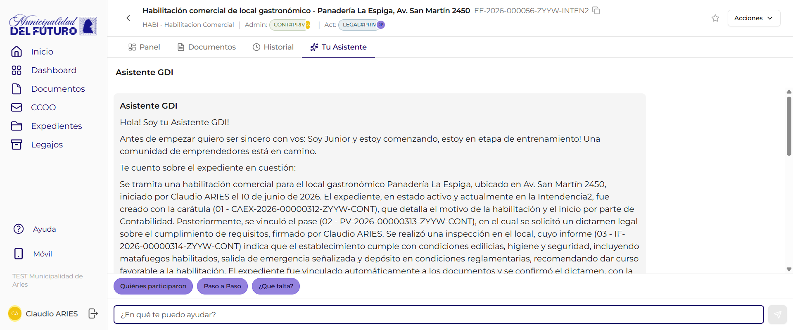

# Asistente AI

El Asistente AI es una herramienta integrada en GDI que permite consultar información sobre expedientes y documentos usando **lenguaje natural**. Está disponible dentro de cada expediente para consultar su contenido. Al abrir el chat presenta automáticamente un **resumen del expediente** generado por IA y, para responder, lee los **resúmenes de los documentos** vinculados y el **historial de movimientos** del expediente. Es de **solo lectura**: consulta y explica, pero no modifica nada.

!!! info "Límite mensual de uso"
    El consumo de inteligencia artificial se registra **por municipio** y tiene un **tope mensual**. Si el municipio alcanza su tope, el asistente se pausa y muestra un cartel indicando el **motivo real** del bloqueo (por ejemplo, límite de uso alcanzado). Las demás funciones del sistema siguen operando con normalidad; el asistente se rehabilita automáticamente al iniciarse el nuevo periodo o si se ajusta el tope del municipio.

!!! video "Video tutorial"
    **GDI — Asistente IA del expediente: pregunta en lenguaje natural**

    
<iframe src="https://www.youtube-nocookie.com/embed/kvCS4NgVMPs?list=PLRIZqApsdJ12JCSzhUxaZ73AheVHUEpDq" title="GDI — Asistente IA del expediente: pregunta en lenguaje natural" loading="lazy" allow="accelerometer; autoplay; clipboard-write; encrypted-media; gyroscope; picture-in-picture; web-share" allowfullscreen></iframe>

---

## Asistente en el Expediente

Dentro de la vista de detalle de un expediente, el tab **"Tu Asistente"** abre un chat integrado que permite hacer preguntas sobre ese expediente específico.

Al abrir el tab, el asistente saluda (*"Hola! Soy tu Asistente GDI!"*), aclara que está en etapa de entrenamiento (*"Soy Junior y estoy comenzando"*) y **presenta automáticamente un resumen del expediente** (*"Te cuento sobre el expediente en cuestión: ..."*). Ese resumen describe la carátula, los pases y asignaciones, los documentos vinculados con su contenido y el estado actual.

### Cómo usarlo

1. Abrir un expediente desde la sección Expedientes.
2. Hacer click en el tab **"Tu Asistente"**.
3. El asistente muestra automáticamente el **resumen del expediente** generado por IA.
4. Escribir una pregunta en el campo de texto inferior o usar los **chips rápidos**.
5. El asistente responde leyendo los resúmenes de los documentos y el historial del expediente.

---

### Chips rápidos

Los chips rápidos son botones de acceso directo que aparecen debajo del chat. Permiten hacer consultas frecuentes con un solo click.

| Chip | Que hace |
|------|----------|
| **Quienes participaron** | Lista los usuarios que intervinieron en el expediente |
| **Paso a Paso** | Describe la secuencia de movimientos y acciones del expediente en orden cronológico |
| **¿Qué falta?** | Analiza la documentación del expediente e indica si falta algún documento o paso pendiente |

---

### Campo de texto libre

Además de los chips rápidos, se puede escribir cualquier pregunta en el campo de texto con el placeholder *"¿En que te puedo ayudar?"*. El asistente interpreta la pregunta y responde leyendo los resúmenes de los documentos vinculados y el historial de movimientos del expediente.

Ejemplos de preguntas que se pueden hacer:

| Pregunta | Tipo de respuesta |
|----------|-------------------|
| *"Quien creó este expediente?"* | Nombre del creador y fecha |
| *"Que documentos tiene vinculados?"* | Lista de documentos con tipo, referencia y estado |
| *"Cual fue el último movimiento?"* | Descripción del último movimiento con fecha y sector |
| *"Resume el expediente en 3 líneas"* | Resumen breve generado por IA |

!!! tip "Resumen automático al abrir"
    No hace falta pedirlo: apenas abrís el tab **"Tu Asistente"**, el asistente presenta solo un resumen del expediente (carátula, pases, documentos vinculados y estado). A partir de ahí podés profundizar con los chips o con preguntas libres.

---

## Preguntas frecuentes

??? question "El asistente puede modificar documentos o expedientes?"
    No. El asistente es de **solo lectura**. Puede consultar información, generar resúmenes y responder preguntas, pero no puede crear, editar ni firmar documentos.

??? question "De dónde saca la información el asistente?"
    De los **resúmenes de los documentos** vinculados al expediente y del **historial de movimientos** (pases, asignaciones, acciones). Con eso arma el resumen automático y responde tus preguntas.

??? question "Pregunte por un documento recién creado y no aparece su contenido"
    Cuando un documento se acaba de crear, su contenido puede tardar un momento en quedar indexado para el asistente. En ese caso el asistente lo aclara. Si esperás unos instantes y volvés a preguntar, ya debería poder leerlo.

??? question "Puedo usar el asistente del expediente sin conexión?"
    No. El asistente requiere conexión a internet para funcionar, ya que procesa las consultas en tiempo real.

??? question "Por qué a veces el asistente tarda en responder?"
    El servicio de IA puede tardar unos segundos en activarse si estuvo inactivo. Una vez que responde la primera consulta, las siguientes son más rápidas.
