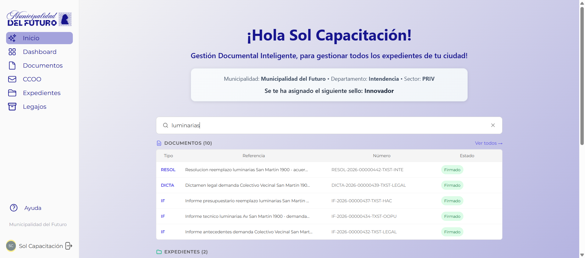

# Buscador General

El buscador general permite encontrar **documentos y expedientes** en todo el sistema desde una única barra de búsqueda. Tiene dos modos: resultados rápidos en tiempo real y búsqueda inteligente completa.

!!! video "Video tutorial"
    **GDI — Búsqueda semántica con IA: encontrá en lenguaje natural**

    
<iframe src="https://www.youtube-nocookie.com/embed/OaiucbGan9Y?list=PLRIZqApsdJ12JCSzhUxaZ73AheVHUEpDq" title="GDI — Busqueda semantica con IA: encontra en lenguaje natural" loading="lazy" allow="accelerometer; autoplay; clipboard-write; encrypted-media; gyroscope; picture-in-picture; web-share" allowfullscreen></iframe>

    **GDI — Buscar y filtrar expedientes y documentos**

    
<iframe src="https://www.youtube-nocookie.com/embed/U351ZpdSYm0?list=PLRIZqApsdJ12JCSzhUxaZ73AheVHUEpDq" title="GDI — Buscar y filtrar expedientes y documentos" loading="lazy" allow="accelerometer; autoplay; clipboard-write; encrypted-media; gyroscope; picture-in-picture; web-share" allowfullscreen></iframe>

---

## Dónde encontrar el buscador

El buscador se encuentra en la **pantalla Home** (Inicio), debajo de la tarjeta de bienvenida con los datos del usuario.

---

## Cómo buscar

### Resultados rápidos (mientras escribís)

1. Escribir al menos **2 caracteres** en el campo de búsqueda.
2. Los resultados aparecen automáticamente debajo del campo, divididos en dos secciones: **Documentos** y **Expedientes**.
3. Se muestran hasta **5 resultados** por sección.
4. Para limpiar la búsqueda, hacer click en el icono **X** a la derecha del campo.

### Búsqueda inteligente completa (Enter)

Al presionar **Enter** (o hacer click en el hint <kbd>↵</kbd> búsqueda inteligente que aparece en el campo), el sistema abre la pantalla de búsqueda completa donde combina:

- **Búsqueda por texto**: documentos y expedientes cuyo **número o referencia** coincidan con las palabras escritas.
- **Búsqueda semántica**: documentos cuyo contenido tenga relación con el significado de la consulta, aunque no contengan exactamente esas palabras.

Los resultados se organizan en tres pestañas: **Semántica**, **Docs** y **Expedientes**. Se pueden ver hasta **50 resultados** por sección.

!!! tip "Búsqueda sin acentos"
    El buscador ignora acentos y tildes. Buscar *"trámite"* encuentra resultados que contengan *"trámite"*, y viceversa.

!!! info "Números exactos"
    Si escribís el número completo de un documento (ej: `NOTA-2026-00000149-TXST-HAC`) o de un expediente (ej: `EE-2026-000007-TXST-HAC`), el sistema lo busca directamente por número exacto, sin búsqueda semántica.

---

## Resultados de Documentos

Los documentos encontrados se muestran en una tabla con las siguientes columnas:

| Columna | Descripción |
|---------|-------------|
| **Tipo** | Sigla del tipo de documento (ej: NOTA, IF, PREPL) |
| **Referencia** | Título descriptivo del documento |
| **Número** | Número oficial asignado al firmar (ej: `NOTA-2026-00000149-TXST-HAC`) |
| **Estado** | Estado actual del documento (Firmado, En edición, etc.) |

Hacer click en un resultado para abrir el documento.

---

## Resultados de Expedientes

Los expedientes encontrados se muestran en una tabla con las siguientes columnas:

| Columna | Descripción |
|---------|-------------|
| **Trata** | Tipo de expediente (ej: COMP, HABI) |
| **Motivo** | Descripción del trámite |
| **Número** | Número oficial del expediente (ej: `EE-2026-000007-TXST-HAC`) |
| **Sector** | Sector actual donde se encuentra el expediente (ej: `OOPU#PRIV`) |

Hacer click en un resultado para abrir el expediente.

---

## Qué se puede buscar

El buscador encuentra coincidencias en múltiples campos:

| Criterio de búsqueda | Ejemplo |
|----------------------|---------|
| Por referencia o motivo | Escribir *"panadería"* encuentra expedientes con esa palabra en el motivo |
| Por número de documento | Escribir *"NOTA-2026"* encuentra documentos con ese prefijo |
| Por número de expediente | Escribir *"EE-2026-000007"* encuentra el expediente exacto |
| Por tipo | Escribir *"PREPL"* encuentra documentos de tipo Pre-Pliego |
| Por significado (búsqueda inteligente) | Escribir *"habilitación de local comercial"* + Enter encuentra documentos que hablen de eso, **aunque esas palabras no estén en el número ni en la referencia** |

!!! warning "La búsqueda por texto NO entra al cuerpo del documento"
    Escribir *"presupuesto"* encuentra los documentos que tengan esa palabra en el
    **número o en la referencia**, no los que la tengan adentro. Para buscar por lo que
    el documento *dice*, está la **búsqueda inteligente**: se escribe la consulta y se
    aprieta **Enter**.

    Hasta septiembre de 2026 la búsqueda por texto si escaneaba el cuerpo. Se sacó a
    propósito: esa consulta se llevaba dos tercios del tiempo de la base de datos y hacia
    lento **todo** el sistema, incluso para los que no estaban buscando. Sacándola, la
    búsqueda paso de tardar segundos a responder al instante.

!!! info "Buscar por nombre de firmante no está disponible"
    Escribir el nombre de una persona no encuentra los documentos que esa persona firmo.
    La búsqueda inteligente tampoco lo cubre: un nombre es un dato, no un tema.
    Para llegar a un documento firmado por alguien, hay que entrar por su número, por su
    referencia o por el expediente donde está vinculado.

---

## Preguntas frecuentes

??? question "El buscador muestra todos los resultados del sistema?"
    El buscador muestra los resultados visibles para el usuario según sus permisos. Solo se encuentran documentos y expedientes a los que el usuario tiene acceso.

??? question "Puedo buscar desde otra pantalla que no sea Home?"
    El buscador general está ubicado en la pantalla Home. Cada sección (Documentos, Expedientes) tiene su propio buscador interno para filtrar dentro de esa sección.

??? question "La búsqueda distingue mayúsculas y minúsculas?"
    No. La búsqueda no distingue entre mayúsculas y minúsculas. Escribir *"nota"*, *"NOTA"* o *"Nota"* produce los mismos resultados.

??? question "Qué pasa si la búsqueda inteligente tarda en responder?"
    El sistema puede tardar unos segundos en activarse si estuvo inactivo. En ese caso, los resultados de texto aparecen de inmediato y los resultados semánticos se suman cuando el sistema termina de conectarse. No es necesario volver a buscar.
