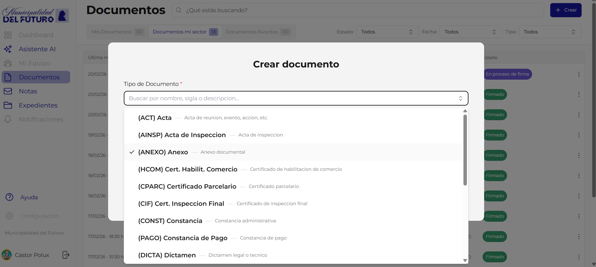
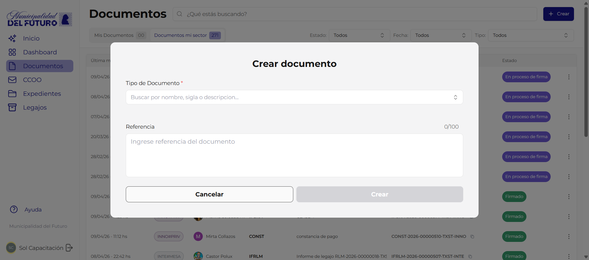
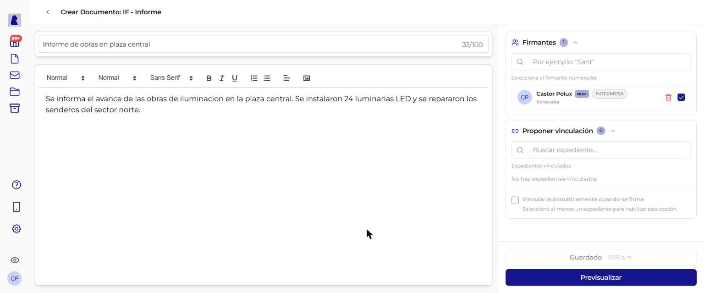
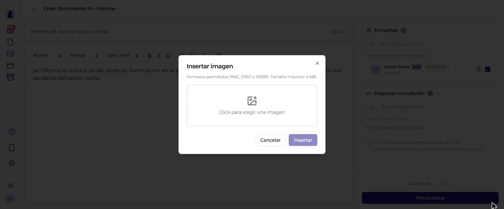
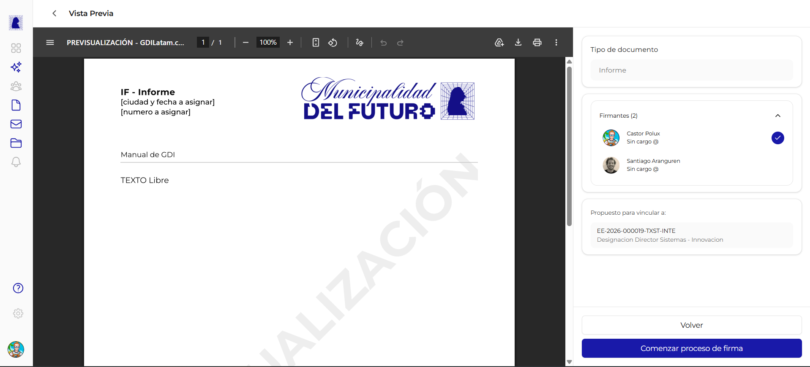
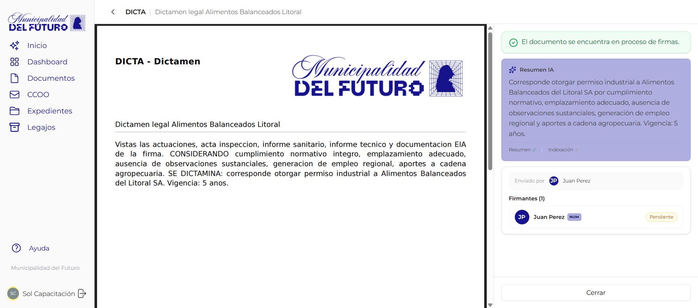
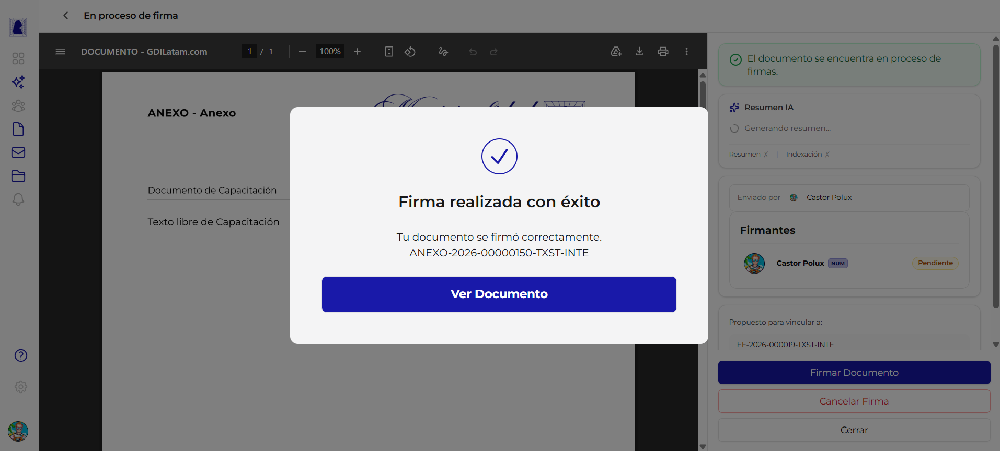

# Crear y Editar Documento

Esta pantalla permite crear un nuevo documento oficial o editar uno existente en estado borrador o rechazado. Se compone de dos zonas: el **panel central** (editor de contenido) y el **panel lateral derecho** (firmantes, vinculación y acciones).

!!! video "Video tutorial"
    **GDI — Crear y firmar un Informe: paso a paso**

    <div class="video-embed"><iframe src="https://www.youtube-nocookie.com/embed/R9A6j3uHEFM?list=PLRIZqApsdJ12JCSzhUxaZ73AheVHUEpDq" title="GDI — Crear y firmar un Informe: paso a paso" loading="lazy" allow="accelerometer; autoplay; clipboard-write; encrypted-media; gyroscope; picture-in-picture; web-share" allowfullscreen></iframe></div>


---

## Paso 1: Abrir el diálogo de creación

Desde la sección **Documentos**, hacer click en el botón **"+ Crear"** en la esquina superior derecha. Se abre un diálogo modal con dos campos.



### Campo: Tipo de Documento

| Propiedad | Valor |
|-----------|-------|
| **Tipo de campo** | Selector desplegable con búsqueda |
| **Obligatorio** | Sí |
| **Búsqueda** | Se puede escribir para filtrar por nombre, sigla o descripción |

Se muestra la lista de tipos disponibles en formato `(SIGLA) Nombre -- Descripcion`. La lista de tipos habilitados depende de la configuración de la organización. Los tipos se muestran en orden alfabético.



### Campo: Referencia

| Propiedad | Valor |
|-----------|-------|
| **Tipo de campo** | Texto libre (textarea) |
| **Obligatorio** | Sí |
| **Límite** | 100 caracteres (se muestra contador `0/100`) |
| **Placeholder** | *"Ingrese referencia del documento"* |

La referencia es el título descriptivo del documento. Aparece en el listado de documentos, en las búsquedas y en el encabezado del PDF generado. Ejemplo: *"Informe situación patrimonial segundo trimestre"*.

### Botones del diálogo

| Botón | Acción |
|-------|--------|
| **Cancelar** | Cierra el diálogo sin crear nada |
| **Crear** | Crea el documento en estado borrador y abre el editor |

!!! warning "Importante"
    La referencia se puede editar después en el editor. El límite es de 100 caracteres, tanto en este diálogo como en el editor.

---

## Paso 2: Editor de documento

Al crear el documento, se abre la pantalla de edición con el panel central y el panel lateral.



### Encabezado

En la parte superior se muestra:

- **Flecha de retorno** (`<`): vuelve al listado de documentos
- **Título**: `Crear Documento: {SIGLA} - {Nombre del tipo}` (ej: "Crear Documento: IF - Informe")

---

## Panel central: Contenido del documento

### Campo: Referencia (editable)

| Propiedad | Valor |
|-----------|-------|
| **Tipo de campo** | Texto libre (input) |
| **Obligatorio** | Sí |
| **Límite** | 100 caracteres (con contador) |
| **Ubicación** | Arriba del editor, campo con borde inferior |

Se carga con el valor ingresado en el diálogo de creación. Se puede modificar libremente.

### Campo: Cuerpo del documento

| Propiedad | Valor |
|-----------|-------|
| **Tipo de campo** | Editor de texto enriquecido (Quill) |
| **Obligatorio** | Sí (para documentos tipo HTML) |
| **Límite** | Sin límite de caracteres |

#### Barra de herramientas del editor

| Herramienta | Función |
|-------------|---------|
| **Normal** | Selector de estilo de párrafo (texto normal o título de nivel 1, 2 o 3) |
| Tamaño | Selector del tamaño de letra |
| Fuente | Selector del tipo de letra |
| **B** | Negrita |
| **I** | Cursiva |
| **U** | Subrayado |
| Lista numerada | Lista con números (1, 2, 3...) |
| Lista con puntos | Lista con puntos |
| Alineación | Alinear el párrafo a la izquierda, al centro, a la derecha o justificado |
| Ícono de imagen | Insertar una imagen. Ver [Insertar una imagen](#insertar-una-imagen) |

El editor soporta copiar y pegar texto desde procesadores de texto (Word, Google Docs) manteniendo formato básico.

#### Insertar una imagen



El botón de imagen de la barra está en los documentos redactados en el editor, incluidos NOTA y MEMO. No está en los documentos importados ni en los formularios (FFCC).

1. Ubicar el cursor donde va la imagen.
2. Hacer click en el ícono de imagen de la barra. Se abre el diálogo **"Insertar imagen"**.
3. Hacer click en *"Click para elegir una imagen"* y elegir el archivo.
4. Completar el **"Texto alternativo (alt)"**: una descripción breve de la imagen.
5. Elegir la **"Alineación"**: **Izquierda**, **Centro** o **Derecha**.
6. Elegir el **"Ancho"**: **200px**, **400px** o **600px**.
7. Hacer click en **"Insertar"**.

| Propiedad | Valor |
|-----------|-------|
| **Formatos** | PNG, JPEG o WEBP |
| **Tamaño máximo** | 4 MB |
| **Texto alternativo** | Opcional, hasta 255 caracteres |
| **Valores iniciales** | Centro y 400px |

Para cambiar la imagen antes de insertarla, hacer click en *"Elegir otra imagen"*.

!!! warning "Las imágenes no se pegan"
    Si se pega o se arrastra una imagen dentro del texto, el editor no la inserta. Muestra el aviso *"La imagen no se pegó. Para insertar una imagen usá el botón de imagen de la barra."* La imagen se agrega solo con el botón de la barra.

!!! info "Documentos importados (PDF)"
    Para tipos de documento marcados como "Importado" (ej: Informe Gráfico Importado, Contrato, Plano), en lugar del editor de texto se muestra una **zona de carga de PDF**. Se puede arrastrar un archivo o hacer click para seleccionarlo.

---

## Panel lateral derecho

El panel lateral contiene tres secciones colapsables y los botones de acción.

### Sección: Firmantes


| Propiedad | Valor |
|-----------|-------|
| **Obligatorio** | Sí (mínimo 1 firmante) |
| **Buscador** | Escribir al menos 2 caracteres para buscar usuarios por nombre |

#### Cómo agregar firmantes

1. Escribir en el campo de búsqueda (ej: *"Sant"*)
2. Se despliega una lista de usuarios que coinciden
3. Hacer click en un usuario para agregarlo a la lista de firmantes
4. Repetir para agregar más firmantes

#### Firmante numerador

El **firmante numerador** es quien otorga el número oficial al documento. Se identifica con un **check azul** (círculo con tilde) al lado de su nombre.

| Regla | Descripción |
|-------|-------------|
| Solo puede haber **1 numerador** | Al marcar un firmante como numerador, el anterior se desmarca automáticamente |
| El numerador **firma último** | Independientemente de su posición en la lista, siempre firma al final |
| Requiere **rango adecuado** | El numerador debe tener el rango necesario para el tipo de documento (ej: un Decreto requiere rango de Intendente) |

#### Acciones sobre firmantes

| Acción | Como |
|--------|------|
| **Marcar como numerador** | Click en el círculo vacío junto al nombre |
| **Eliminar firmante** | Click en el icono de papelera roja |

!!! warning "Validación de permisos"
    Al previsualizar, el sistema verifica que el numerador tenga el rango necesario para firmar el tipo de documento seleccionado. Si no tiene permisos suficientes, se muestra una advertencia en color amarillo y no se puede iniciar el proceso de firma.

---

### Sección: Vincular a un expediente (opcional)

| Propiedad | Valor |
|-----------|-------|
| **Obligatorio** | No |
| **Buscador** | Escribir al menos 2 caracteres para buscar expedientes por número o referencia |
| **Colapsable** | Sí (se puede expandir/contraer con la flecha) |

#### Cómo vincular

1. Expandir la sección "Vincular a un expediente (opcional)"
2. Escribir en el campo "Buscar expediente..." (ej: *"EE-2026"* o *"Habilitación"*)
3. Se despliega una lista de expedientes que coinciden
4. Hacer click en un expediente para proponerlo como vinculación
5. El expediente aparece en la lista "Expedientes vinculados" con su número y referencia

#### Eliminar vinculación propuesta

Click en el icono de papelera junto al expediente.

!!! info "Vinculación propuesta vs. oficial"
    La vinculación desde esta pantalla es una **propuesta**. El documento aparecerá como "Propuesto para vincular" en el expediente destino. El administrador del expediente deberá **aceptar o rechazar** la propuesta para que se convierta en vinculación oficial.

---

### Sección: Destinatarios (solo para tipo NOTA)

!!! note "Solo visible para documentos tipo NOTA"
    Esta sección aparece únicamente cuando el tipo de documento es **NOTA**. Para otros tipos no se muestra.

| Propiedad | Valor |
|-----------|-------|
| **Obligatorio** | Sí (al menos 1 destinatario en "Para") |

Los destinatarios son **sectores** del organismo (no usuarios individuales):

| Campo | Descripción | Obligatorio |
|-------|-------------|-------------|
| **Para (TO)** | Sectores destinatarios principales | Sí (mínimo 1) |
| **CC** | Sectores en copia | No |
| **CCO (BCC)** | Sectores en copia oculta | No |

---

## Acciones: Guardar y Previsualizar

En la parte inferior del panel lateral se encuentran los dos botones de acción.

### Botón: Guardar

| Propiedad | Valor |
|-----------|-------|
| **Estilo** | Botón con borde, texto "Guardar" |
| **Habilitado cuando** | La referencia no está vacía |

Guarda el estado actual del documento como **borrador**. Se pueden guardar cambios parciales sin necesidad de completar todo. El documento queda en estado **"En edición"** y se puede continuar editando después.

Al guardar se envían al servidor: referencia, contenido HTML, lista de firmantes con su orden y numerador, destinatarios (si es NOTA) y expedientes propuestos.

### Botón: Previsualizar

| Propiedad | Valor |
|-----------|-------|
| **Estilo** | Botón azul (primario), texto "Previsualizar" |
| **Habilitado cuando** | La referencia no está vacía Y el contenido tiene texto |

Guarda automáticamente y luego navega a la **vista previa del documento en formato PDF**.



La vista previa muestra:

- El **PDF generado** con membrete oficial de la organización, referencia y contenido
- Marca de agua **"PREVISUALIZACION"** en diagonal
- Panel lateral con tipo de documento, firmantes y expedientes propuestos
- Botones **"Volver"** (regresa al editor) y **"Comenzar proceso de firma"**

---

## Ciclo de vida del documento

### Estados posibles

| Estado | Descripción | Se puede editar |
|--------|-------------|:---------------:|
| **En edición** | Documento en borrador, creado pero no enviado a firmar | Sí |
| **En proceso de firma** | Se inició el proceso de firma. Los firmantes van firmando en orden | No |
| **Firmar ahora** | Es el turno del usuario actual para firmar | No |
| **Firmado** | Todos firmaron. El documento tiene número oficial | No |
| **Rechazado** | Un firmante o el creador rechazo el documento | Sí |

### Flujo completo

```
Crear documento (borrador)
    |
    v
Editar contenido + firmantes + vincular expediente
    |
    v
Previsualizar (genera PDF con marca de agua)
    |
    v
Comenzar proceso de firma (solo el creador puede hacerlo)
    |
    +----> Firmantes firman en orden (1, 2, 3...)
    |          |
    |          +----> Numerador firma ultimo
    |                     |
    |                     v
    |              Documento FIRMADO
    |              (se asigna numero oficial)
    |
    +----> Rechazar (creador o firmante)
               |
               v
          Documento RECHAZADO
          (vuelve a ser editable, ciclo de subsanacion)
```



Al iniciar el proceso de firma, el panel lateral muestra:

- Banner verde: *"El documento se encuentra en proceso de firmas"*
- **Resumen IA**: Se genera automáticamente un resumen del documento
- **Firmantes** con estado (Pendiente / Firmado) y badge **NUM** para el numerador
- **Expedientes propuestos** vinculados
- Botones: **"Firmar Documento"**, **"Cancelar Firma"**, **"Cerrar"**



Al firmar exitosamente se muestra un diálogo de confirmación con el **número oficial** asignado al documento (ej: `ANEXO-2026-00000150-TXST-INTE`).

---

## Reglas de negocio

!!! abstract "Resumen de reglas"

    1. **Solo el creador** puede iniciar el proceso de firma
    2. **Solo el creador o un firmante** pueden rechazar un documento en proceso de firma
    3. El **numerador** debe tener el **rango adecuado** para el tipo de documento (ej: un Decreto requiere rango de Intendente)
    4. Los **firmantes regulares firman primero**, en el orden asignado. El numerador firma al final
    5. Al firmar el numerador, se genera el **número oficial** del documento (ej: `IF-2026-00000122-TXST-INTE`)
    6. Un documento **rechazado** puede ser editado y enviado nuevamente a firma (ciclo de subsanación)
    7. Los tipos **CAEX** (Carátula de Expediente) y **PV** (Pase de Vista) son autogenerados por el sistema y no aparecen en el selector

---

## Catálogo de tipos de documento

Para ver la lista completa de tipos de documento disponibles en el sistema (HTML, Importados e Internos), consultar el [Catálogo de Tipos de Documento](../catalogos/tipos-de-documento.md).

!!! info "Tipos habilitados"
    Cada organización define su propia lista de tipos habilitados a partir del catálogo global. La lista que ves en el selector depende de la configuración de tu organización.

---

## Formato del número oficial

Al firmar el numerador, se genera un número único con el siguiente formato:

```
{SIGLA}-{ANO}-{SECUENCIAL}-{TENANT}-{DEPARTAMENTO}
```

| Parte | Ejemplo | Descripción |
|-------|---------|-------------|
| SIGLA | `IF` | Acrónimo del tipo de documento |
| ANO | `2026` | Año de creación |
| SECUENCIAL | `00000122` | Número secuencial (8 dígitos, único por tenant) |
| TENANT | `TXST` | Código de la organizacion/tenant |
| DEPARTAMENTO | `INTE` | Acrónimo del departamento del numerador |

Ejemplo completo: `IF-2026-00000122-TXST-INTE`

---

## Preguntas frecuentes

??? question "Puedo editar un documento después de guardarlo?"
    Sí. Mientras el documento esté en estado **"En edición"** o **"Rechazado"**, se puede editar libremente: cambiar la referencia, el contenido, los firmantes y los expedientes vinculados.

??? question "Puedo cambiar el tipo de documento después de crearlo?"
    No. El tipo de documento se define al momento de la creación y no se puede cambiar después.

??? question "Qué pasa si el numerador no tiene rango suficiente?"
    Al previsualizar se muestra una advertencia. No se podrá iniciar el proceso de firma hasta que se cambie el numerador por uno con el rango adecuado.

??? question "Puedo vincular un documento a más de un expediente?"
    Sí. Se pueden proponer vinculaciones a múltiples expedientes desde esta pantalla.

??? question "Qué pasa si rechazo un documento en proceso de firma?"
    El documento vuelve al estado **"Rechazado"** y se puede editar nuevamente. Esto permite corregir errores y volver a enviarlo a firma (ciclo de subsanación).

??? question "Quién puede firmar un documento?"
    Solo los usuarios que fueron agregados como firmantes. El orden de firma es: primero los firmantes regulares (en el orden de la lista) y último el numerador.
