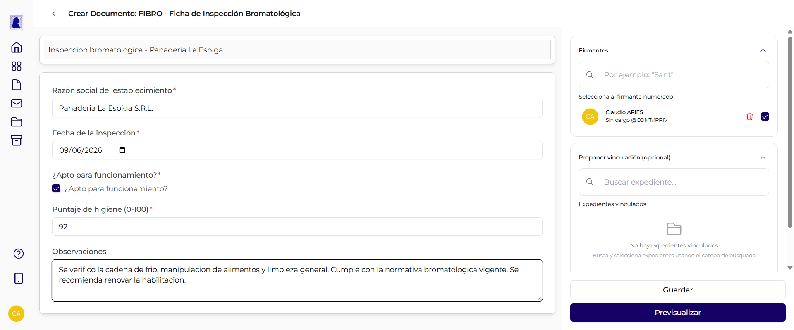
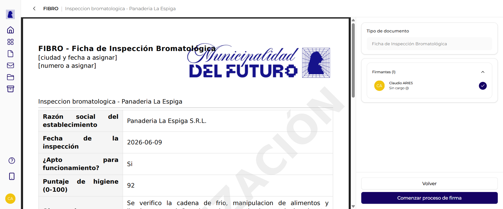

# Documento FFCC (Formulario Controlado)

Un documento **FFCC** (Formulario Controlado) reemplaza el editor de texto libre por un **formulario de campos** que el usuario completa. En vez de redactar el contenido a mano, se cargan valores en campos predefinidos (texto, fecha, número, si/no, etc.) y el sistema arma el documento oficial con formato `campo: valor`. Si el administrador le cargó una [plantilla](../../administradores/plantilla-ffcc.md) al tipo, el documento sale como un texto redactado con esos valores.

Sirve para trámites que siempre tienen la misma estructura de datos: fichas de inspección, constancias, formularios de relevamiento, etc. Los campos los define el administrador del organismo en el tipo de documento (ver [Tipos de Documentos](../../administradores/tipos-de-documentos.md#formularios-controlados-ffcc)).

!!! info "Qué tipos son FFCC"
    En la lista de tipos al crear un documento, los tipos FFCC se comportan distinto: al elegirlos, el editor muestra los campos del formulario en lugar de la barra de texto enriquecido. Pueden ser un tipo **FFCC** propio del municipio, o variantes **NOTA FFCC** / **MEMO FFCC**.

---

## Crear un documento FFCC

1. Ir a **Documentos** y presionar **"Crear"** (o crear el documento desde un expediente con **"Vincular Documento"**).
2. En **Tipo de Documento**, elegir un tipo FFCC (por ejemplo *Ficha de Inspección Bromatológica*).
3. Ingresar la **Referencia** y presionar **Crear**.
4. El editor abre el **formulario controlado** con los campos definidos para ese tipo.



---

## Completar el formulario

En lugar del editor de texto, el panel central muestra los campos del tipo. Cada campo tiene su **etiqueta** y un control según su tipo:

| Tipo de campo | Control que ve el usuario |
|---------------|---------------------------|
| **Texto corto** | Cuadro de texto de una línea |
| **Texto largo** | Cuadro de texto de varias líneas |
| **Email** | Cuadro de texto que valida formato de correo |
| **Número** | Campo numérico |
| **Fecha** | Selector de fecha (día / mes / año) |
| **Selección (lista)** | Desplegable con opciones predefinidas |
| **Sí / No** | Casilla de verificación |
| **Documento adjunto** | Carga de un archivo |

Los campos marcados con asterisco (**\***) son **obligatorios**: hay que completarlos antes de poder firmar.

### Grupos que se repiten

Algunos formularios tienen un **grupo**: un conjunto de campos que se carga varias veces. Por ejemplo, en el *Acta de Inspección* de la «Municipalidad del Futuro», el grupo **Personas** tiene Nombre, Apellido y DNI.

Cada repetición se llama **bloque** y lleva un título con su número:

```
Persona 1   Nombre [Juana ]  Apellido [Pérez ]  DNI [20111111]  ✕
Persona 2   Nombre [Carlos]  Apellido [Gómez ]  DNI [30222222]  ✕
            [+ Agregar persona]
```

- Con **«+ Agregar persona»** sumás un bloque vacío con los mismos campos.
- Con la **«✕»** de un bloque, lo quitás.
- El formulario arranca con la cantidad mínima de bloques que fijó el administrador.
- Cuando llegás al máximo, el «+» se apaga. Cuando estás en el mínimo, la «✕» se apaga.
- Si un campo del grupo es obligatorio, hay que completarlo en cada bloque. El aviso marca el campo del bloque que falta.

!!! note "El resto del documento es igual"
    Las secciones **Firmantes** y **Proponer vinculación** (con la opción de [vinculación automática al firmar](../expedientes/vincular-documentos.md)) funcionan igual que en cualquier otro documento. Solo cambia la forma de cargar el contenido.

---

## Cómo se ve el PDF

Al previsualizar o firmar, el sistema genera el PDF oficial con el membrete del organismo y una **tabla de campos y valores**: cada fila muestra la etiqueta del campo y el valor cargado.



Si el formulario tiene un grupo y el tipo no tiene plantilla, cada bloque sale con su título y debajo sus campos:

> **Fecha:** 22/08/2026
>
> **Persona 1**
>
> **Nombre:** Juana
>
> **Apellido:** Pérez
>
> **DNI:** 20111111
>
> **Persona 2**
>
> **Nombre:** Carlos
>
> …

Si el tipo tiene plantilla, el texto del grupo sale una vez por cada bloque, como lo armó el administrador.

A partir de ahí, el documento sigue el flujo habitual: se firma, se numera y puede vincularse a un expediente como cualquier otro documento.

---

## Preguntas frecuentes

??? question "Por qué no veo la barra de texto enriquecido?"
    Porque el tipo de documento es **FFCC**: usa un formulario de campos controlados en vez del editor libre. Es el comportamiento esperado para ese tipo.

??? question "Puedo dejar campos vacíos?"
    Solo los campos que **no** son obligatorios. Los campos marcados con asterisco (**\***) deben completarse antes de firmar.

??? question "Quién define los campos del formulario?"
    El administrador del organismo, desde el detalle del tipo de documento en el BackOffice. Ver [Tipos de Documentos - Formularios Controlados (FFCC)](../../administradores/tipos-de-documentos.md#formularios-controlados-ffcc).

??? question "Un FFCC se puede vincular a un expediente?"
    Sí. Una vez firmado se comporta como cualquier documento: se puede proponer o vincular automáticamente a uno o varios expedientes.
