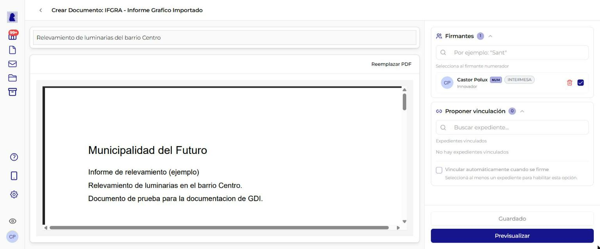
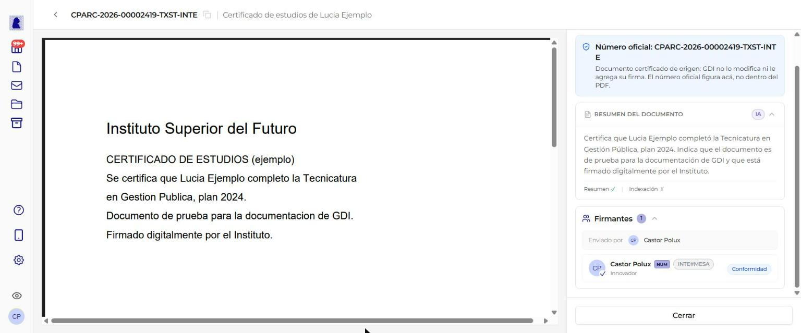

# Documento Importado (PDF)

Un documento importado permite subir un archivo PDF externo al sistema para que forme parte del circuito oficial de firma y numeración. A diferencia del documento HTML que se redacta en el editor Quill, el documento importado **no tiene editor de texto**: el contenido es el PDF que se carga.

---

## Diferencias con el documento HTML

| Característica | Documento HTML | Documento Importado |
|----------------|:--------------:|:-------------------:|
| Editor Quill (texto enriquecido) | Sí | No |
| Barra de herramientas de formato | Sí | No |
| Zona de carga de PDF | No | Sí |
| Panel lateral (Firmantes, Vincular expediente) | Sí | Sí |
| Archivos adjuntos | Sí, si el tipo lo permite | Sí, si el tipo lo permite |
| Proceso de firma y numeración | Sí | Sí |

!!! info "El flujo de firma es idéntico"
    Una vez cargado el PDF, el documento importado sigue exactamente el mismo circuito de previsualización, firma y numeración que un documento HTML. La única diferencia es como se genera el contenido.

!!! tip "PDF que ya viene certificado"
    Si el PDF ya trae una firma de certificación de otro organismo (por ejemplo, un título universitario o una escritura de un escribano), GDI no lo modifica. Lo numera sin firmarlo encima. Ver [PDF certificado de origen](#pdf-certificado-de-origen).

---

## Panel central: Zona de carga de PDF

Al abrir un documento de tipo importado, el panel central muestra la zona de importación en lugar del editor de texto.

### Encabezado

En la parte superior se muestra:

- **Flecha de retorno** (`<`): vuelve al listado de documentos
- **Título**: `Crear Documento: {SIGLA} - {Nombre del tipo}` (ej: "Crear Documento: IFGRA - Informe Gráfico Importado")

### Campo: Referencia

| Propiedad | Valor |
|-----------|-------|
| **Tipo de campo** | Texto libre (input) |
| **Obligatorio** | Sí |
| **Límite** | 100 caracteres (con contador) |
| **Ubicación** | Arriba de la zona de carga, campo con borde inferior |

Se carga con el valor ingresado en el diálogo de creación. Se puede modificar libremente.

### Zona de importación

La zona central muestra el título **"Importar PDF"** con el texto descriptivo: *"Selecciona el archivo PDF que deseás importar. Luego haz clic en "Previsualizar" para procesarlo."*

| Propiedad | Valor |
|-----------|-------|
| **Formato aceptado** | PDF únicamente |
| **Tamaño máximo** | 10 MB |
| **Drag & drop** | Sí (arrastrar archivo desde el explorador de archivos) |
| **Click para seleccionar** | Sí (abre el selector de archivos del sistema operativo) |
| **Icono** | Flecha de carga (upload) |
| **Texto principal** | *"Arrastra un archivo PDF aquí"* |
| **Texto secundario** | *"o haz clic para seleccionar"* |
| **Indicador de límite** | *"Máximo 10 MB"* |

Mientras se sube el archivo, la pantalla muestra *"Subiendo PDF... N%"* y después *"Procesando PDF..."*.

### Reemplazar el PDF

Cuando el documento ya tiene un PDF, el panel central muestra el visor. Arriba a la derecha está el botón **"Reemplazar PDF"**.

1. Hacer click en **"Reemplazar PDF"**. Aparece la zona de carga con el texto *"Selecciona un nuevo archivo PDF para reemplazar el actual."*
2. Arrastrar o elegir el PDF nuevo.
3. Hacer click en **"Previsualizar"** para procesarlo.

Para dejar el PDF anterior sin cambios, hacer click en **"Cancelar"**.

El PDF se puede reemplazar mientras el documento está en edición o rechazado.

!!! note "Un PDF principal por documento"
    Cada documento importado tiene un solo PDF principal. Si el tipo de documento lo permite, se le pueden sumar archivos adjuntos. Ver [Archivos adjuntos](#archivos-adjuntos).

---

## Archivos adjuntos

Algunos tipos de documento importado aceptan **archivos adjuntos**: planillas, fotos, planos u otros PDF que acompañan al PDF principal. Si el tipo lo permite, el panel lateral muestra la sección **"Archivos adjuntos"**. Si la sección no aparece, el tipo no acepta adjuntos.

### Cómo agregar un adjunto

1. En la sección **"Archivos adjuntos"**, arrastrar los archivos a la zona *"Arrastrá archivos acá o hacé clic"*.
2. O hacer click en la zona y elegir los archivos desde la computadora.

| Propiedad | Valor |
|-----------|-------|
| **Formatos** | PDF, Excel, Word, ODT/ODS, CSV, TXT, imágenes o DXF |
| **Tamaño por archivo** | Hasta 10 MB |
| **Tamaño total** | Hasta 10 MB entre todos los adjuntos del documento |
| **Cantidad** | Hasta 10 adjuntos por documento. Al llegar al tope, la zona dice *"Alcanzaste el máximo de adjuntos"* |

Cada adjunto de la lista tiene un botón para descargarlo y otro para quitarlo.

### Qué pasa con los adjuntos al firmar

Al comenzar el proceso de firma, GDI guarda los adjuntos **dentro del PDF firmado**. Los adjuntos viajan con el documento oficial: no quedan como archivos sueltos.

Después de la firma, los adjuntos se ven y se descargan desde el expediente. Ver [Archivos embebidos en documentos oficiales](../expedientes/detalle-expediente.md#archivos-embebidos-en-documentos-oficiales).

!!! warning "Los adjuntos se cargan antes de firmar"
    Un documento firmado no admite adjuntos nuevos. Si falta un archivo, se carga como documento aparte en el mismo expediente.

---

## PDF certificado de origen

Algunos PDF llegan ya certificados por el organismo que los emitió. Por ejemplo: un título universitario, un certificado bancario o una escritura de un escribano. Esa **firma de certificación** cierra el archivo: cualquier cambio la rompe.

GDI reconoce la firma de certificación solo, al importar el PDF. El usuario no tiene que marcar nada.

### Qué hace GDI con un PDF certificado de origen

| Documento importado común | PDF certificado de origen |
|---------------------------|---------------------------|
| GDI le agrega la hoja de firma al final | GDI lo guarda tal cual, sin la hoja de firma |
| Cada firmante firma digitalmente el PDF | Cada firmante da su **Conformidad** en GDI. Nadie firma el PDF |
| El número oficial queda impreso en el PDF | El número oficial figura en GDI, **no dentro del PDF** |
| Acepta adjuntos si el tipo lo permite | No acepta adjuntos |

### Cómo se firma

1. Cada firmante hace click en **"Firmar Documento"**, como siempre.
2. GDI no pide el token ni abre FirmadorGDI.
3. GDI registra la conformidad del firmante.
4. Cuando firma el numerador, GDI asigna el número oficial.

El diálogo de firma exitosa lo explica: *"El documento viene certificado de origen: no se usó el token ni se firmó el PDF. Quedó registrada tu conformidad en GDI. El número oficial figura en GDI, no dentro del PDF."*

### Dónde se ve que un documento es certificado de origen

| Lugar | Qué muestra |
|-------|-------------|
| Previsualización, firma y detalle del documento | Un aviso azul con un escudo. Dice **"Número oficial: ..."** (cuando ya lo tiene) y *"Documento certificado de origen: GDI no lo modifica ni le agrega su firma. El número oficial figura acá, no dentro del PDF."* |
| Lista de firmantes | La insignia **"Conformidad"** en lugar de la firma. Al pasar el mouse: *"Dio conformidad en GDI; no firmó digitalmente el PDF porque viene certificado de origen."* |
| Documentos del expediente | Un escudo junto al número del documento y el aviso arriba del visor. Ver [Detalle del Expediente](../expedientes/detalle-expediente.md#documentos-certificados-de-origen) |
| Firma de varios documentos juntos con token | Los documentos certificados de origen aparecen aparte. Ver [Firmar con Token](firmar-con-token.md#documentos-certificados-de-origen-en-la-firma-conjunta) |
| Celular | El mismo aviso y la insignia "Conformidad" |

!!! example "Ejemplo"
    En la Municipalidad del Futuro, Laura Gómez importa un contrato que un escribano ya certificó. El documento queda numerado como `CONT-2026-00000012-MUNDEV-LEGAL`. El PDF sigue igual al original. El número se ve en GDI, en el aviso azul.

!!! warning "Subí siempre el archivo original"
    Si el PDF se comprime, se edita o se imprime y escanea, la firma de certificación se rompe o desaparece. Hay que subir el archivo tal como lo entregó el organismo emisor.

---

## Avisos al importar un PDF

Al importar, GDI revisa las firmas que trae el PDF. Si encuentra un problema, no importa el archivo y muestra uno de estos avisos:

| Aviso | Qué hacer |
|-------|-----------|
| *"La firma de este PDF está rota o el documento fue modificado después de firmarse (puede pasar si lo comprimiste o editaste). Subí el archivo original."* | Subir el archivo original, sin comprimir ni editar |
| *"El PDF dice venir certificado, pero ninguna de sus firmas respalda esa certificación. No se importó: volvé a generar o exportar el PDF desde su origen e importalo de nuevo."* | Pedir el PDF de nuevo al organismo emisor, o exportarlo otra vez |
| *"El PDF trae firmas digitales que no se pudieron leer. No se importó para no romperlas: volvé a generar o exportar el PDF desde su origen."* | Pedir el PDF de nuevo al organismo emisor, o exportarlo otra vez |
| *"El PDF está protegido con contraseña para abrirse. No se importó: importá una copia sin contraseña de apertura."* | Guardar una copia sin contraseña de apertura e importarla |

---

## Tipos de documento importados

Los tipos de documento importados disponibles dependen de la configuración de cada organización. Algunos ejemplos comunes son: Informe Gráfico Importado (IFGRA), Contrato (CONT), Oficio Judicial (OFJUD), Plano (PLANO), entre otros.

Para ver la lista completa de tipos de documento importados, consultar el [Catálogo de Tipos de Documento](../catalogos/tipos-de-documento.md#documentos-importados-18-tipos).

---

## Panel lateral derecho

El panel lateral es idéntico al del documento HTML y contiene las secciones de **Firmantes** y **Vincular a un expediente**. Para una descripción detallada de cada sección, consultar [Crear y Editar Documento - Panel lateral derecho](crear-editar-documento.md#panel-lateral-derecho).

### Resumen de secciones

| Sección | Obligatorio | Descripción |
|---------|:-----------:|-------------|
| **Firmantes** | Sí (mínimo 1) | Usuarios que firmaran el documento. Uno se marca como numerador |
| **Vincular a un expediente** | No | Permite proponer la vinculación a uno o más expedientes |

!!! note "Sin sección Destinatarios"
    Los documentos importados no tienen sección de Destinatarios. Esa sección es exclusiva del tipo NOTA.

---

## Acciones: Guardar y Previsualizar

En la parte inferior del panel lateral se encuentran los dos botones de acción.

### Botón: Guardar

| Propiedad | Valor |
|-----------|-------|
| **Estilo** | Botón con borde gris, texto "Guardado" cuando ya se guardó |
| **Habilitado cuando** | La referencia no está vacía |

Guarda el estado actual del documento como borrador, incluyendo el archivo PDF cargado, la lista de firmantes y los expedientes propuestos.

### Botón: Previsualizar

| Propiedad | Valor |
|-----------|-------|
| **Estilo** | Botón azul (primario), texto "Previsualizar" |
| **Habilitado cuando** | La referencia no está vacía Y se cargó un archivo PDF |

Guarda automáticamente y navega a la vista previa del documento en formato PDF. Desde allí se puede iniciar el proceso de firma.

---

## Preguntas frecuentes

??? question "Qué pasa si el archivo PDF supera los 10 MB?"
    El sistema no permite cargar archivos que excedan el límite de 10 MB. Muestra el aviso *"El archivo pesa N MB y el máximo es 10 MB."* Se debe reducir el tamaño del archivo (por ejemplo, comprimiendo imágenes o eliminando páginas innecesarias) antes de intentar subirlo nuevamente.

??? question "Puedo reemplazar el PDF después de cargarlo?"
    Sí, con el botón **"Reemplazar PDF"**, mientras el documento está en edición o rechazado. Ver [Reemplazar el PDF](#reemplazar-el-pdf).

??? question "Si rechazan el documento, se pierde el PDF?"
    No. Al rechazar un documento importado, el PDF queda cargado. El creador puede cambiarlo con **"Reemplazar PDF"** o enviarlo a firma de nuevo. Ver [Rechazar y Subsanar](rechazar-y-subsanar.md#rechazar-un-documento-importado).

??? question "El PDF importado se modifica al firmarse?"
    Sí, salvo que sea un [PDF certificado de origen](#pdf-certificado-de-origen). Al igual que los documentos HTML, el sistema agrega el membrete oficial, la referencia, los datos de firma y el número oficial al PDF resultante. Los adjuntos quedan dentro del PDF firmado.

??? question "Se pueden agregar adjuntos a un PDF certificado de origen?"
    No. Cualquier cambio rompería su firma de certificación. GDI muestra el aviso *"Este documento viene certificado de origen y no admite adjuntos desde GDI. Cargá el archivo como documento aparte en el mismo expediente."*
