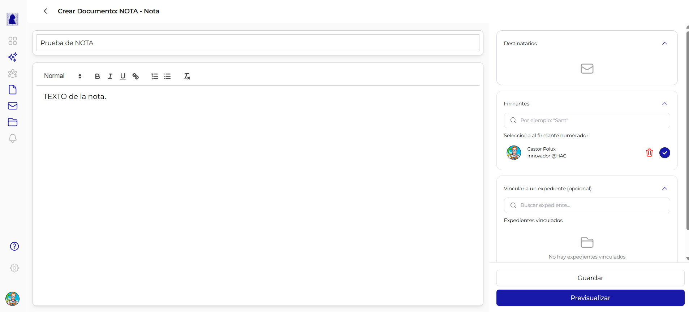
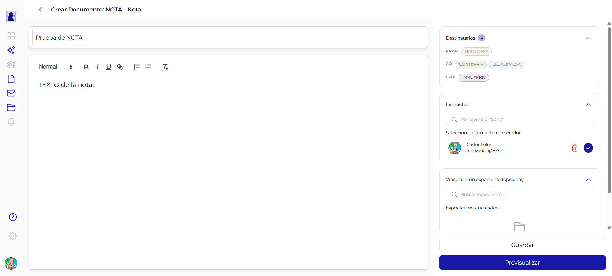

# Documento tipo NOTA

La NOTA es el equivalente digital de un memo o comunicación interna oficial. Se utiliza para enviar comunicaciones formales entre sectores del organismo. A diferencia de un documento HTML común, la NOTA incluye una sección de **Destinatarios** y el PDF generado muestra los campos PARA, CC y CCO en el encabezado.



---

## Diferencias con el documento HTML común

| Característica | Documento HTML común | NOTA |
|----------------|:--------------------:|:----:|
| Editor Quill (texto enriquecido) | Sí | Sí |
| Barra de herramientas de formato | Sí | Sí |
| Sección Firmantes | Sí | Sí |
| Sección Vincular expediente | Sí | Sí |
| **Sección Destinatarios** | No | **Sí** |
| **Campos PARA/CC en el PDF** | No | **Sí** |
| **Tracking de apertura** | No | **Sí** |

!!! info "El PDF de la NOTA incluye destinatarios"
    Al generar el PDF, los sectores destinatarios (PARA y CC) se imprimen en el encabezado del documento, formando parte del registro oficial. Los destinatarios en CCO no aparecen en el PDF.

---

## Panel central: Editor de contenido

El panel central es idéntico al de un documento HTML común. Incluye:

- **Campo Referencia** (texto libre, hasta 100 caracteres)
- **Editor Quill** con barra de herramientas (estilo, tamaño, fuente, **B**, *I*, U, listas, alineación e imagen)
- **Imágenes**: se insertan con el botón de imagen de la barra, igual que en un documento común. Ver [Insertar una imagen](crear-editar-documento.md#insertar-una-imagen)

Para una descripción detallada del editor, consultar [Crear y Editar Documento - Panel central](crear-editar-documento.md#panel-central-contenido-del-documento).

---

## Panel lateral: Sección Destinatarios

La sección Destinatarios es la **primera sección** del panel lateral, ubicada arriba de Firmantes y Vincular expediente. Solo aparece cuando el tipo de documento es NOTA.



### Campos de destinatarios

| Campo | Descripción | Obligatorio | Ubicación en el PDF |
|-------|-------------|:-----------:|:-------------------:|
| **PARA (TO)** | Sectores destinatarios principales de la comunicación | Sí (mínimo 1) | Sí |
| **CC** | Sectores que reciben copia de la comunicación | No | Sí |
| **CCO (BCC)** | Sectores que reciben copia oculta | No | No (no aparece en el PDF) |

### Propiedades de la sección

| Propiedad | Valor |
|-----------|-------|
| **Ubicación** | Primera sección del panel lateral derecho |
| **Icono sin destinatarios** | Sobre vacío |
| **Indicador con destinatarios** | Badge numérico con la cantidad total de destinatarios |
| **Obligatorio** | Sí (al menos 1 destinatario en PARA) |

---

## Cómo agregar destinatarios

1. En el panel lateral, localizar la sección **Destinatarios** (primera sección, con icono de sobre)
2. Hacer click en la sección para expandirla
3. Seleccionar el campo deseado: **PARA**, **CC** o **CCO**
4. Escribir en el buscador para filtrar sectores disponibles
5. Hacer click en el sector deseado para agregarlo
6. Repetir para agregar más destinatarios en cualquiera de los tres campos

Al agregar destinatarios, se muestra un badge numérico junto al título de la sección indicando la cantidad total.

---

## Los destinatarios son sectores

!!! warning "Sectores, no usuarios individuales"
    Los destinatarios de una NOTA son **sectores del organismo** (por ejemplo, Mesa de Entradas de Hacienda), no usuarios individuales. Todos los usuarios asignados a ese sector recibirán la notificación de la NOTA.

### Formato de los badges de destinatarios

Cada destinatario se muestra como un badge con el formato:

```
DEPARTAMENTO#SECTOR
```

| Parte | Ejemplo | Descripción |
|-------|---------|-------------|
| DEPARTAMENTO | `HAC` | Acrónimo del departamento (ej: Hacienda) |
| `#` | Separador | Carácter separador |
| SECTOR | `MESA` | Acrónimo del sector dentro del departamento |

Ejemplo completo: `HAC#MESA` (Mesa de Entradas de Hacienda)

### Colores de los badges por tipo

| Tipo | Color del badge | Ejemplo |
|------|----------------|---------|
| **PARA** | Verde/azul | `HAC#MESA` |
| **CC** | Tono intermedio | `CONT#PRIV`, `LEGAL#MESA` |
| **CCO** | Tono diferenciado | `INNO#PRIV` |

Los colores permiten identificar rápidamente en que campo (PARA, CC o CCO) fue agregado cada destinatario.

---

## Panel lateral: Firmantes y Vincular expediente

Las secciones de **Firmantes** y **Vincular a un expediente** funcionan exactamente igual que en un documento HTML común. Para una descripción detallada, consultar:

- [Firmantes](crear-editar-documento.md#seccion-firmantes)
- [Vincular a un expediente](crear-editar-documento.md#seccion-vincular-a-un-expediente-opcional)

---

## Acciones: Guardar y Previsualizar

Los botones de acción funcionan igual que en un documento HTML común. Al guardar, se envían también los destinatarios (PARA, CC, CCO) al servidor.

Para más detalles, consultar [Crear y Editar Documento - Acciones](crear-editar-documento.md#acciones-guardar-y-previsualizar).

---

## Preguntas frecuentes

??? question "Puedo enviar una NOTA a un usuario específico?"
    No directamente. Los destinatarios son sectores, no usuarios individuales. Si se necesita dirigir la comunicación a una persona en particular, se debe seleccionar el sector al que pertenece y mencionar al destinatario en el cuerpo de la NOTA.

??? question "Los destinatarios en CCO pueden ver quiénes son los otros destinatarios?"
    Sí. Los destinatarios en CCO pueden ver los campos PARA y CC, pero los destinatarios en PARA y CC no pueden ver quiénes están en CCO. El CCO no aparece impreso en el PDF oficial.

??? question "Puedo modificar los destinatarios después de guardar?"
    Sí, mientras el documento esté en estado "En edición" o "Rechazado" se pueden agregar o quitar destinatarios libremente.
