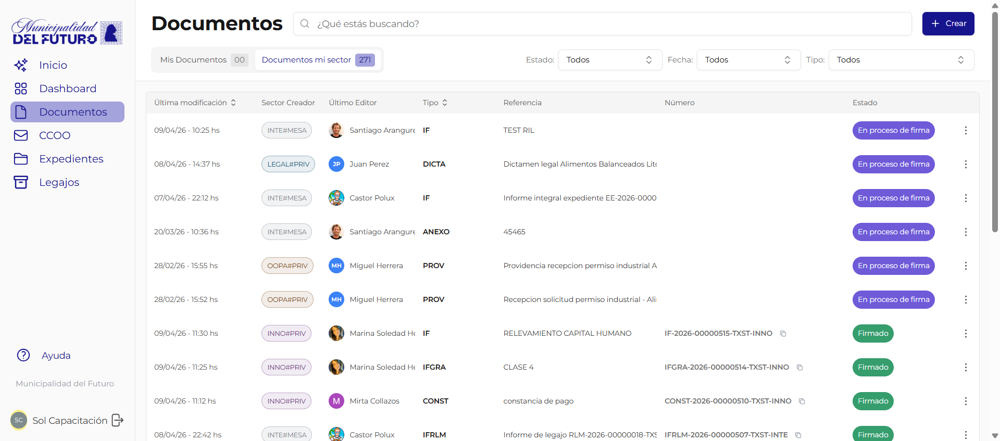

# Documentos

La sección **Documentos** es el módulo principal de GDI. Desde aquí se crean, editan, firman y gestionan todos los documentos oficiales del organismo.

## Acceso

Desde el **menú lateral izquierdo**, hacer click en **Documentos**. Se muestra el listado de documentos visibles para el usuario.

## Pantalla principal: Listado de documentos

### Solapas

Arriba del listado hay 4 solapas. Cada una tiene un ícono y su nombre, estés en ella o no. Al pasar el mouse se ve qué muestra.

| Solapa | Ícono | Qué muestra |
|---------|-------|-------------|
| **A mi firma** | Lapicera | Los documentos que podés firmar ahora: sos firmante, todavía no firmaste y te toca el turno. Incluye los que piden token |
| **Mis Documentos** | Hoja | Los documentos que creaste o en los que sos firmante o numerador |
| **Compartidos conmigo** | Dos personas | Los documentos que otra persona te compartió para que los edites |
| **Documentos de mi sector** | Papeles apilados | Los documentos de otros usuarios de tus sectores (el principal y los adicionales), en proceso de firma o firmados |

### Punto rojo

Un **punto rojo** (sin número) arriba del ícono avisa que hay algo para mirar:

| Dónde | Cuándo aparece | Cuándo se apaga |
|-------|----------------|-----------------|
| Solapa **A mi firma** | Hay al menos un documento para firmar | Cuando ya no queda nada para firmar. Entrar a la solapa no lo apaga |
| Solapa **Compartidos conmigo** | Hay al menos un documento compartido que todavía no abriste | Al abrir cada documento, como un mail sin leer. Entrar a la solapa no alcanza |
| **Documentos**, en el menú de la izquierda | Hay algo para firmar o algo compartido sin abrir | Cuando se apagan los dos de arriba |
| **CCOO**, en el menú de la izquierda | Hay memos sin leer o notas del sector sin leer | Al leerlos |

Ejemplo: en la Municipalidad del Futuro, Juana Pérez le comparte a Carlos Gómez un borrador de nota. Carlos ve el punto rojo en **Documentos** y en **Compartidos conmigo**. Cuando abre el borrador, el punto se apaga.

!!! info "Lo que editaste en un borrador compartido"
    Cuando un borrador que te compartieron se firma, el documento aparece en **Mis Documentos** de cada persona que lo editó. Lo encontrás con el buscador, por referencia, como cualquier otro tuyo. Ejemplo: en la Municipalidad del Futuro, Lucía Fernández arma un informe y lo comparte con Castor Gómez. Castor lo termina y lo manda a firma. Una vez firmado, el informe está en Mis Documentos de Lucía y también en el de Castor.

    Mientras el borrador está en curso, lo ves en **Compartidos**. Al firmarse, sale de Compartidos. Ver [Compartir un borrador](crear-editar-documento.md#compartir-un-borrador-y-editarlo-por-turnos).

!!! info "Los documentos que arma el sistema no aparecen acá"
    La carátula, el pase y el documento de cierre (`CIEX`) los genera el sistema solo. No aparecen en **Mis Documentos**, ni en **Documentos mi sector**, ni en **A mi firma**, aunque salgan a tu nombre. Los encontrás en el expediente, en **Docs Oficiales**.

### Filtros adicionales

En la parte superior derecha del listado se encuentran tres selectores:

| Filtro | Opciones | Descripción |
|--------|----------|-------------|
| **Estado** | Todos, En edición, En proceso de firma, Firmado, Rechazado | Filtrar documentos por su estado actual |
| **Fecha** | Todos, Hoy, Esta semana, Este mes | Filtrar por rango de fecha de última modificación |
| **Tipo** | Todos, IF, NOTA, DICTA, etc. | Filtrar por tipo de documento |

### Tarjetas del listado

Cada documento se muestra como una tarjeta de dos filas.

**Fila 1** (de izquierda a derecha):

| Elemento | Descripción |
|----------|-------------|
| **Sigla** | Acrónimo del tipo de documento en badge primario (ej: `IF`, `NOTA`) |
| **Referencia** | Título descriptivo del documento (truncado si es largo) |
| **Estado** | Badge de color redondeado con el estado actual (ej: `Firmado`, `En edicion`) |
| **Número oficial** | Número asignado al firmar (ej: `IF-2026-00000122-TXST-INTE`), con botón de copiar al portapapeles. Solo aparece si el documento ya tiene número |
| **Fecha** | Fecha y hora de última modificación |
| **`>`** | Flecha de navegación, se resalta al pasar el cursor |

**Fila 2** (de izquierda a derecha):

| Elemento | Descripción |
|----------|-------------|
| **Resumen IA** | Resumen automático del contenido generado por IA (`short_resume`), en texto itálico gris. Solo aparece si el documento ya fue procesado |
| **Avatar + nombre del último editor** | Foto de perfil (o iniciales en círculo) del último usuario que editó, seguido de su nombre |
| **Avatares de firmantes** | Fotos de perfil (o iniciales) de los firmantes asignados. Se muestran hasta 2; si hay más, aparece un contador `+N`. Solo aparece si el documento tiene firmantes |

### Buscador

En la parte superior central hay un campo de búsqueda con placeholder *"Que estás buscando?"*. Permite buscar por **referencia o número**. No busca dentro del cuerpo del documento: para eso está la [búsqueda inteligente](../busqueda/buscador-general.md) del Home.

### Botón Crear

En la esquina superior derecha, el botón **"+ Crear"** abre el diálogo para crear un nuevo documento. Ver [Crear y Editar Documento](crear-editar-documento.md).

## Ver el PDF desde el celular

En la versión para celular, al tocar **Ver PDF** el documento se abre en una pestaña nueva con la dirección de GDI de tu municipio (por ejemplo, `https://mundev.gdilatam.com/api/documents/...`). El PDF pasa por GDI, que controla en ese momento que puedas verlo.

## Páginas de esta sección

| Página | Descripción |
|--------|-------------|
| [Crear y Editar Documento](crear-editar-documento.md) | Como crear un documento nuevo, completar campos, agregar firmantes y previsualizar |
| [Documento Importado (PDF)](documento-importado.md) | Como crear un documento subiendo un archivo PDF externo |
| [Documento tipo NOTA](documento-nota.md) | Como crear una nota oficial con destinatarios, copia y copia oculta |
| [Previsualizar Documento](previsualizar-documento.md) | Vista previa en formato PDF antes de enviar a firma |
| [Proceso de Firma](proceso-de-firma.md) | Como funciona el circuito de firmas, orden de firmantes y numerador |
| [Rechazar y Subsanar](rechazar-y-subsanar.md) | Como rechazar un documento y corregirlo en el ciclo de subsanación |
