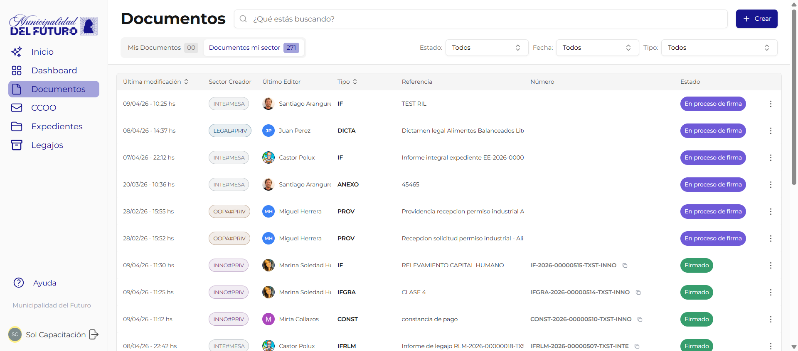

# Documentos

La sección **Documentos** es el módulo principal de GDI. Desde aquí se crean, editan, firman y gestionan todos los documentos oficiales del organismo.

## Acceso

Desde el **menú lateral izquierdo**, hacer click en **Documentos**. Se muestra el listado de documentos visibles para el usuario.

## Pantalla principal: Listado de documentos

### Pestañas de filtrado

| Pestaña | Que muestra |
|---------|-------------|
| **Mis Documentos** | Documentos creados por el usuario actual |
| **Documentos mi sector** | Documentos creados por cualquier usuario del sector al que pertenece el usuario |
| **Documentos favoritos** | Documentos marcados como favorito por el usuario |

### Filtros adicionales

En la parte superior derecha del listado se encuentran tres selectores:

| Filtro | Opciones | Descripción |
|--------|----------|-------------|
| **Estado** | Todos, En edición, En proceso de firma, Firmado, Rechazado | Filtrar documentos por su estado actual |
| **Fecha** | Todos, Hoy, Esta semana, Este mes | Filtrar por rango de fecha de última modificación |
| **Tipo** | Todos, IF, NOTA, DICTA, etc. | Filtrar por tipo de documento |

### Tarjetas del listado

Cada documento se muestra como una tarjeta de dos filas.

**Fila 1** (de izquierda a derecha):

| Elemento | Descripción |
|----------|-------------|
| **Sigla** | Acrónimo del tipo de documento en badge primario (ej: `IF`, `NOTA`) |
| **Referencia** | Título descriptivo del documento (truncado si es largo) |
| **Estado** | Badge de color redondeado con el estado actual (ej: `Firmado`, `En edicion`) |
| **Número oficial** | Número asignado al firmar (ej: `IF-2026-00000122-TXST-INTE`), con botón de copiar al portapapeles. Solo aparece si el documento ya tiene número |
| **Fecha** | Fecha y hora de última modificación |
| **`>`** | Flecha de navegación, se resalta al pasar el cursor |

**Fila 2** (de izquierda a derecha):

| Elemento | Descripción |
|----------|-------------|
| **Resumen IA** | Resumen automático del contenido generado por IA (`short_resume`), en texto itálico gris. Solo aparece si el documento ya fue procesado |
| **Avatar + nombre del último editor** | Foto de perfil (o iniciales en círculo) del último usuario que editó, seguido de su nombre |
| **Avatares de firmantes** | Fotos de perfil (o iniciales) de los firmantes asignados. Se muestran hasta 2; si hay más, aparece un contador `+N`. Solo aparece si el documento tiene firmantes |

### Buscador

En la parte superior central hay un campo de búsqueda con placeholder *"Que estás buscando?"*. Permite buscar por **referencia o número**. No busca dentro del cuerpo del documento: para eso está la [búsqueda inteligente](../busqueda/buscador-general.md) del Home.

### Botón Crear

En la esquina superior derecha, el botón **"+ Crear"** abre el diálogo para crear un nuevo documento. Ver [Crear y Editar Documento](crear-editar-documento.md).

## Páginas de esta sección

| Página | Descripción |
|--------|-------------|
| [Crear y Editar Documento](crear-editar-documento.md) | Como crear un documento nuevo, completar campos, agregar firmantes y previsualizar |
| [Documento Importado (PDF)](documento-importado.md) | Como crear un documento subiendo un archivo PDF externo |
| [Documento tipo NOTA](documento-nota.md) | Como crear una nota oficial con destinatarios, copia y copia oculta |
| [Previsualizar Documento](previsualizar-documento.md) | Vista previa en formato PDF antes de enviar a firma |
| [Proceso de Firma](proceso-de-firma.md) | Como funciona el circuito de firmas, orden de firmantes y numerador |
| [Rechazar y Subsanar](rechazar-y-subsanar.md) | Como rechazar un documento y corregirlo en el ciclo de subsanación |
