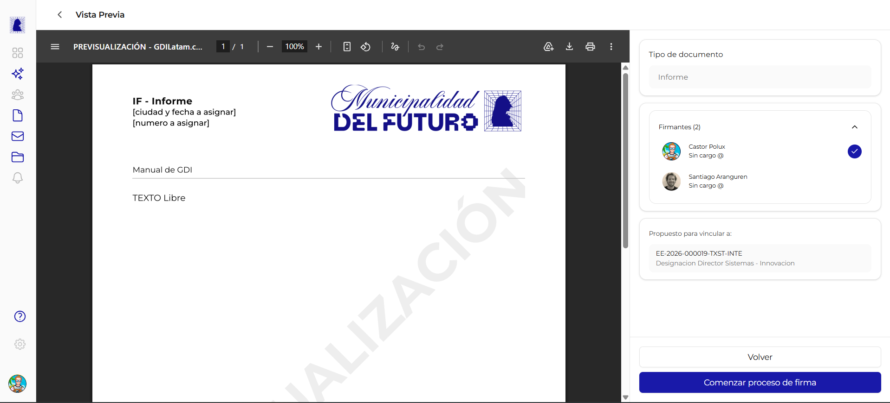

# Previsualizar Documento

La pantalla de previsualización permite revisar el documento en formato PDF antes de iniciar el proceso de firma. Muestra como quedará el documento final con el membrete oficial, la referencia y el contenido, junto con una marca de agua diagonal que indica que aún no es un documento oficial.



---

## Cómo llegar a esta pantalla

Desde el editor de documento (ya sea HTML o importado), hacer click en el botón **"Previsualizar"** en la parte inferior del panel lateral. El sistema guarda automáticamente los cambios antes de navegar a la previsualización.

!!! note "Requisitos previos"
    Para previsualizar se necesita: una referencia no vacía, contenido en el editor (o un PDF cargado para documentos importados) y al menos un firmante asignado.

---

## Encabezado

En la parte superior se muestra:

- **Flecha de retorno** (`<`): al hacer click, aparece el texto **"Vista Previa"** como título de la pantalla
- No se muestra el tipo de documento en el encabezado (ese dato está en el panel lateral)

---

## Visor PDF

El área principal muestra el documento renderizado en formato PDF dentro de un visor integrado.

### Barra de herramientas del visor

| Herramienta | Función |
|-------------|---------|
| **Menú** (hamburguesa) | Opciones adicionales del visor |
| **Título** | Muestra "PREVISUALIZACION - GDILatam.c..." |
| **Paginador** | Navegar entre páginas (ej: "1/1", "2/5") |
| **Zoom** | Ajustar nivel de zoom (ej: "100%") |
| **Vista de página** | Cambiar modo de visualización (una página, dos páginas) |
| **Rotación** | Rotar el documento 90 grados |
| **Búsqueda** | Buscar texto dentro del documento |
| **Descarga** | Descargar el PDF de previsualización |
| **Impresión** | Imprimir el documento |

### Contenido del PDF

El PDF generado incluye:

- **Logo de la organización** en el encabezado (ej: "Municipalidad del Futuro")
- **Tipo de documento**: sigla y nombre (ej: "IF - Informe")
- **Placeholders**: "[ciudad y fecha a asignar]", "[número a asignar]" (se completan al firmar)
- **Referencia**: el título descriptivo ingresado por el usuario
- **Cuerpo**: el contenido redactado en el editor o el PDF importado

---

## Marca de agua "PREVISUALIZACION"

| Propiedad | Valor |
|-----------|-------|
| **Texto** | PREVISUALIZACION |
| **Orientación** | Diagonal (esquina inferior izquierda a esquina superior derecha) |
| **Visible en** | Todas las páginas del documento |
| **Propósito** | Indica que el documento aún no es oficial y no tiene validez legal |

!!! warning "No es un documento oficial"
    Mientras se muestre la marca de agua "PREVISUALIZACION", el documento no tiene número oficial ni firmas. No debe utilizarse como documento válido. La marca de agua desaparece una vez que se completa el proceso de firma.

---

## Panel lateral derecho

El panel lateral en la previsualización es de **solo lectura** y muestra un resumen de la configuración del documento.

### Secciones del panel

| Sección | Contenido | Editable |
|---------|-----------|:--------:|
| **Tipo de documento** | Nombre del tipo seleccionado (ej: "Informe") | No |
| **Firmantes** | Lista de firmantes con indicador de numerador | No |
| **Propuesto para vincular a** | Expedientes propuestos para vinculación | No |

### Firmantes en la previsualización

Cada firmante se muestra con su nombre completo. El firmante designado como **numerador** se identifica con un **check azul** (círculo con tilde) junto a su nombre.

| Indicador | Significado |
|-----------|-------------|
| Check azul (círculo con tilde) | Este firmante es el **numerador** (asigna el número oficial) |
| Sin indicador | Firmante regular |

### Expedientes propuestos

Si se propuso vincular el documento a uno o más expedientes, se muestran con su número y referencia. Ejemplo:

```
EE-2026-000019-TXST-INTE / Designacion Director Sistemas - Innovacion
```

---

## Acciones

En la parte inferior del panel lateral se encuentran dos botones.

### Botón: Volver

| Propiedad | Valor |
|-----------|-------|
| **Estilo** | Botón blanco con borde (secundario) |
| **Acción** | Regresa al editor de documento para seguir editando |

### Botón: Comenzar proceso de firma

| Propiedad | Valor |
|-----------|-------|
| **Estilo** | Botón azul (primario) |
| **Acción** | Inicia el circuito de firmas. El documento pasa al estado "En proceso de firma" |
| **Habilitado cuando** | El numerador tiene el rango adecuado para el tipo de documento |

!!! warning "Validación del numerador"
    Si el firmante designado como numerador no tiene el rango necesario para firmar el tipo de documento seleccionado (por ejemplo, un Decreto requiere rango de Intendente), se muestra una **advertencia en color amarillo** y el botón "Comenzar proceso de firma" queda inhabilitado. Se debe volver al editor y cambiar el numerador por uno con el rango adecuado.

---

## Preguntas frecuentes

??? question "Puedo descargar el PDF de previsualización?"
    Sí. La barra de herramientas del visor incluye un botón de descarga. Sin embargo, el PDF descargado tendrá la marca de agua "PREVISUALIZACION" y no es un documento oficial.

??? question "Si vuelvo al editor y hago cambios, tengo que previsualizar de nuevo?"
    Sí. Cada vez que se hacen cambios en el editor es recomendable previsualizar nuevamente para verificar que el PDF refleje los cambios correctamente antes de iniciar el proceso de firma.

??? question "Qué pasa si inicio el proceso de firma y el documento tiene errores?"
    Se puede cancelar la firma desde la pantalla de proceso de firma. El documento vuelve a estado editable para corregir los errores. Ver [Rechazar y Subsanar](rechazar-y-subsanar.md) para más detalles.
