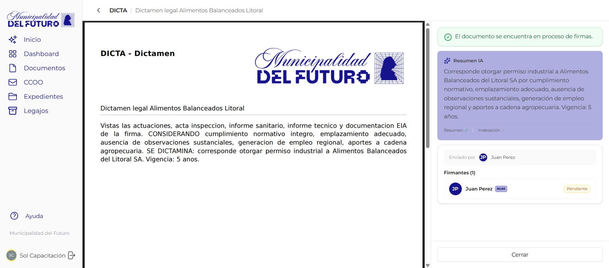
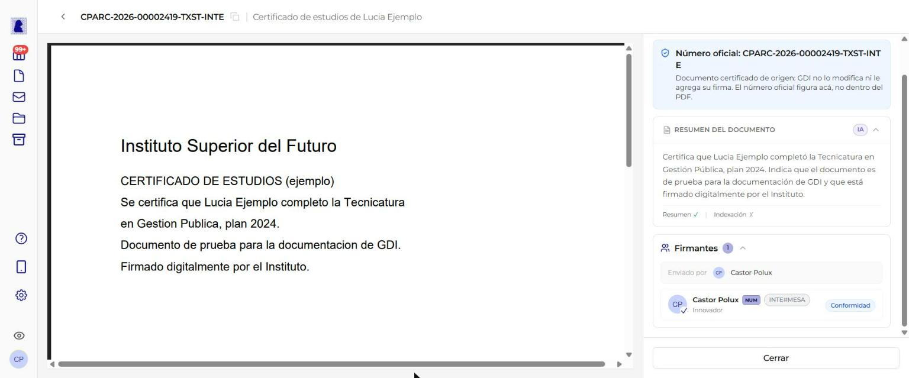
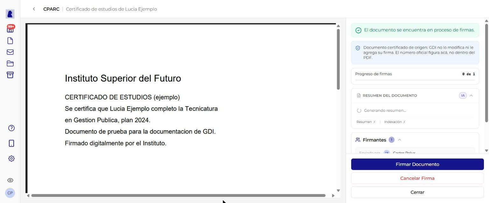
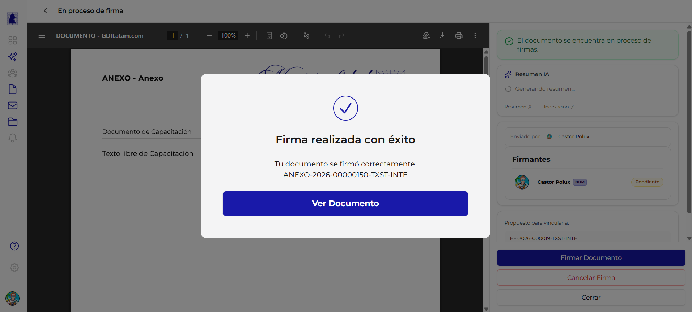
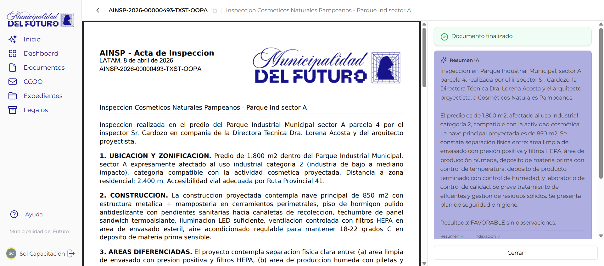

# Proceso de Firma

Una vez que se inicia el proceso de firma desde la previsualización, el documento entra en un circuito donde los firmantes deben firmar en orden. Esta pantalla muestra el estado actual del proceso, permite firmar y ofrece la opción de cancelar la firma si se detecta un error.

!!! video "Video tutorial"
    **GDI Latam #2 — Firmar documentos paso a paso**

    <div class="video-embed"><iframe src="https://www.youtube-nocookie.com/embed/292GrNVGUSU?list=PLRIZqApsdJ12JCSzhUxaZ73AheVHUEpDq" title="GDI Latam #2 — Firmar documentos paso a paso" loading="lazy" allow="accelerometer; autoplay; clipboard-write; encrypted-media; gyroscope; picture-in-picture; web-share" allowfullscreen></iframe></div>

    **GDI Latam #3 — Firma conjunta de documentos: como funciona**

    <div class="video-embed"><iframe src="https://www.youtube-nocookie.com/embed/RuvKiC_loho?list=PLRIZqApsdJ12JCSzhUxaZ73AheVHUEpDq" title="GDI Latam #3 — Firma conjunta de documentos" loading="lazy" allow="accelerometer; autoplay; clipboard-write; encrypted-media; gyroscope; picture-in-picture; web-share" allowfullscreen></iframe></div>



---

## Cómo llegar a esta pantalla

Desde la [previsualización del documento](previsualizar-documento.md), hacer click en el botón **"Comenzar proceso de firma"**. También se accede al abrir un documento que ya se encuentra en estado "En proceso de firma" o "Firmar ahora" desde el listado de documentos.

---

## Encabezado

En la parte superior se muestra:

- **Flecha de retorno** (`<`): vuelve al listado de documentos
- **Título**: "En proceso de firma"

---

## Visor PDF

El área principal muestra el documento en formato PDF sin marca de agua. La barra de herramientas del visor muestra el título **"DOCUMENTO - GDILatam.com"** e incluye las mismas funcionalidades de navegación, zoom, descarga e impresión que la previsualización.

!!! info "Sin marca de agua"
    A diferencia de la previsualización, el PDF en esta etapa ya **no muestra la marca de agua "PREVISUALIZACION"**. Sin embargo, el documento aún no tiene número oficial hasta que el numerador firme.

---

## Panel lateral derecho

El panel lateral muestra la información del proceso de firma y las acciones disponibles.

### Banner de estado

| Propiedad | Valor |
|-----------|-------|
| **Color** | Verde |
| **Texto** | *"El documento se encuentra en proceso de firmas."* |
| **Ubicación** | Parte superior del panel lateral |

### Resumen generado por IA

| Propiedad | Valor |
|-----------|-------|
| **Estado inicial** | *"Generando resumen..."* con indicador de carga (spinner) |
| **Contenido** | Resumen automático del contenido del documento |
| **Links** | "Resumen X" y "Indexación X" (cerrar/expandir cada sección) |

El sistema genera automáticamente un resumen del documento utilizando inteligencia artificial. Este resumen facilita a los firmantes comprender rápidamente el contenido antes de firmar.

### Enviado por

Muestra el nombre y avatar del usuario que inició el proceso de firma (el creador del documento).

### Firmantes y estados



La sección de firmantes muestra a cada firmante con su estado actual y los badges correspondientes.

#### Estados de un firmante

| Estado | Badge | Color | Descripción |
|--------|-------|-------|-------------|
| **Pendiente** | `Pendiente` | Amarillo | El firmante aún no ha firmado. Puede ser que no sea su turno todavía |
| **Firmado** | `Firmado` | Verde | El firmante ya firmó el documento |
| **Conformidad** | `Conformidad` | Azul claro | Solo en un [PDF certificado de origen](documento-importado.md#pdf-certificado-de-origen). El firmante dio su conformidad en GDI, sin firmar digitalmente el PDF. Al pasar el mouse: *"Dio conformidad en GDI; no firmó digitalmente el PDF porque viene certificado de origen."* |

#### Badges especiales

| Badge | Color | Significado |
|-------|-------|-------------|
| **NUM** | Azul oscuro | Indica que este firmante es el **numerador** (firma último y asigna el número oficial) |

Ejemplo de como se muestra un firmante numerador pendiente:

```
Juan Perez  [NUM]  [Pendiente]
```

### Aviso de certificado de origen



Si el documento es un [PDF certificado de origen](documento-importado.md#pdf-certificado-de-origen), el panel lateral muestra un aviso azul con un escudo:

```
Número oficial: CONT-2026-00000012-MUNDEV-LEGAL
Documento certificado de origen: GDI no lo modifica ni le agrega su firma.
El número oficial figura acá, no dentro del PDF.
```

La línea del número oficial aparece recién cuando el documento ya está numerado.

### Expedientes propuestos

Si el documento tiene expedientes propuestos para vinculación, se muestran con su número y referencia:

```
Propuesto para vincular a:
EE-2026-000019-TXST-INTE / Designacion Director Sistemas - Innovacion
```

---

## Acciones

En la parte inferior del panel lateral se encuentran los botones de acción. Los botones visibles dependen del rol del usuario y del estado del documento.

### Botón: Firmar Documento

| Propiedad | Valor |
|-----------|-------|
| **Estilo** | Botón azul (primario) |
| **Visible cuando** | Es el turno del usuario actual para firmar |
| **Acción** | Registra la firma del usuario en el documento |

### Botón: Cancelar Firma

| Propiedad | Valor |
|-----------|-------|
| **Estilo** | Texto rojo (sin fondo) |
| **Visible cuando** | El usuario es el creador o un firmante del documento |
| **Acción** | Abre el diálogo de rechazo. Ver [Rechazar y Subsanar](rechazar-y-subsanar.md) |

### Botón: Cerrar

| Propiedad | Valor |
|-----------|-------|
| **Estilo** | Botón gris (secundario) |
| **Acción** | Cierra la pantalla y vuelve al listado de documentos |

---

## Diálogo de firma exitosa

Al firmar correctamente, se muestra un diálogo modal de confirmación.



### Contenido del diálogo

| Elemento | Valor |
|----------|-------|
| **Icono** | Check azul (círculo con tilde) |
| **Título** | *"Firma realizada con éxito"* |
| **Mensaje** | *"Tu documento se firmó correctamente."* |
| **Número oficial** | Se muestra cuando el numerador firma (ej: `ANEXO-2026-00000150-TXST-INTE`) |
| **Botón** | **"Ver Documento"** (azul) - abre el documento firmado |

!!! note "Número oficial"
    El número oficial solo se asigna cuando firma el **numerador** (último firmante). Si un firmante regular firma, el diálogo de éxito no muestra número oficial porque el documento aún no está completamente firmado.

!!! info "Con un PDF certificado de origen"
    Si el tipo de documento pide firma con token, el diálogo suma este texto: *"El documento viene certificado de origen: no se usó el token ni se firmó el PDF. Quedó registrada tu conformidad en GDI. El número oficial figura en GDI, no dentro del PDF."*

### Documento finalizado

Una vez completada la firma, el documento muestra el estado "Documento finalizado" junto con el resumen generado por IA, la información de firmantes y el PDF oficial.



### Formato del número oficial

El número oficial se genera con el formato:

```
{SIGLA}-{ANO}-{SECUENCIAL}-{TENANT}-{DEPARTAMENTO}
```

Para una descripción detallada del formato, consultar [Crear y Editar Documento - Formato del número oficial](crear-editar-documento.md#formato-del-numero-oficial).

---

## Avisos cuando el PDF no se puede firmar

Algunos documentos importados traen un PDF que GDI no puede firmar. En ese caso la firma se frena y el panel lateral muestra el motivo:

| Aviso | Qué hacer |
|-------|-----------|
| *"Este PDF viene certificado de origen y no se puede firmar. Rechazá el documento, borralo e importalo de nuevo: GDI lo va a numerar sin firmarlo encima."* | Rechazar el documento, borrarlo e importar el PDF de nuevo |
| *"Este PDF declara una certificación que ninguna firma respalda y no se puede firmar. Rechazá el documento, borralo, volvé a generar el PDF desde su origen e importalo de nuevo."* | Pedir el PDF de nuevo al organismo emisor e importarlo en un documento nuevo |
| *"No se pudieron leer las firmas que trae este PDF (firma incompleta o archivo dañado). Rechazá el documento, borralo, volvé a generar el PDF desde su origen e importalo de nuevo."* | Igual que el anterior |
| *"Este PDF está protegido con contraseña de apertura y no se puede firmar. Rechazá el documento, borralo e importá una copia sin contraseña."* | Importar una copia sin contraseña de apertura |
| *"No pudimos verificar el PDF certificado de origen. Reintentá en unos segundos."* | Esperar unos segundos y firmar de nuevo |
| *"El PDF cambió desde que se verificó como certificado de origen, así que no se numeró. Reintentá la firma; si se repite, rechazá el documento, borralo e importalo de nuevo."* | Firmar de nuevo. Si se repite, rechazar, borrar e importar de nuevo |

Para rechazar, ver [Rechazar y Subsanar](rechazar-y-subsanar.md).

---

## Reglas de negocio

!!! abstract "Resumen de reglas del proceso de firma"

    1. **Solo el creador** puede iniciar el proceso de firma desde la previsualización
    2. Los **firmantes regulares firman primero**, en el orden en que fueron agregados a la lista
    3. El **numerador firma último**, independientemente de su posición en la lista original
    4. Al firmar el numerador, se genera el **número oficial** del documento
    5. El **creador o cualquier firmante** pueden cancelar la firma (el documento vuelve a edición)
    6. Al cancelar la firma, **todas las firmas realizadas se eliminan** y el proceso debe reiniciarse
    7. Un firmante solo puede firmar cuando **es su turno** (todos los anteriores ya firmaron)

---

## Preguntas frecuentes

??? question "Puedo firmar un documento si no es mi turno?"
    No. Los firmantes deben firmar en el orden establecido. El botón "Firmar Documento" solo aparece cuando es tu turno.

??? question "Qué pasa si cancelo la firma después de que otros ya firmaron?"
    Al cancelar la firma, se eliminan todas las firmas realizadas y el documento vuelve al estado "Rechazado". Todos los firmantes deberán firmar nuevamente si se reenvía a firma.

??? question "Quién puede ver el documento en proceso de firma?"
    El creador y todos los firmantes pueden acceder al documento mientras está en proceso de firma. Los firmantes ven el botón "Firmar Documento" solo cuando es su turno.
