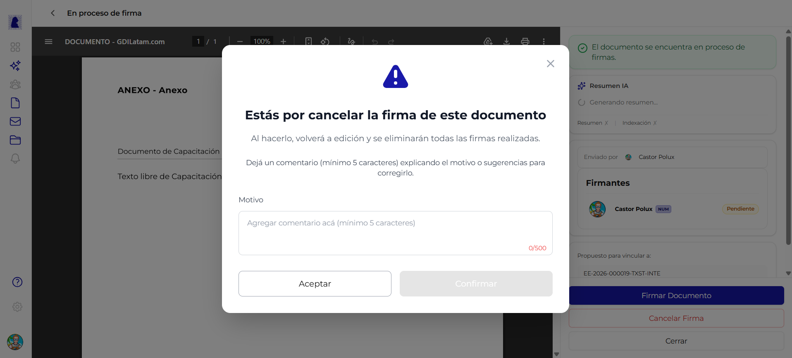

# Rechazar y Subsanar Documento

Cuando un documento en proceso de firma contiene errores o necesita correcciones, cualquier firmante o el creador pueden cancelar la firma. El documento vuelve al estado editable para ser corregido y reenviado a firma. Este ciclo se conoce como **subsanación**.

!!! video "Video tutorial"
    **GDI Latam #4 — Rechazar, corregir y reenviar documentos**

    <div class="video-embed"><iframe src="https://www.youtube-nocookie.com/embed/ESaWZA2BzeE?list=PLRIZqApsdJ12JCSzhUxaZ73AheVHUEpDq" title="GDI Latam #4 — Rechazar, corregir y reenviar documentos" loading="lazy" allow="accelerometer; autoplay; clipboard-write; encrypted-media; gyroscope; picture-in-picture; web-share" allowfullscreen></iframe></div>



---

## Cómo cancelar una firma

Desde la pantalla de [Proceso de Firma](proceso-de-firma.md), hacer click en el botón **"Cancelar Firma"** (texto rojo en la parte inferior del panel lateral). Se abre un diálogo modal de confirmación.

---

## Diálogo de rechazo

Al hacer click en "Cancelar Firma", se muestra un diálogo modal con un icono de advertencia (triángulo amarillo).

### Contenido del diálogo

| Elemento | Valor |
|----------|-------|
| **Icono** | Triángulo amarillo de advertencia |
| **Título** | *"Estas por cancelar la firma de este documento"* |
| **Mensaje 1** | *"Al hacerlo, volverá a edición y se eliminarán todas las firmas realizadas."* |
| **Mensaje 2** | *"Deja un comentario (mínimo 5 caracteres) explicando el motivo o sugerencias para corregirlo."* |

### Campo: Motivo

| Propiedad | Valor |
|-----------|-------|
| **Tipo de campo** | Textarea (área de texto) |
| **Placeholder** | *"Agregar comentario acá (mínimo 5 caracteres)"* |
| **Mínimo** | 5 caracteres |
| **Máximo** | 500 caracteres |
| **Contador** | Se muestra `0/500` y se actualiza al escribir |
| **Obligatorio** | Sí |

!!! warning "El motivo es obligatorio"
    No se puede confirmar el rechazo sin escribir un motivo de al menos 5 caracteres. El botón "Confirmar" permanece deshabilitado (gris) hasta que se cumpla este requisito.

### Botones del diálogo

| Botón | Estilo | Acción | Estado |
|-------|--------|--------|--------|
| **Aceptar** | Blanco con borde (secundario) | Cierra el diálogo sin cancelar la firma. El documento sigue en proceso de firma | Siempre habilitado |
| **Confirmar** | Gris (deshabilitado) / Activo al escribir motivo | Confirma el rechazo. El documento vuelve a estado editable | Deshabilitado hasta que el motivo tenga al menos 5 caracteres |

!!! info "Nombre de los botones"
    El botón **"Aceptar"** cierra el diálogo (es decir, se acepta que no se quiere rechazar). El botón **"Confirmar"** es el que efectivamente ejecuta el rechazo del documento.

---

## Flujo de subsanación

El ciclo de subsanación es el proceso completo desde el rechazo hasta el reenvío a firma:

```
Documento en proceso de firma
    |
    v
Cancelar Firma (boton rojo)
    |
    v
Dialogo de rechazo (escribir motivo)
    |
    v
Confirmar rechazo
    |
    v
Documento vuelve a estado "Rechazado"
(todas las firmas realizadas se eliminan)
    |
    v
Editar documento (corregir errores)
    |
    v
Previsualizar nuevamente
    |
    v
Comenzar proceso de firma (nuevo ciclo)
```

### Estados involucrados

| Estado | Descripción | Editable |
|--------|-------------|:--------:|
| **En proceso de firma** | Estado previo al rechazo. Los firmantes van firmando en orden | No |
| **Rechazado** | El documento fue devuelto para correcciones. Todas las firmas se eliminaron | Sí |
| **En edición** | Después de editar el documento rechazado, vuelve a este estado | Sí |
| **En proceso de firma** | Al reenviar a firma, se reinicia el ciclo completo | No |

!!! warning "Las firmas se eliminan al rechazar"
    Al confirmar el rechazo, **todas las firmas realizadas hasta el momento se eliminan**. Cuando el documento se reenvie a firma, todos los firmantes deberán firmar nuevamente desde cero.

---

## Rechazar un documento importado

Un [documento importado](documento-importado.md) no tiene texto: su contenido es el PDF. Al rechazarlo, **el PDF queda cargado**. GDI borra las firmas, pero no el archivo. El PDF vuelve a como estaba antes de la primera firma.

Para corregir un documento importado rechazado:

1. Abrir el documento rechazado. El panel central muestra el PDF.
2. Si el error está en el PDF, hacer click en **"Reemplazar PDF"** y subir el archivo corregido.
3. Si el PDF está bien (por ejemplo, el error estaba en los firmantes), dejarlo como está.
4. Hacer click en **"Previsualizar"** y comenzar el proceso de firma de nuevo.

!!! note "Caso poco común: el documento vuelve sin PDF"
    Si GDI no encuentra una copia del PDF sin firmas, el documento rechazado vuelve sin PDF. En ese caso, hay que importar el archivo de nuevo.

---

## Quien puede rechazar un documento

| Rol | Puede rechazar |
|-----|:--------------:|
| **Creador del documento** | Sí |
| **Firmante activo** (cualquier firmante asignado) | Sí |
| **Usuarios no involucrados** | No |

El creador puede cancelar la firma en cualquier momento del proceso. Los firmantes también pueden cancelar cuando acceden al documento en proceso de firma.

---

## Preguntas frecuentes

??? question "Puedo rechazar un documento que ya está completamente firmado?"
    No. Una vez que todos los firmantes (incluido el numerador) han firmado y se asignó el número oficial, el documento queda en estado "Firmado" y no se puede rechazar ni modificar.

??? question "El motivo del rechazo queda registrado?"
    Sí. El comentario ingresado al rechazar queda registrado en el historial del documento. Los otros firmantes y el creador pueden verlo para entender qué correcciones se necesitan.

??? question "Cuántas veces se puede rechazar y subsanar un documento?"
    No hay límite. El ciclo de subsanación (rechazar, corregir, reenviar a firma) se puede repetir las veces que sea necesario hasta que todos los firmantes estén conformes con el contenido.
