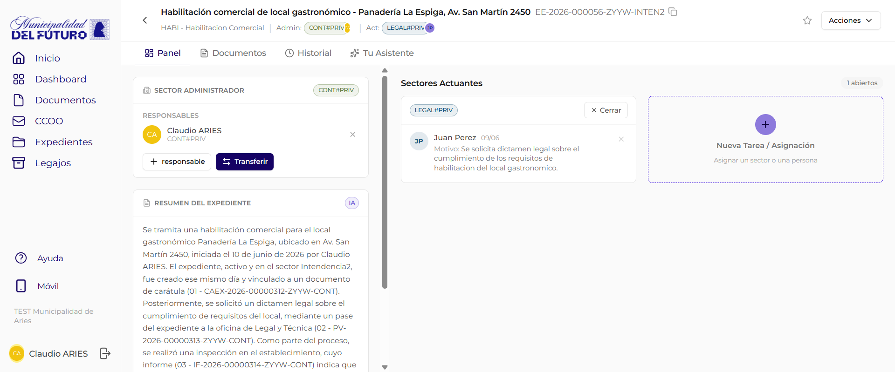
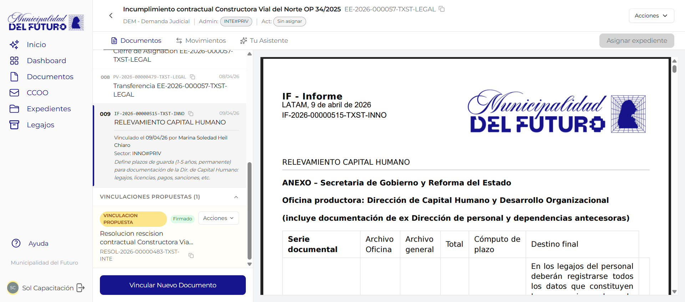
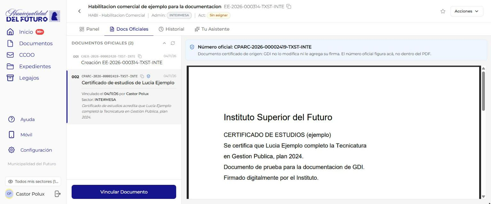

# Detalle del Expediente

Esta pantalla muestra la información completa de un expediente electrónico: su panel de gestión (sectores, responsables y resumen IA), los documentos que lo componen, el historial de actividad y el asistente de inteligencia artificial. Se accede haciendo click en cualquier expediente desde el listado de expedientes.



---

## Header del expediente

En la parte superior de la pantalla se muestra la información general del expediente en dos líneas compactas. El header es común a todas las pestañas.

### Primera línea: título y número

| Elemento | Descripción |
|----------|-------------|
| **Flecha de retorno** | Vuelve al listado de expedientes, preservando la solapa activa |
| **Título** | Nombre descriptivo del expediente (motivo de creación) |
| **Número oficial** | Identificador único mostrado junto al título, con botón para copiar al portapapeles |
| **Estrella** (favorito) | Marca o desmarca el expediente como favorito. Amarilla cuando está activa. Se sincroniza inmediatamente con el servidor |
| **Botón "Acciones"** | Desplegable con las operaciones disponibles sobre el expediente |

### Segunda línea: resumen inline

Debajo del título se muestra un resumen de los datos del expediente en una sola línea separada por barras:

| Dato | Descripción | Ejemplo |
|------|-------------|---------|
| **Tipo** | Sigla y nombre del tipo de trámite | `HABI - Habilitacion comercial de local gastronomico` |
| **Admin** | Sector administrador actual (badge de color) con el avatar del responsable administrador inline | `CONT#PRIV` |
| **Act** | Sector actuante con las iniciales de la persona asignada. Si no hay actuante, aparece el badge **"Sin asignar"** | `LEGAL#PRIV` o badge "Sin asignar" |

### Opciones del menú "Acciones"

| Opción | Descripción |
|--------|-------------|
| **Descargar** | Descarga un archivo ZIP con todos los documentos oficiales del expediente. Ver sección [Descargar expediente como ZIP](#descargar-expediente-como-zip) |
| **Nuevo Movimiento** | Abre el modal para crear una nueva asignación o transferencia. Ver [Panel del Expediente](panel.md#nueva-tarea-asignacion) |
| **Vincular Documentos** | Navega a la pestaña Documentos y abre el modal de vinculación. Ver [Vincular Documentos](vincular-documentos.md) |
| **Subsanar** | Abre el proceso guiado de subsanación. Ver [Subsanar en Expediente](subsanar-expediente.md) |

---

## Pestañas disponibles

La pantalla se organiza en cuatro pestañas:

| Pestaña | Descripción |
|---------|-------------|
| **Panel** | Vista de gestión del expediente: sector administrador, responsables, resumen IA y sectores actuantes (pestaña por defecto) |
| **Documentos** | Lista de documentos oficiales y propuestos del expediente |
| **Historial** | Historial de actividad y acciones realizadas sobre el expediente. Ver [Historial](movimientos.md) |
| **Tu Asistente** | Asistente de inteligencia artificial para consultas sobre el expediente. Ver [Tu Asistente](../asistente-ai/index.md) |

!!! info "Panel es la pestaña por defecto"
    Al abrir un expediente, la pestaña **Panel** se muestra activa. La antigua pestaña "Movimientos" ahora se llama **Historial**.

---

## Pestaña Panel

Es la pestaña central del expediente y la que se muestra por defecto al abrirlo. Concentra la gestión de quien controla el expediente, quienes son sus responsables, el resumen IA y los sectores actuantes; además, desde ahí se crean las asignaciones y transferencias ("Nueva Tarea / Asignación").


Por su extensión, el Panel se documenta en su propia página: ver **[Panel del Expediente](panel.md)**.

---

## Pestaña Documentos

Lista los documentos que componen el expediente y permite previsualizar cada PDF.



### Documentos oficiales

La sección colapsable **"DOCUMENTOS OFICIALES (N)"** muestra un contador con la cantidad total de documentos incorporados. Cada documento de la lista muestra:

| Elemento | Descripción | Ejemplo |
|----------|-------------|---------|
| **Número de orden** | Posición dentro del expediente (001, 002, 003...) | `001` |
| **Número oficial** | Identificador único del documento, con botón para copiar | `CAEX-2026-00000133-...` |
| **Fecha** | Fecha de incorporación al expediente | `18/02/26` |
| **Referencia** | Título descriptivo del documento | *Creación del expediente* |
| **Línea de vinculación** | `Vinculado el FECHA por USUARIO / Sector: SECTOR` | — |
| **Resumen IA** | A veces, un resumen de una línea generado por inteligencia artificial | — |
| **Clip de embebidos** | Icono de clip con un número cuando el documento tiene **archivos embebidos** (adjuntos que quedaron dentro del PDF firmado). Tooltip: *"Tiene N archivos embebidos"*. Si el documento no tiene embebidos, no aparece nada | 📎 2 |

| **Escudo de certificado de origen** | Ícono de escudo azul junto al número cuando el documento es un **PDF certificado de origen**. Al pasar el mouse: *"Documento certificado de origen: GDI no lo modifica ni le agrega su firma. El número oficial figura acá, no dentro del PDF."* | — |

Al hacer click en un documento de la lista, se muestra una **vista previa del PDF** en el panel derecho.

!!! info "Primer documento: Carátula (CAEX)"
    El documento número 001 de todo expediente es siempre la **carátula** (tipo CAEX), generada automáticamente por el sistema al crear el expediente. Contiene los datos básicos: tipo, número, motivo y repartición iniciadora.

El botón **"Vincular Documento"** abre el flujo de vinculación. Ver [Vincular Documentos](vincular-documentos.md).

### Archivos embebidos en documentos oficiales

Cuando un documento oficial se creó con archivos adjuntos (por ejemplo, planillas, imágenes o PDFs complementarios), esos archivos quedan **embebidos dentro del PDF firmado**. Se llaman **archivos embebidos** porque viajan adentro del documento oficial, no como piezas sueltas del expediente.

#### Cómo saber si un documento tiene embebidos

En la lista de **DOCUMENTOS OFICIALES**, los documentos que tienen archivos embebidos muestran un **clip 📎 con un número** al lado (cantidad de embebidos). Si no ves el clip, ese documento no tiene embebidos.

#### Cómo verlos y descargarlos

1. Hacer click en el documento en la lista para abrirlo en el panel derecho.
2. Arriba del visor del PDF aparece una barra **"📎 Archivos embebidos (N)"**.
3. Desplegar la barra para ver la lista de adjuntos. Por cada archivo tenés:

    - **Ver** (icono de ojo): abre el archivo en una nueva pestaña del navegador. Disponible solo para formatos que el navegador puede mostrar: **PDF, PNG, JPG, JPEG, GIF, WEBP y TXT**.
    - **Descargar** (icono de flecha): baja el archivo a tu computadora. Siempre disponible, para cualquier extensión.

!!! info "Son de solo lectura"
    Los archivos embebidos quedaron dentro del PDF cuando el documento se oficializó. Se pueden **ver y descargar**, pero **no se editan ni se agregan nuevos**: forman parte del documento firmado y cambiarlos rompería la firma. Si necesitás incorporar información adicional, lo correcto es vincular un documento nuevo al expediente.

!!! note "Si el documento no tiene embebidos"
    La barra "📎 Archivos embebidos" no aparece. Directamente se muestra el visor del PDF.

### Documentos certificados de origen



Un **PDF certificado de origen** es un PDF importado que ya traía la firma de certificación de otro organismo (por ejemplo, un escribano). GDI lo guarda sin tocarlo, así que el número oficial **no está impreso en el PDF**.

Por eso, al abrir uno de estos documentos, arriba del visor aparece un aviso azul con el número:

```
Número oficial: CONT-2026-00000012-MUNDEV-LEGAL
Documento certificado de origen: GDI no lo modifica ni le agrega su firma.
El número oficial figura acá, no dentro del PDF.
```

En el detalle del documento, sus firmantes figuran con **"Conformidad"** en lugar de una firma digital. Ver [PDF certificado de origen](../documentos/documento-importado.md#pdf-certificado-de-origen).

---

### Documentos propuestos

Cuando hay vinculaciones pendientes, aparece la sección **"DOCUMENTOS PROPUESTOS"**, que muestra los documentos cuya vinculación fue solicitada pero aún no fue aceptada por el sector administrador.

Cada documento propuesto muestra:

| Elemento | Descripción |
|----------|-------------|
| **Badge "VINCULACION PROPUESTA"** | Etiqueta que indica que el documento está pendiente de aceptación |
| **Estado de firma** | Badge "En firma" o "Firmado", según el estado actual del documento |
| **Menú "Acciones"** | Desplegable con las opciones disponibles según el estado del documento |

#### Acciones sobre documentos propuestos

| Acción | Disponible cuando | Descripción |
|--------|-------------------|-------------|
| **Aceptar Vinculación** | El documento está **Firmado** | Incorpora el documento al expediente como documento oficial. Se le asigna un número de orden |
| **Rechazar Vinculación** | Siempre (Firmado o En firma) | Rechaza la propuesta. El documento no se incorpora al expediente |

!!! warning "Documentos en firma"
    Un documento que está **"En firma"** (aún no fue firmado por todos los firmantes) solo puede ser **rechazado**. La opción "Aceptar Vinculación" no está disponible hasta que el documento esté completamente firmado.

---

## Pestaña Historial

La pestaña **Historial** (antes "Movimientos") muestra la línea de tiempo de actividad del expediente: que documentos se vincularon, que acciones se realizaron, quien las ejecuto y cuando. Tiene su propia página: ver [Historial](movimientos.md).

---

## Pestaña Tu Asistente

La pestaña **Tu Asistente** abre el asistente de inteligencia artificial, que responde consultas sobre el contenido del expediente. Ver [Tu Asistente](../asistente-ai/index.md).

---

## Descargar expediente como ZIP

La opción **"Descargar"** del menú Acciones genera y descarga un archivo `.zip` con todos los documentos oficiales activos del expediente.

### Qué incluye el ZIP

- Solo los **documentos oficiales** del expediente (no borradores ni propuestas pendientes).
- El ZIP se nombra con el número oficial del expediente: por ejemplo `EE-2026-000019-TXST-CONT.zip`.
- Cada PDF dentro del ZIP se nombra con su número de orden y número oficial: `001 - CAEX-2026-00000133-TXST-CONT.pdf`, `002 - IF-2026-00000136-TXST-CONT.pdf`, etc.

### Cómo descargar

1. Abrir el expediente.
2. Hacer click en el botón **"Acciones"** (esquina superior derecha).
3. Seleccionar **"Descargar"**.
4. El sistema prepara el archivo. El botón muestra el texto *"Descargando..."* mientras procesa.
5. El archivo `.zip` se descarga automáticamente al completarse.

!!! info "Expedientes grandes"
    Expedientes con muchos documentos pueden tardar unos segundos en prepararse antes de que comience la descarga. El botón queda deshabilitado durante ese tiempo para evitar descargas duplicadas.

!!! note "Solo documentos oficiales"
    Los documentos en estado de propuesta (pendientes de aceptación) y los documentos subsanados no se incluyen en el ZIP.

---

## Preguntas frecuentes

??? question "Dónde gestiono responsables, asignaciones y transferencias?"
    Todo eso se hace desde la pestaña **Panel**. Ver [Panel del Expediente](panel.md), que detalla el sector administrador, los responsables, el resumen IA, los sectores actuantes y el modal "Nueva Tarea / Asignación".

??? question "Puedo ver el contenido de un documento sin descargarlo?"
    Sí. En la pestaña Documentos, al hacer click en cualquier documento de la lista se muestra una vista previa del PDF en el panel derecho.

??? question "Qué significa el número de orden de cada documento?"
    Es la posición cronológica del documento dentro del expediente. El 001 es siempre la carátula, y los siguientes se numeran en el orden en que fueron incorporados.

??? question "Quién puede aceptar o rechazar documentos propuestos?"
    Solo el **sector administrador** del expediente puede aceptar o rechazar propuestas de vinculación de documentos.

??? question "Puedo copiar el número del expediente o de un documento?"
    Sí. Junto al número oficial del expediente (en la primera línea del header) y junto a cada número de documento hay un botón de copia que permite copiar al portapapeles con un solo click.

??? question "Qué es la estrella junto al botón Acciones?"
    Es el botón de **favorito**. Al hacer click, marca el expediente como favorito (estrella amarilla) o lo desmarca. Los expedientes marcados como favoritos aparecen en la solapa "Favoritos" del listado de expedientes.

??? question "Qué es el clip 📎 con un número al lado de un documento?"
    Indica que ese documento oficial tiene **archivos embebidos** (adjuntos que quedaron dentro del PDF firmado). El número es la cantidad. Al abrir el documento, arriba del visor aparece la barra **"📎 Archivos embebidos (N)"** con los botones **Ver** y **Descargar** por archivo. Ver [Archivos embebidos en documentos oficiales](#archivos-embebidos-en-documentos-oficiales).

??? question "Puedo agregar o cambiar los archivos embebidos de un documento oficial?"
    No. Los embebidos son de **solo lectura**: viajan dentro del PDF firmado y se ven y descargan, pero no se editan ni se suman nuevos. Si necesitás incorporar más información, vincula un documento nuevo al expediente.

??? question "Qué es el escudo azul al lado de un documento?"
    Indica un **PDF certificado de origen**: GDI lo guardó tal cual lo emitió otro organismo. El número oficial no está dentro del PDF: figura en el aviso azul arriba del visor. Ver [Documentos certificados de origen](#documentos-certificados-de-origen).

??? question "El ZIP incluye todos los documentos del expediente?"
    Incluye todos los documentos **oficiales** activos. No incluye documentos en estado de propuesta de vinculación ni documentos que hayan sido subsanados (reemplazados por otro documento).
