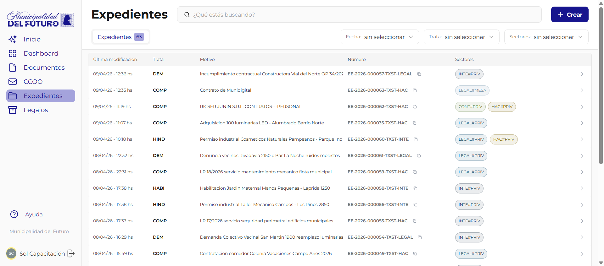
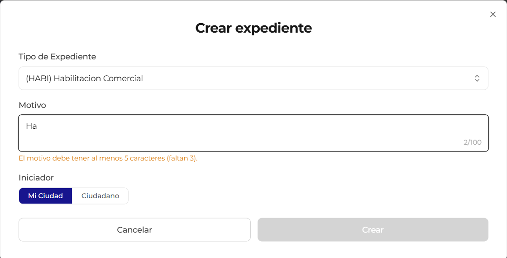

# Expedientes

Un **expediente electrónico** es una carpeta digital que agrupa documentos oficiales relacionados a un mismo trámite o asunto administrativo. Funciona como el equivalente digital de una carpeta física de expediente: reune en un solo lugar todos los informes, dictamenes, resoluciones y demás documentos que forman parte de una gestión.

!!! video "Video tutorial"
    **GDI — Crear un expediente: paso a paso**

    <div class="video-embed"><iframe src="https://www.youtube-nocookie.com/embed/j2Svh6K2L2k?list=PLRIZqApsdJ12JCSzhUxaZ73AheVHUEpDq" title="GDI — Crear un expediente: paso a paso" loading="lazy" allow="accelerometer; autoplay; clipboard-write; encrypted-media; gyroscope; picture-in-picture; web-share" allowfullscreen></iframe></div>

---



## Identificación del expediente

Cada expediente recibe un **número oficial único** al momento de su creación, con el siguiente formato:

```
EE-{ANO}-{SECUENCIAL}-{TENANT}-{DEPARTAMENTO}
```

| Parte | Ejemplo | Descripción |
|-------|---------|-------------|
| EE | `EE` | Prefijo fijo que identifica un expediente electrónico |
| ANO | `2026` | Año de creación |
| SECUENCIAL | `000019` | Número secuencial (6 dígitos, único por tenant) |
| TENANT | `TXST` | Código de la organizacion/tenant |
| DEPARTAMENTO | `INTE` | Acrónimo del departamento iniciador |

Ejemplo completo: `EE-2026-000019-TXST-INTE`

---

## Composición de un expediente

Al crearse un expediente, el sistema genera automáticamente una **carátula** (documento tipo CAEX) que contiene los datos básicos: tipo de expediente, motivo, repartición iniciadora y número oficial. Esta carátula queda como el primer documento del expediente.

Cada expediente tiene:

| Elemento | Descripción |
|----------|-------------|
| **Tipo** | Categoría del trámite (ej: RRHH - Recursos Humanos, HABI - Habilitación Comercial, COMP - Compras) |
| **Sector administrador** | El sector que tiene el control actual del expediente |
| **Responsables** | Usuarios designados para llevar adelante el trámite (administrador y adicionales) |
| **Documentos oficiales** | Documentos firmados y vinculados al expediente, numerados en orden |
| **Documentos propuestos** | Documentos cuya vinculación fue propuesta pero aún no fue aceptada |

---

## Motivo del expediente



Al crear un expediente, el campo **Motivo** explica de qué se trata el trámite. Ese texto queda en la carátula.

| Propiedad | Valor |
|-----------|-------|
| **Mínimo** | 5 caracteres |
| **Máximo** | 100 caracteres, con contador `0/100` |
| **Obligatorio** | Sí |

Mientras el motivo tiene menos de 5 caracteres, el botón **"Crear"** queda deshabilitado. Debajo del campo aparece cuántos caracteres faltan. Por ejemplo: *"El motivo debe tener al menos 5 caracteres (faltan 2)."* Los espacios al principio y al final no cuentan.

---

## Iniciador del expediente

Al crear un expediente, además del tipo y el motivo, se elige **quién lo inicia** con un selector de dos opciones:

| Opción | Significado |
|--------|-------------|
| **Mi Ciudad** | El expediente lo inicia el propio municipio (comportamiento habitual) |
| **Ciudadano** | El expediente lo inicia un **vecino del padrón**, a pedido suyo (por ejemplo, un trámite presentado en mesa de entradas) |

Al elegir **Ciudadano** aparece un buscador para seleccionar al vecino por nombre o CUIL (el CUIL se puede escribir con o sin guiones). Solo se puede elegir **un** ciudadano; los ciudadanos **bloqueados** no aparecen en el buscador ni pueden asociarse.

### Si el ciudadano no está en el padrón

Al final de la lista de resultados siempre aparece la opción **Crear ciudadano**. Abre un formulario breve, sin salir de la pantalla:

| Campo | Regla |
|-------|-------|
| **Nombre y apellido** | Como figura en el documento |
| **CUIL** | 11 dígitos, con o sin guiones. Se valida el dígito verificador. También vale el CUIT de una empresa |

Al confirmar, el ciudadano queda cargado en el padrón y **elegido como iniciador**. A tener en cuenta:

- **Revisar los datos antes de crear**: el nombre y el CUIL no se pueden editar después.
- El ciudadano nace en estado **Pendiente**. Alcanza para ser iniciador y para recibir el expediente; para **firmar o iniciar trámites desde el portal** un administrador tiene que validarlo en BackOffice > Ciudadanos.
- Si el CUIL **ya estaba cargado**, no se crea nada: se muestra el ciudadano existente con el botón **Usar este**. Si está bloqueado, se avisa y no se puede usar.
- Lo puede hacer cualquier usuario del municipio. En BackOffice > Ciudadanos estas altas figuran con origen **App**.

La misma opción está en la caja **TAD** del Panel del expediente (**Compartir con un ciudadano**): ahí el ciudadano se crea y se le comparte el expediente en el mismo paso.

Reglas del expediente iniciado por un ciudadano:

- El **empleado sigue siendo el creador**: el expediente radica en el sector del empleado y la carátula (CAEX) la firma el, como cualquier expediente interno.
- El expediente se **comparte automáticamente** con el ciudadano, que pasa a verlo desde su portal de Trámites a Distancia (TAD).
- En la caja **TAD** del Panel, el ciudadano iniciador figura marcado como "Inicio el expediente" y **no puede ser quitado** del expediente.
- El movimiento queda registrado en el historial del expediente.

---

## Listado de expedientes

El listado muestra los expedientes como **tarjetas** (cards), una por expediente. Cada tarjeta tiene dos filas:

**Fila superior:** tipo del expediente (badge azul) | motivo | sector administrador | actuantes | número oficial | botón copiar | fecha de última modificación | estrella de favorito | flecha de ingreso.

**Fila inferior:** resumen breve generado por inteligencia artificial (en cursiva gris).

---

## Solapas de vista

En la parte superior del listado hay cinco solapas para filtrar la vista:

| Solapa | Muestra |
|--------|---------|
| **Todo** | Todos los expedientes a los que el usuario tiene acceso |
| **Personal** | Expedientes donde el usuario es responsable o actuante directo |
| **Administrador** | Expedientes donde el sector del usuario es el administrador |
| **Actuante** | Expedientes donde el sector del usuario participa como actuante |
| **Favoritos** | Expedientes que el usuario marcó con la estrella de favorito |

Cada solapa muestra un contador con la cantidad de expedientes correspondientes (excepto "Todo", que muestra todos).

---

## Secciones de esta guía

| Página | Descripción |
|--------|-------------|
| [Detalle del Expediente](detalle-expediente.md) | Vista principal del expediente: header, documentos oficiales, documentos propuestos, responsables y acciones disponibles incluyendo la descarga ZIP |
| [Movimientos](movimientos.md) | Historial de actividad, acciones en curso/finalizadas, y como crear actuaciones internas o transferencias |
| [Vincular Documentos](vincular-documentos.md) | Como vincular documentos oficiales a un expediente, aceptar o rechazar propuestas de vinculación |
| [Subsanar en Expediente](subsanar-expediente.md) | Como reemplazar un documento dentro de un expediente aportando un justificante |
| [Expedientes Reservados](reservados.md) | Quien ve un expediente o documento reservado, como reconocerlo y que pasa si no tenés acceso |
