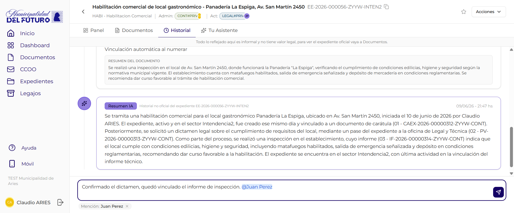
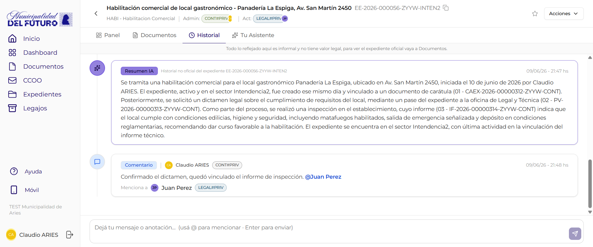

# Historial

La pestaña **Historial** muestra la actividad del expediente como una **línea de tiempo** de eventos (caratulación, vinculaciones, pases, asignaciones, propuestas, resúmenes de IA) y, al pie, un **chat de comentarios** con menciones para anotar y comunicarse de forma informal con el equipo.

!!! warning "Información no oficial"
    Arriba de la pestaña hay un banner que aclara: *"Todo lo reflejado aquí es informal y no tiene valor legal, para ver el expediente oficial vaya a Documentos."* El historial y el chat sirven como apoyo de trabajo y trazabilidad, pero **no constituyen un registro legal** del expediente.

!!! video "Video tutorial"
    **GDI — Comentar y mencionar en el Historial del expediente**

    
<iframe src="https://www.youtube-nocookie.com/embed/ZDhj1pVCldg?list=PLRIZqApsdJ12JCSzhUxaZ73AheVHUEpDq" title="GDI — Comentar y mencionar en el Historial del expediente" loading="lazy" allow="accelerometer; autoplay; clipboard-write; encrypted-media; gyroscope; picture-in-picture; web-share" allowfullscreen></iframe>

---

## Timeline de actividad

El área central muestra los eventos del expediente en **orden cronológico**. Cada evento incluye:

| Elemento | Descripción |
|----------|-------------|
| **Icono de color** | Identifica visualmente el tipo de evento |
| **Badge de tipo** | Etiqueta con el tipo de evento (ej: *Vinculación*, *Pase*, *Comentario*) |
| **Avatar y nombre** | Usuario que generó el evento, con su foto o iniciales |
| **Badge de sector** | Sector del usuario (ej: `LEGAL#PRIV`) |
| **Hora** | Momento en que se registró el evento |
| **Tarjeta de detalle** | Algunos eventos suman una tarjeta con información ampliada (resumen del documento, motivo del pase, etc.) |

### Tipos de evento

| Tipo | Que representa |
|------|----------------|
| **Caratulación** | Creación del expediente (primer evento de la línea de tiempo) |
| **Vinculación** | Se vinculó un documento al expediente. Incluye una tarjeta **"RESUMEN DEL DOCUMENTO"** |
| **Vinculación automática al numerar** | El documento se vinculó solo al obtener su número oficial |
| **Pase** | Movimiento del expediente hacia un sector. Muestra el estado (ej: *En curso*) |
| **Asignación de responsable** | Se designó o cambio un responsable del expediente |
| **Propuesta** | Se propuso la vinculación de un documento, pendiente de aceptación |
| **Resumen IA** | Resumen del expediente generado por inteligencia artificial (ver abajo) |
| **Comentario** | Anotación informal cargada desde el chat (ver [Chat de comentarios](#chat-de-comentarios)) |

### Resumen IA

Periódicamente el sistema genera un **resumen automático** del expediente con inteligencia artificial. Aparece en la timeline como una **tarjeta dorada** titulada *"Historial no oficial del expediente &lt;número&gt;"*, con el contenido sintetizado del estado y la evolución del trámite.

!!! info "Resumen no oficial"
    El resumen generado por IA es un apoyo informativo. No constituye un documento oficial ni reemplaza la lectura de los documentos del expediente.

---

## Chat de comentarios

Al pie del historial hay un **campo de mensaje** para dejar comentarios y anotaciones informales. Cada comentario publicado queda en la timeline como un evento de tipo **Comentario**, con tu avatar, nombre, sector y hora.

| Elemento | Descripción |
|----------|-------------|
| **Campo de mensaje** | Cuadro de texto con el placeholder *"Deja tu mensaje o anotación… (usa @ para mencionar · Enter para enviar)"* |
| **Botón "Publicar"** | Envía el comentario al historial. También podés enviar con **Enter** |

### Cómo dejar un comentario

1. Escribí tu mensaje en el campo de la parte inferior.
2. Presiona **Enter** o el botón **"Publicar"**.
3. El comentario aparece de inmediato en la timeline con el badge **"Comentario"**.

---

## Menciones con @

Dentro de un comentario podés **mencionar** a otra persona para vincularla y notificarla.

### Cómo mencionar a alguien

1. En el campo de mensaje, escribí **`@`** seguido del nombre de la persona.
2. Aparece un **autocompletado** con personas (avatar, nombre y badge de sector).
3. Elegí una de la lista: la mención se inserta en el texto y aparece un chip **"Mención: &lt;Nombre&gt;"** sobre el campo.
4. Si te equivocaste, presiona **"Quitar mención"** en el chip para removerla.
5. Publica el comentario.

### Cómo se ve el comentario publicado

El comentario ya publicado muestra:

| Elemento | Descripción |
|----------|-------------|
| **Badge "Comentario"** | Identifica el evento como una anotación del chat |
| **Texto con la mención resaltada** | El `@Nombre` aparece destacado dentro del mensaje |
| **Línea "Menciona a..."** | Debajo del texto, una línea *"Menciona a &lt;avatar&gt; Nombre &lt;sector&gt;"* con la persona mencionada |

!!! info "La persona mencionada queda vinculada"
    Al mencionar a alguien, esa persona queda **notificada y vinculada** al comentario. Por ejemplo, en el expediente *"Habilitación comercial - Panadería La Espiga"*, Claudio menciona a **Juan Pérez (LEGAL#PRIV)**: el comentario muestra la mención resaltada y la línea *"Menciona a Juan Pérez"*.

---

## Preguntas frecuentes

??? question "Cómo creo una actuación interna o una transferencia?"
    Ya no se crean desde el Historial. Se hacen desde la pestaña **Panel**, con el modal **"Nueva Tarea / Asignación"**. Ver [Detalle del Expediente](detalle-expediente.md).

??? question "El historial es un registro oficial?"
    No. El banner en la parte superior aclara que todo lo reflejado ahí es **informal y no tiene valor legal**. Para el expediente oficial, anda a la pestaña **Documentos**.

??? question "Cómo menciono a una persona en un comentario?"
    Escribí **`@`** seguido del nombre en el campo de mensaje, elegí a la persona del autocompletado y publica. Quedará resaltada en el texto y notificada.

??? question "Puedo quitar una mención antes de publicar?"
    Sí. Mientras redactás, el chip **"Mención: &lt;Nombre&gt;"** tiene un botón **"Quitar mención"** para removerla.

??? question "Cómo envío un comentario rápido?"
    Escribí el mensaje y presioná **Enter**, o usá el botón **"Publicar"**.

??? question "Qué es la tarjeta dorada del expediente?"
    Es el **Resumen IA**: un resumen no oficial del expediente generado por inteligencia artificial, titulado *"Historial no oficial del expediente &lt;número&gt;"*. Es un apoyo informativo, no reemplaza los documentos oficiales.

??? question "Qué tipos de eventos veo en la timeline?"
    Caratulación, Vinculación (con resumen del documento), Vinculación automática al numerar, Pase, Asignación de responsable, Propuesta, Resumen IA y Comentario.
