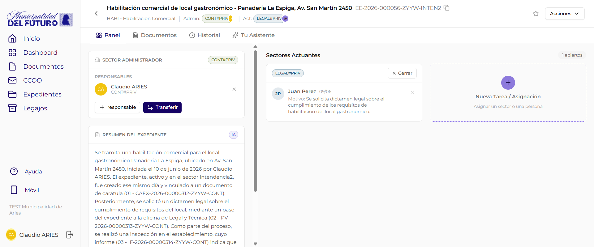
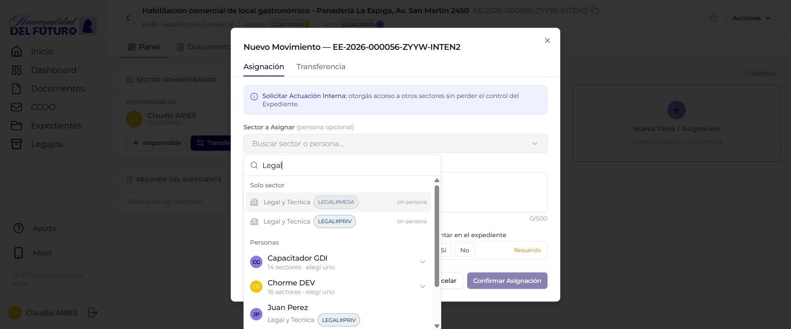

# Panel del Expediente

La pestaña **Panel** es la vista de gestión del expediente y la **pestaña por defecto** al abrirlo. Concentra quien controla el expediente (sector administrador y responsables), un resumen generado por IA, y que sectores están actuando sobre el. Se organiza en dos columnas.

!!! info "Panel, Documentos, Historial y Tu Asistente"
    El detalle del expediente tiene cuatro pestañas: **Panel**, **Documentos**, **Historial** y **Tu Asistente**. El Panel es la que se muestra activa al abrir el expediente. Para el header y la vista general ver [Detalle del Expediente](detalle-expediente.md); para la línea de tiempo y los comentarios ver [Historial](movimientos.md).

!!! video "Video tutorial"
    **GDI — Asignar responsable a un expediente**

    
<iframe src="https://www.youtube-nocookie.com/embed/xQ_BP0zBcI0?list=PLRIZqApsdJ12JCSzhUxaZ73AheVHUEpDq" title="GDI — Asignar responsable a un expediente" loading="lazy" allow="accelerometer; autoplay; clipboard-write; encrypted-media; gyroscope; picture-in-picture; web-share" allowfullscreen></iframe>

    **GDI — Solicitar una actuación a otro sector**

    
<iframe src="https://www.youtube-nocookie.com/embed/UqAhKlIrjOI?list=PLRIZqApsdJ12JCSzhUxaZ73AheVHUEpDq" title="GDI — Solicitar una actuacion a otro sector" loading="lazy" allow="accelerometer; autoplay; clipboard-write; encrypted-media; gyroscope; picture-in-picture; web-share" allowfullscreen></iframe>

    **GDI — Solicitar una actuación a una persona**

    
<iframe src="https://www.youtube-nocookie.com/embed/MURbMmn_r60?list=PLRIZqApsdJ12JCSzhUxaZ73AheVHUEpDq" title="GDI — Solicitar una actuacion a una persona" loading="lazy" allow="accelerometer; autoplay; clipboard-write; encrypted-media; gyroscope; picture-in-picture; web-share" allowfullscreen></iframe>

    **GDI — Transferir un expediente a otro sector**

    
<iframe src="https://www.youtube-nocookie.com/embed/1uHUB-X70xU?list=PLRIZqApsdJ12JCSzhUxaZ73AheVHUEpDq" title="GDI — Transferir un expediente a otro sector" loading="lazy" allow="accelerometer; autoplay; clipboard-write; encrypted-media; gyroscope; picture-in-picture; web-share" allowfullscreen></iframe>

    **GDI — Finalizar una actuación en el expediente**

    
<iframe src="https://www.youtube-nocookie.com/embed/3a68UvifAW4?list=PLRIZqApsdJ12JCSzhUxaZ73AheVHUEpDq" title="GDI — Finalizar una actuacion en el expediente" loading="lazy" allow="accelerometer; autoplay; clipboard-write; encrypted-media; gyroscope; picture-in-picture; web-share" allowfullscreen></iframe>

---

## Columna izquierda: administración y responsables

### Sector Administrador

La tarjeta **"SECTOR ADMINISTRADOR"** muestra el badge del sector que controla el expediente (por ejemplo `CONT#PRIV`). Es el área organizacional responsable del expediente.

### Responsables

Debajo, la sección **"RESPONSABLES"** lista cada responsable asignado:

| Elemento | Descripción |
|----------|-------------|
| **Avatar y nombre** | Foto o iniciales del responsable, su nombre y su sector |
| **Botón "Quitar responsable" (X)** | Quita al responsable de la lista |
| **"Sin responsables asignados."** | Mensaje que aparece cuando no hay ningún responsable |
| **Botón "+ responsable"** | Abre el modal para agregar un responsable administrador |
| **Botón "Transferir"** | Cede el control administrativo del expediente a otro sector |

!!! note "Responsable administrador y responsables adicionales"
    El expediente puede tener un **responsable administrador** principal y **responsables adicionales**. El responsable administrador solo puede elegirse entre los usuarios del **sector administrador** del expediente.

#### Modal "Agregar responsable administrador"

El botón **"+ responsable"** abre el modal titulado **"Agregar responsable administrador - Busca y elegí la persona"**. El buscador solo muestra usuarios pertenecientes al sector administrador. Al elegir una persona y confirmar, queda registrada como responsable.

### Resumen del expediente (IA)

La tarjeta **"RESUMEN DEL EXPEDIENTE"**, identificada con el badge **"IA"**, muestra un resumen generado automáticamente por inteligencia artificial a partir de los documentos y movimientos del expediente. Si todavía no se generó, muestra el mensaje **"Todavía no hay resumen."**.

!!! info "Resumen no oficial"
    El resumen generado por IA es un apoyo informativo. No constituye un documento oficial ni reemplaza la lectura de los documentos del expediente.

---

## Columna derecha: Sectores Actuantes

La columna **"Sectores Actuantes"** lista los sectores que tienen acceso para actuar sobre el expediente sin controlarlo. Un contador en el encabezado indica cuántos hay (por ejemplo **"1 abiertos"**).

Cada sector actuante se muestra como una tarjeta con:

| Elemento | Descripción |
|----------|-------------|
| **Badge del sector** | Sigla del sector actuante (por ejemplo `LEGAL#PRIV`) |
| **Persona asignada** | Avatar, nombre y fecha de la persona a cargo de la tarea |
| **Motivo** | Texto de la solicitud (`Motivo: ...`) |
| **Botón "Reasignar responsable"** | Cambia la persona asignada dentro del sector actuante |
| **Botón "Cerrar tarea"** | Cierra la tarea de ese sector actuante |
| **Botón "Cerrar"** | Cierra el sector actuante |

Debajo de las tarjetas hay una caja punteada **"Nueva Tarea / Asignación — Asignar un sector o una persona"** con un botón **+** que abre el modal de nuevo movimiento.

!!! info "El Panel es la fuente de verdad"
    Las **caritas** (avatares) que se ven en el encabezado del expediente y en el listado de expedientes son un espejo de lo que muestra el Panel: los responsables administradores más las personas a cargo de las **tareas abiertas** de los sectores actuantes. Si una carita no aparece donde esperabas, lo que vale es lo que dice el Panel.

### Finalizados

Cuando un sector actuante se cierra, su tarjeta **no desaparece**: baja a la línea de tiempo **"Finalizados"**, al pie de la columna. Esa línea de tiempo reune, en orden cronológico:

- los **sectores actuantes cerrados** (con el nombre de la repartición y las caras de las personas que actuaron),
- las **transferencias** de control entre sectores,
- y la **creación del expediente** como primer hito.

Es de solo consulta: sirve para reconstruir de un vistazo por donde paso el expediente y quien actuó en cada etapa.

---

## Nueva Tarea / Asignación

El botón **"Nueva Tarea / Asignación"** (la caja punteada de la columna Sectores Actuantes, o la opción **"Nuevo Movimiento"** del menú Acciones) abre el modal **"Nuevo Movimiento — &lt;número&gt;"**, con dos pestañas: **Asignación** y **Transferencia**.

### Asignación

Solicita una **Actuación Interna**: otorgas acceso a otros sectores **sin perder el control** del Expediente. El sector asignado puede consultar los documentos y realizar las tareas solicitadas, pero el sector administrador mantiene la responsabilidad.

| Campo | Tipo | Descripción |
|-------|------|-------------|
| **Sector a Asignar (persona opcional)** | Combobox con búsqueda | Al escribir 2 o más caracteres busca y agrupa los resultados en **"Solo sector"** y **"Personas"**. Si se elige una persona, se muestran sus sectores para seleccionar uno |
| **Motivo (min. 5 caracteres)** | Textarea | Descripción de lo que se solicita. Muestra un contador `/500` |
| **Sector Solicitante** | Texto fijo | El sector del usuario que realiza la solicitud. No es editable |
| **Asentar en el expediente** | Sí / No | Si es **Sí**, genera una providencia de pase (PV) que queda registrada en la pestaña Documentos |

| Botón | Acción |
|-------|--------|
| **Cancelar** | Cierra el modal sin crear la asignación |
| **Confirmar Asignación** | Crea la actuación interna y otorga el acceso al sector o persona elegida |

!!! info "Asignar otorga acceso, no cede el control"
    Una asignación suma al sector o persona como **actuante**: obtiene acceso para consultar y actuar sobre el expediente, pero el control administrativo sigue en el sector administrador.

### Transferencia

La pestaña **Transferencia** **cede el control administrativo** del expediente a otro sector, igual que la transferencia clásica. A diferencia de la asignación, el sector que transfiere pierde el rol de administrador y el sector destino pasa a ser el nuevo administrador.

!!! warning "La transferencia cambia el administrador"
    Al transferir, el sector de origen pierde el control administrativo. Solo el nuevo sector administrador podrá volver a transferir el expediente o gestionarlo.

---

## Preguntas frecuentes

??? question "Cuál es la diferencia entre asignación y transferencia?"
    La **asignación** (actuación interna) otorga acceso a otro sector o persona sin perder el control: el sector administrador sigue siendo el mismo. La **transferencia** cede el control administrativo al sector destino, que pasa a ser el nuevo administrador.

??? question "Quién puede ser responsable administrador?"
    El responsable administrador solo puede elegirse entre los usuarios del **sector administrador** del expediente. Se asigna desde el modal "Agregar responsable administrador" en la pestaña Panel.

??? question "Qué es el badge IA en la tarjeta de resumen?"
    Indica que el resumen del expediente fue generado automáticamente por inteligencia artificial a partir de sus documentos y movimientos. Si aún no se generó, muestra "Todavía no hay resumen.".

??? question "Qué significa el contador 'N abiertos' en Sectores Actuantes?"
    Es la cantidad de sectores actuantes activos sobre el expediente, es decir, los sectores a los que se les otorgó acceso mediante una asignación y que todavía no fueron cerrados.

??? question "Una asignación genera algún documento en el expediente?"
    Si el campo **"Asentar en el expediente"** queda en **Sí**, la asignación genera una providencia de pase (PV) que queda registrada en la pestaña Documentos.
