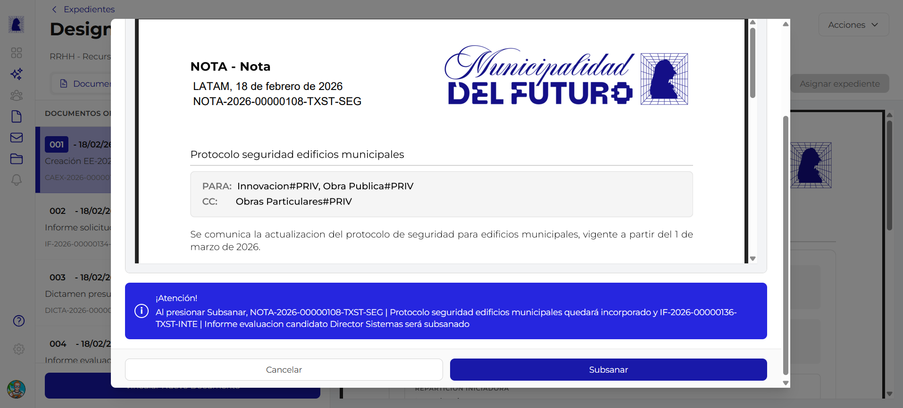
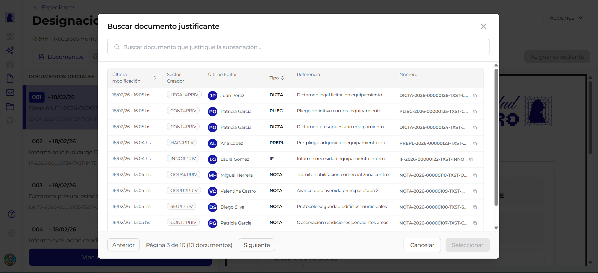

# Subsanar en Expediente

**Subsanar** un documento dentro de un expediente significa reemplazarlo por otro documento que corrige o actualiza la información. El documento original queda marcado como subsanado y se incorpora el nuevo documento justificante en su lugar. Este proceso permite corregir errores sin eliminar el registro histórico.

!!! video "Video tutorial"
    **GDI Latam #9 — Subsanar documentos en un expediente**

    
<iframe src="https://www.youtube-nocookie.com/embed/jtHGK2Ic84E?list=PLRIZqApsdJ12JCSzhUxaZ73AheVHUEpDq" title="GDI Latam #9 — Subsanar documentos en un expediente" loading="lazy" allow="accelerometer; autoplay; clipboard-write; encrypted-media; gyroscope; picture-in-picture; web-share" allowfullscreen></iframe>

---

## Cómo iniciar

1. Abrir el detalle del expediente
2. En la esquina superior derecha, hacer click en el botón **"Acciones"**
3. Seleccionar la opción **"Subsanar"** del menú desplegable

Se abre un proceso guiado de dos pasos.

---

## Paso 1: Seleccionar documento a subsanar

Se muestra un modal con el título **"Subsanar documento"** y el subtítulo *"Selecciona el documento a subsanar"*.

### Buscador

En la parte superior hay un campo de búsqueda con el placeholder *"Buscar documento..."*. Permite filtrar los documentos del expediente por referencia o número.

### Lista de documentos

Se muestran los documentos del expediente con la siguiente información:

| Columna | Descripción | Ejemplo |
|---------|-------------|---------|
| **Número de orden** | Posición del documento dentro del expediente | `004` |
| **Fecha** | Fecha de incorporación | `18/02/26` |
| **Referencia** | Título descriptivo del documento | *Informe evaluación candidato Director Sistemas* |
| **Número oficial** | Identificador único del documento | `IF-2026-00000136-TXST-INTE` |

### Selección

Al hacer click en un documento, se resalta con un borde azul y un icono de check, indicando que fue seleccionado.

### Botones

| Botón | Acción |
|-------|--------|
| **Cancelar** | Cierra el modal sin realizar cambios |
| **Siguiente** | Avanza al paso 2 con el documento seleccionado. Se habilita al seleccionar un documento |

---

## Paso 2: Seleccionar documento justificante

Se muestra un segundo modal con el título **"Buscar documento justificante"**. El documento justificante es el que reemplazará al documento subsanado dentro del expediente.

### Buscador

Campo de búsqueda con el placeholder *"Buscar documento que justifique la subsanación..."*. Permite buscar por **número o referencia** (no por el contenido del documento).

### Tabla de resultados

Los documentos disponibles se muestran en una tabla paginada con las siguientes columnas:

| Columna | Descripción |
|---------|-------------|
| **Última modificación** | Fecha de la última edición del documento |
| **Sector Creador** | Sector que creó el documento, mostrado como badge |
| **Último Editor** | Avatar y nombre del último editor |
| **Tipo** | Sigla del tipo de documento |
| **Referencia** | Título descriptivo |
| **Número** | Número oficial del documento |

### Paginación

La tabla muestra 10 documentos por página con botones **"Anterior"** y **"Siguiente"** y el indicador de página actual (ej: *"Página 3 de 10 (10 documentos)"*).

### Botones

| Botón | Acción |
|-------|--------|
| **Cancelar** | Cierra el modal sin realizar cambios |
| **Seleccionar** | Confirma la selección del documento justificante y ejecuta la subsanación |

---

## Resultado de la subsanación

Al completar los dos pasos:

- El **documento original** queda marcado como **subsanado** dentro del expediente. No se elimina, pero se identifica visualmente como reemplazado.
- El **documento justificante** se incorpora al expediente como nuevo documento oficial, recibiendo un número de orden.
- El historial del expediente registra la operación de subsanación con la relación entre ambos documentos.

---

## Reglas de negocio

!!! abstract "Resumen de reglas"

    1. Solo el **sector administrador** del expediente puede ejecutar una subsanación
    2. El documento a subsanar debe ser un **documento oficial** ya incorporado al expediente
    3. El documento justificante debe estar **firmado** (no se puede usar un documento en borrador o en proceso de firma)
    4. El documento original **no se elimina**: queda en el expediente con la marca de subsanado para preservar el registro histórico
    5. La subsanación queda registrada en el **historial de movimientos** del expediente

---

## Preguntas frecuentes

??? question "Qué significa subsanar un documento?"
    Subsanar es el acto de corregir o reemplazar un documento dentro de un expediente. El documento original permanece visible (marcado como subsanado) y el nuevo documento justificante ocupa su función.

??? question "El documento subsanado se borra del expediente?"
    No. El documento original permanece en el expediente pero queda identificado como subsanado. Esto garantiza la trazabilidad y el registro histórico completo.

??? question "Puedo subsanar la carátula del expediente (CAEX)?"
    No. La carátula es un documento autogenerado por el sistema y no puede ser subsanada.

??? question "Puedo usar como justificante un documento que ya está en el expediente?"
    No. El documento justificante debe ser un documento externo al expediente que se incorporará como nuevo documento oficial.

??? question "Quién puede ver que un documento fue subsanado?"
    Cualquier usuario con acceso al expediente puede ver la marca de subsanación y la relación entre el documento original y el justificante.
