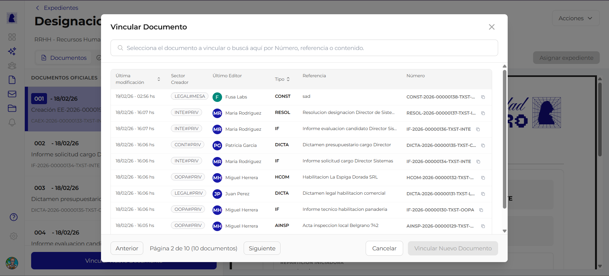
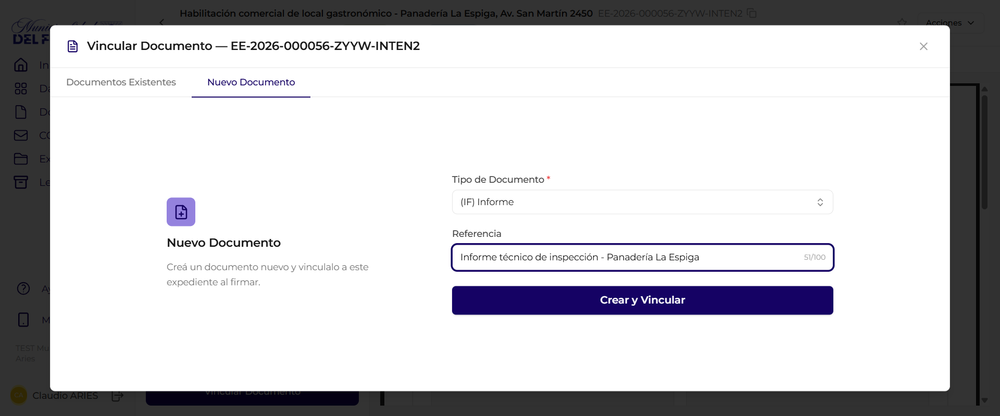
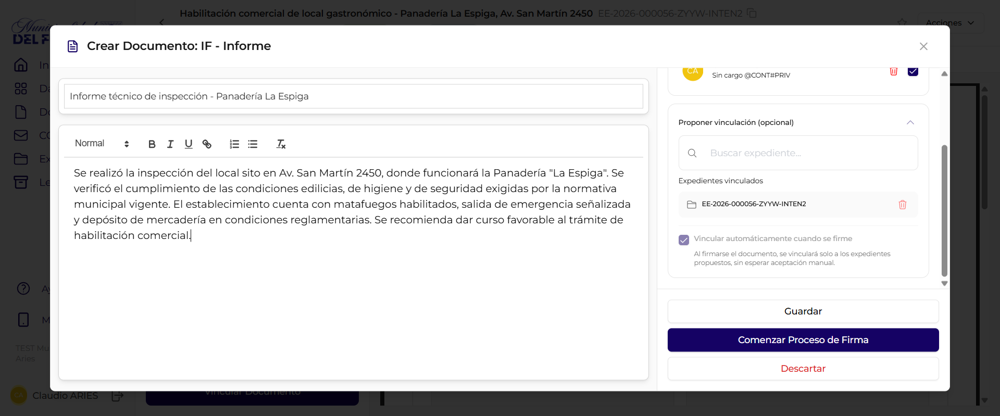
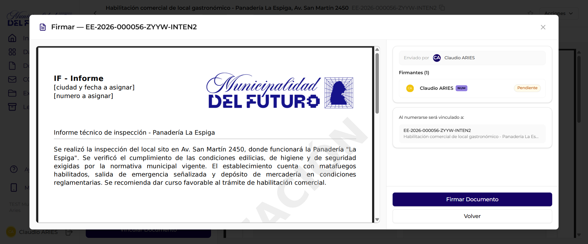
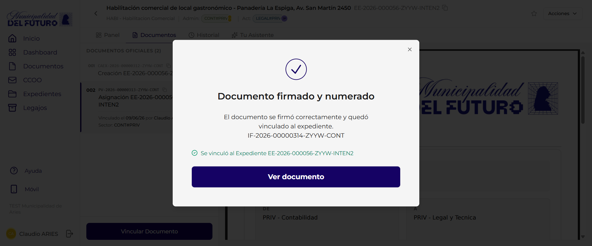
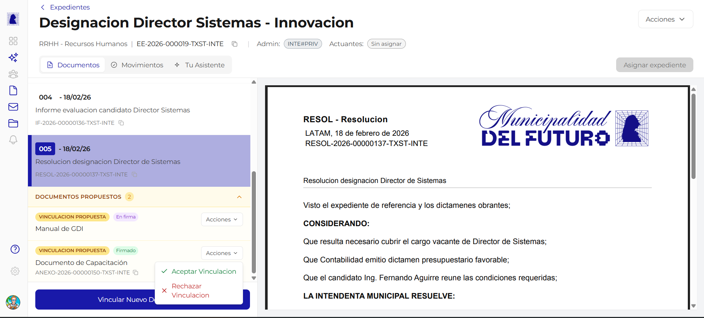
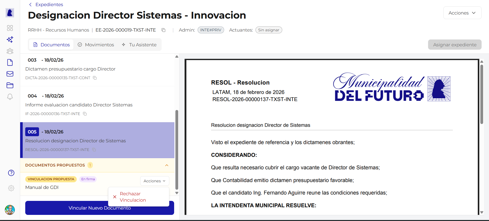

# Vincular Documentos

Vincular un documento a un expediente significa incorporarlo como parte oficial del trámite. Solo los documentos firmados pueden quedar vinculados de forma definitiva. Esta página describe el proceso completo: vincular un documento ya existente o crear uno nuevo que se vincule automáticamente al firmarse, confirmar la vinculación, y gestionar las propuestas pendientes.

!!! video "Video tutorial"
    **GDI — Vincular un documento existente a un expediente**

    
<iframe src="https://www.youtube-nocookie.com/embed/11BY6OkI9BU?list=PLRIZqApsdJ12JCSzhUxaZ73AheVHUEpDq" title="GDI — Vincular un documento existente a un expediente" loading="lazy" allow="accelerometer; autoplay; clipboard-write; encrypted-media; gyroscope; picture-in-picture; web-share" allowfullscreen></iframe>

    **GDI — Crear y vincular un documento nuevo al firmar**

    
<iframe src="https://www.youtube-nocookie.com/embed/1vnJknK57MA?list=PLRIZqApsdJ12JCSzhUxaZ73AheVHUEpDq" title="GDI — Crear y vincular un documento nuevo al firmar" loading="lazy" allow="accelerometer; autoplay; clipboard-write; encrypted-media; gyroscope; picture-in-picture; web-share" allowfullscreen></iframe>

---

## Iniciar la vinculación

Hay dos formas de abrir el mismo modal:

- Desde la pestaña **Documentos** del detalle del expediente, con el botón **"Vincular Documento"** ubicado en la parte inferior de la lista de documentos.
- Desde el menú **Acciones** del encabezado del expediente, con la opción **"Vincular Documentos"**.

En ambos casos el sistema primero verifica los permisos (muestra *"Verificando permisos..."* un instante). Si el usuario no tiene permiso de edición en los sectores asociados al expediente, en lugar del modal aparece el aviso **"Sin permisos para actuar sobre este expediente"**.

Se abre el modal **"Vincular Documento — <numero>"**, que tiene dos pestañas:

- **Documentos Existentes**: el flujo clásico de buscar y seleccionar un documento ya firmado para vincularlo.
- **Nuevo Documento**: crear un documento nuevo y vincularlo a este expediente al firmarse (vinculación automática).

!!! info "Dos formas de vincular"
    Usa **Documentos Existentes** cuando el documento ya está creado (y normalmente firmado). Usa **Nuevo Documento** cuando todavía no existe y querés que se incorpore solo al expediente en el momento en que se firme.

---

## Modal "Vincular Documento" — pestaña Documentos Existentes

La pestaña **Documentos Existentes** permite buscar y seleccionar un documento existente para vincularlo al expediente.

### Buscador

En la parte superior del modal hay un campo de búsqueda con el texto guía: *"Selecciona el documento a vincular o busca por número o referencia."* Se puede buscar por:

- Número oficial del documento (ej: `IF-2026-00000134`)
- Referencia o título del documento

!!! info "Qué documentos se listan"
    - Sin escribir nada, la tabla lista los documentos **firmados del sector del usuario**. Los borradores y los documentos en proceso de firma no aparecen: no se pueden vincular.
    - Si el texto ingresado tiene forma de **número oficial**, la búsqueda se hace en **todo el sistema** y el resultado se marca con una etiqueta **"Global"** u **"Oficial"**. Es la forma de vincular un documento de otro sector.
    - Si el expediente **no** es reservado, los documentos reservados quedan excluidos de la búsqueda.

### Tabla de resultados

Los documentos se muestran en una tabla paginada con las siguientes columnas:

| Columna | Descripción |
|---------|-------------|
| **Última modificación** | Fecha de la última edición del documento |
| **Sector Creador** | Sector que creó el documento, mostrado como badge de color |
| **Último Editor** | Avatar y nombre del usuario que editó por última vez |
| **Tipo** | Sigla del tipo de documento (ej: CONST, RESOL, IF, DICTA) |
| **Referencia** | Título descriptivo del documento |
| **Número** | Número oficial del documento, con botón para copiar |

### Paginación

La tabla muestra 10 documentos por página. En la parte inferior se indica la página actual y el total (ej: *"Página 2 de 10 (10 documentos)"*) con botones **"Anterior"** y **"Siguiente"** para navegar.

### Botones del modal

| Botón | Acción |
|-------|--------|
| **Cancelar** | Cierra el modal sin vincular nada |
| **Continuar** | Pasa al segundo paso (vista previa y confirmación). Solo se habilita con un documento seleccionado |

La selección es **de a un documento por vez**: al elegir una fila, sobre los botones aparece la tarjeta *"Seleccionado: <numero> - <referencia>"*.

---

## Segundo paso: vista previa y confirmación

Al presionar **"Continuar"** el modal cambia de paso (no se abre una ventana nueva) y muestra:

| Elemento | Descripción |
|----------|-------------|
| **Vista previa PDF** | Preview del documento seleccionado con su membrete y contenido |
| **Panel lateral** | Documento seleccionado, sector creador y resumen automático del documento |
| **Aviso de confirmación** | Cartel azul **"Atención"**: *"Al presionar Vincular, el documento <numero> será vinculado al Expediente."* |

### Botones del paso de confirmación

| Botón | Acción |
|-------|--------|
| **Volver** | Regresa al buscador sin vincular |
| **Vincular** | Confirma la vinculación del documento al expediente |

!!! info "Vinculación como propuesta"
    Si el usuario que vincula no es el administrador del expediente, el documento queda como **propuesta de vinculación** pendiente de aceptación. Si el usuario es el administrador, el documento se incorpora directamente como documento oficial. La decisión la toma el sistema al confirmar: el modal es el mismo en los dos casos.

---

## Crear y vincular un documento nuevo (vinculación automática)

Además de vincular documentos ya existentes, podés crear un documento nuevo directamente desde el expediente y dejarlo configurado para que **se vincule solo en el momento en que se firme**, sin tener que esperar la aceptación manual de una propuesta.

### 1. Pestaña "Nuevo Documento" del modal

En el modal **"Vincular Documento — <numero>"**, abrir la pestaña **"Nuevo Documento"**. El texto guía indica: *"Crea un documento nuevo y vinculalo a este expediente al firmar."* Completar los campos:

| Campo | Descripción |
|-------|-------------|
| **Tipo de Documento** | Obligatorio. Buscador que filtra por nombre o sigla del tipo (ej: IF, RESOL, NOTA) |
| **Referencia** | Título descriptivo del documento a crear |

Presionar **"Crear y Vincular"**. El sistema abre el editor del documento ya con el expediente cargado como destino de la vinculación.

### 2. Editor del documento: "Proponer vinculación (opcional)"

En el editor (título **"Crear Documento: TIPO - Nombre"**), además de redactar el contenido, vas a ver la sección **"Proponer vinculación"**, que muestra:

- **Expedientes vinculados: <numero>** — el expediente desde el que se inició la creación.
- Un checkbox **"Vincular automáticamente cuando se firme"**, **tildado**, con la nota: *"Al firmarse el documento, se vinculará solo a los expedientes propuestos, sin esperar aceptación manual."*

Más abajo se configuran los **Firmantes** y, cuando todo está listo, se presiona **"Comenzar Proceso de Firma"**.

!!! warning "En este flujo la vinculación automática no se puede desactivar"
    Cuando el documento se crea **desde el expediente** (pestaña "Nuevo Documento"), el panel de vinculación queda **bloqueado**: el expediente de origen no se puede quitar ni se pueden agregar otros, y el checkbox **"Vincular automáticamente cuando se firme"** queda fijo en tildado. Es lógico: la finalidad de este flujo es justamente que el documento se incorpore al expediente al firmarse.

    Para elegir entre vinculación automática y propuesta pendiente hay que crear el documento por el camino normal (**Documentos › Crear documento**): ahí la sección "Proponer vinculación" es editable y el checkbox se puede destildar. Destildado, al firmarse el documento queda como **propuesta de vinculación** que el administrador del expediente debe aceptar.

### 3. Confirmación en el paso de firma

En el modal **"Firmar — <numero>"**, antes de confirmar la firma, el sistema avisa el destino de la vinculación automática con el texto: *"Al numerarse será vinculado a: <numero> <titulo del expediente>"*.

### 4. Resultado: documento firmado y vinculado

Al firmar, aparece la confirmación **"Documento firmado y numerado — El documento se firmó correctamente y quedó vinculado al expediente."**, con el número asignado al documento y la leyenda *"Se vinculó al Expediente <numero>"*.

El documento queda **directamente como documento oficial** del expediente, sin pasar por la sección "DOCUMENTOS PROPUESTOS" ni requerir aceptación manual.

!!! note "Diferencia clave con la vinculación clásica"
    Con la **vinculación automática** el documento se incorpora solo al firmarse. El flujo clásico —queda como propuesta que el administrador del expediente acepta o rechaza— es el que se da cuando el documento se crea por fuera del expediente y se destilda el checkbox, o cuando se vincula un documento existente sin ser administrador.

---

## Vinculaciones propuestas

Los documentos cuya vinculación fue propuesta (pero aún no aceptada) aparecen en una sección desplegable al final de la lista de documentos, dentro de la pestaña Documentos del expediente, con el título **"Vinculaciones Propuestas (N)"**.

Cada documento propuesto muestra:

| Elemento | Descripción |
|----------|-------------|
| **Badge "Vinculación Propuesta"** | Etiqueta que identifica al documento como pendiente de aceptación |
| **Estado de firma** | Badge con el estado del documento: "Borrador", "En firma", "Firmado", "Rechazado" o "Cancelado" |
| **Menú "Acciones"** | Desplegable con las opciones disponibles |

Al seleccionar una propuesta, el panel derecho del expediente muestra su contenido (el PDF si ya está firmado, o el borrador si todavía no), junto con quien la propuso, la fecha y el resumen del documento.

---

## Aceptar vinculación

Para aceptar la vinculación de un documento propuesto:

1. Ubicar el documento en la sección **"Vinculaciones Propuestas"**
2. Hacer click en el botón **"Acciones"** del documento
3. Seleccionar **"Aceptar Vinculación"** (icono check verde)
4. Confirmar en el mensaje que aparece en la misma fila: *"Se vinculará <referencia> al expediente. Confirmar?"*

El documento se incorpora a la lista de **documentos oficiales** del expediente y recibe un número de orden secuencial.

!!! warning "Solo documentos firmados"
    La opción "Aceptar Vinculación" solo está disponible para documentos con estado **"Firmado"**. Un documento que aún está "En firma" no puede ser aceptado.

---

## Rechazar vinculación

Para rechazar la vinculación de un documento propuesto:

1. Ubicar el documento en la sección **"Vinculaciones Propuestas"**
2. Hacer click en el botón **"Acciones"** del documento
3. Seleccionar **"Rechazar Vinculación"** (icono X rojo)
4. Confirmar en el mensaje que aparece en la misma fila: *"Se descartará la propuesta de <referencia>. Confirmar?"*

El documento se elimina de la lista de propuestos. No se incorpora al expediente.

!!! note "Rechazar documentos en firma"
    A diferencia de la aceptación, la opción de rechazar está disponible **siempre**, tanto para documentos "En firma" como para documentos "Firmados".

---

## Reglas de negocio

!!! abstract "Resumen de reglas"

    1. Solo el **sector administrador** del expediente puede aceptar o rechazar propuestas de vinculación
    2. Un documento debe estar **completamente firmado** para poder ser aceptado como vinculación oficial
    3. Un documento **en proceso de firma** solo puede ser rechazado, no aceptado
    4. Al aceptar una vinculación, el documento recibe un **número de orden** secuencial dentro del expediente
    5. Rechazar una vinculación **no afecta** al documento original; solo lo quita de la lista de propuestos del expediente
    6. Un mismo documento puede ser propuesto para vinculación en **múltiples expedientes**
    7. Con la **vinculación automática** (checkbox tildado al crear el documento), al firmarse el documento se incorpora directo como oficial, sin pasar por "Vinculaciones Propuestas" ni requerir aceptación manual
    8. Desde el modal solo se pueden vincular documentos **firmados**; para traer uno de otro sector hay que buscarlo por su **número oficial**

---

## Preguntas frecuentes

??? question "Cuál es la diferencia entre vincular un documento existente y crear uno nuevo?"
    En la pestaña **Documentos Existentes** seleccionas un documento que ya fue creado (normalmente firmado) y lo vinculás. En la pestaña **Nuevo Documento** creas el documento desde cero y el sistema te lleva al editor con el expediente ya cargado para que se vincule al firmarse.

??? question "Qué significa el checkbox 'Vincular automáticamente cuando se firme'?"
    Tildado, el documento se incorpora solo al expediente en el momento de firmarse, sin esperar la aceptación de una propuesta. Destildado, el documento queda como propuesta de vinculación que el administrador del expediente debe aceptar manualmente.

??? question "Por qué no puedo destildar el checkbox de vinculación automática?"
    Porque el documento se está creando **desde el expediente**: en ese flujo el destino ya está definido y el panel de vinculación queda bloqueado. Si necesitás dejarlo como propuesta pendiente, crea el documento desde **Documentos › Crear documento** y elegí ahí el expediente.

??? question "Si uso la vinculación automática, el documento queda en 'Vinculaciones Propuestas'?"
    No. Con el checkbox tildado, al firmarse el documento queda directamente como documento oficial del expediente. Solo aparece en "Vinculaciones Propuestas" si se deja la vinculación como propuesta pendiente.

??? question "Por qué no encuentro en el buscador un documento que existe?"
    Tres motivos posibles: todavía no está **firmado** (los borradores y los documentos en firma no se listan), es de **otro sector** (hay que buscarlo por su número oficial completo) o es un documento **reservado** y el expediente no lo es.
