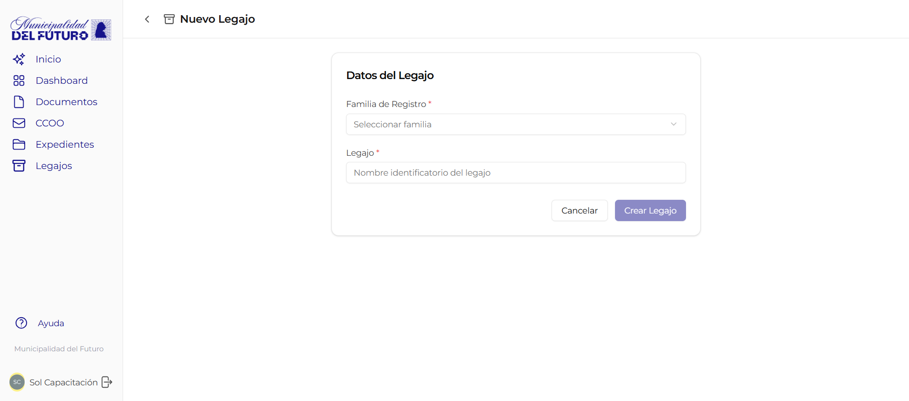
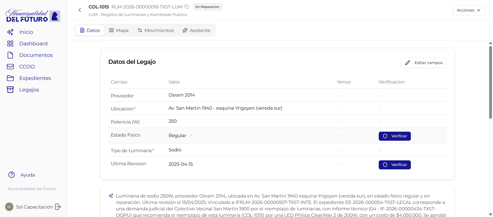

# Crear y editar legajo

Esta página explica cómo crear un legajo nuevo, completar sus campos, cambiar su estado y generar informes IFRLM.

---

## Crear un legajo nuevo

### Paso 1: Seleccionar la familia de registro

Desde la pantalla principal de **Legajos**, hace click en el botón **"+ Crear"**. El sistema abre el formulario de nuevo legajo con un selector de familias de registro.

!!! tip "Solo ves las familias que tenés habilitadas"
    El selector muestra únicamente las familias activas en las que tenés permiso `can_create`. Si no aparece la familia que necesitás, contacta al administrador del sistema.

Selecciona la familia que corresponda al tipo de legajo que querés crear (ej: Arquitectura, Luminarias, Ordenanzas).

### Paso 2: Completar el nombre del legajo

El campo **Legajo** es el nombre identificatorio del legajo. Debe ser claro y descriptivo para que cualquier usuario entienda de que se trata.

!!! example "Ejemplos de nombres"
    - `Obra Av. San Martin 1250 - Gonzalez`
    - `Luminaria LED #4521 - Rotonda Belgrano`
    - `Ordenanza 3847/2025 - Uso de suelo zona norte`
    - `Habilitacion - Panaderia Don Carlos - Mitre 890`

### Paso 3: Completar los campos de la familia

Una vez seleccionada la familia, aparecen los campos específicos de esa familia. Los campos pueden ser de distintos tipos:

| Tipo de campo | Ejemplo |
|---------------|---------|
| Texto libre | Nombre del titular, observaciones |
| Número | Superficie en m2, número de medidor |
| Fecha | Fecha de habilitación, fecha de vencimiento |
| Selección | Estado de la obra (en curso, finalizada, paralizada) |
| Archivo adjunto | Plano aprobado, foto del frente |

!!! warning "Campos obligatorios"
    Los campos marcados con asterisco (*) son obligatorios. El sistema valida que estén completos antes de crear el legajo. Si falta algún campo obligatorio, se muestra un mensaje indicando cuáles faltan.

Al confirmar con **"Crear Legajo"**, el sistema asigna automáticamente el **número oficial** con formato `RLM-{ANO}-{SEQ}-{TENANT}-{CODIGO}` y redirige al detalle del legajo recién creado.

---

## Editar campos de un legajo

Para modificar los datos de un legajo existente:

1. Abrí el legajo desde el listado
2. En la pestaña **Datos**, hace click en el campo que querés modificar para editarlo directamente (edición inline), o usa el botón de edición global para modificar varios campos a la vez
3. Ingresa el nuevo valor
4. Guarda los cambios

!!! info "Campos verificados"
    Si un campo ya fue verificado por un verificador, al editarlo se pierde la verificación y el campo vuelve a estado **pendiente de verificación**. Ver [Verificación](verificacion.md).

Todos los cambios quedan registrados en la pestaña **Movimientos** del legajo con fecha, usuario y valor anterior.

---

## Cambiar el estado de un legajo

Desde la vista de detalle del legajo, hace click en el botón **"Acciones"** (arriba a la derecha) y selecciona **"Cambiar Estado"**.

Los estados disponibles dependen de la familia de registro. Podés cambiar de cualquier estado a cualquier otro sin restricciones. El sistema registra cada cambio en el historial con fecha, usuario y motivo.

!!! tip "Motivo del cambio"
    Al cambiar de estado podés agregar un motivo opcional. Es recomendable hacerlo para mantener la trazabilidad del legajo.

---

## Generar informe IFRLM

El **IFRLM (Informe de Registro Legajo Multipropósito)** es una foto del legajo en un momento determinado. Genera un documento oficial con todos los datos del legajo tal como están al momento de emitirlo.

### Cómo generarlo

1. Abrí el legajo del que querés emitir el informe
2. Hace click en **"Acciones"** (arriba a la derecha) y selecciona **"Generar Informe IFRLM"**
3. El sistema crea un documento tipo IFRLM con:
    - Todos los campos del legajo y sus valores actuales
    - Estado de verificación de cada campo
    - Fecha y hora de emisión
    - Número oficial del informe

!!! tip "Usos típicos del IFRLM"
    - Adjuntar a un expediente como constancia del estado actual de un registro
    - Responder un pedido de informe sobre una habilitación vigente
    - Documentar el estado de una obra antes de una inspección

El informe generado queda disponible en la sección **Documentos** y puede vincularse a expedientes como cualquier otro documento oficial.

!!! info "El IFRLM es un snapshot"
    El informe refleja los datos al momento de su emisión. Si los datos del legajo cambian después, el informe no se actualiza. Para obtener datos actualizados, genera un nuevo IFRLM.
