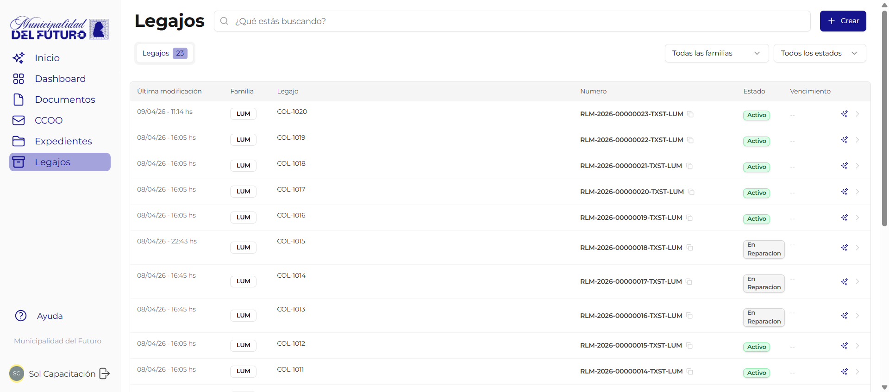

# Legajos (RLM)

El **Registro Legajo Multipropósito (RLM)** es un sistema de legajos digitales que permite organizar, verificar y consultar información estructurada sobre cualquier tema que el municipio necesite registrar.

Un legajo es una ficha digital que agrupa campos de datos verificables sobre un asunto específico. A diferencia de un expediente (que agrupa documentos de un trámite), un legajo agrupa **datos** que se mantienen actualizados a lo largo del tiempo.

---



El listado muestra cada legajo como una **card** con la siguiente información en una sola fila: código de familia, nombre del legajo, estado, número oficial (con botón para copiar), próxima fecha de vencimiento (en amarillo si vence en 30 días o menos) y fecha de última actualización. Si el legajo tiene un resumen generado por IA, aparece en itálica debajo del nombre.

---

## Para qué sirve

| Uso | Ejemplo |
|-----|---------|
| Registrar habilitaciones | Legajo de un comercio con datos del titular, rubro, vencimiento de habilitación |
| Control de obras | Legajo de una obra con datos del profesional, planos aprobados, estado de inspección |
| Inventario de activos | Legajo de una luminaria con ubicación, tipo de lámpara, fecha de instalación |
| Registro normativo | Legajo de una ordenanza con número, fecha de sanción, temática |

---

## Familias de registro

Cada legajo pertenece a una **familia de registro**. La familia define qué tipo de información se registra y que campos están disponibles.

!!! example "Ejemplos de familias"
    - **Arquitectura** -- Legajos de obras, permisos de construcción, planos
    - **Luminarias** -- Legajos de puntos de luz, mantenimiento, recambios
    - **Ordenanzas** -- Legajos de normativa municipal vigente
    - **Habilitaciones Comerciales** -- Legajos de comercios habilitados

La familia determina:

- Que **campos** tiene cada legajo (ej: dirección, responsable, fecha de vencimiento)
- Que **código** se usa en la numeración
- Que **permisos** se requieren para ver, crear, editar o verificar

---

## Numeración oficial

Cada legajo recibe un **número oficial único** al momento de su creación, con el siguiente formato:

```
RLM-{ANO}-{SECUENCIAL}-{TENANT}-{CODIGO}
```

| Parte | Ejemplo | Descripción |
|-------|---------|-------------|
| RLM | `RLM` | Prefijo fijo que identifica un legajo |
| ANO | `2026` | Año de creación |
| SECUENCIAL | `00000042` | Número secuencial único por tenant (8 dígitos) |
| TENANT | `TXST` | Código de la organizacion/tenant |
| CODIGO | `ARQ` | Código de la familia de registro |

Ejemplo completo: `RLM-2026-00000042-TXST-ARQ`

---

## Estados de un legajo

Cada familia de registro define sus propios estados posibles. Los estados más comunes son:

| Estado | Descripción |
|--------|-------------|
| :material-pencil-outline: **Borrador** | El legajo fue creado pero aún no tiene todos los campos obligatorios completos |
| :material-check-circle-outline: **Activo** | El legajo está completo y vigente |
| :material-pause-circle-outline: **Suspendido** | El legajo fue suspendido temporalmente (ej: habilitación observada) |
| :material-archive-outline: **Archivado** | El legajo fue archivado y ya no está en uso activo |

!!! info "Estados personalizables"
    Cada familia puede definir sus propios estados según su necesidad. Por ejemplo, una familia de habilitaciones podría tener: *Ingresado*, *En revisión*, *Aprobado*, *Rechazado*, *Vencido*. Los estados se configuran desde el [BackOffice](../../administradores/familias-registro.md).

!!! info "Quien puede cambiar el estado"
    Solo los usuarios con permiso de edición sobre la familia de registro pueden cambiar el estado de un legajo. No hay restricción de transiciones: cualquier estado puede pasar a cualquier otro. Los cambios de estado quedan registrados en el historial.

---

## Permisos

El acceso a los legajos se gestiona con permisos granulares por familia de registro:

| Permiso | Que permite |
|---------|-------------|
| **Ver** (`can_view`) | Consultar legajos y sus campos |
| **Crear** (`can_create`) | Crear legajos nuevos dentro de la familia |
| **Editar** (`can_edit`) | Modificar campos y cargar datos en los legajos |
| **Verificar** (`can_verify`) | Confirmar datos cargados con documento oficial de respaldo |

!!! warning "Editar no es verificar"
    Un usuario que puede editar no necesariamente puede verificar. La verificación es un paso separado que requiere su propio permiso. Ver [Verificación](verificacion.md) para más detalle.

---

## Pestañas del detalle de legajo

Al abrir un legajo, la vista de detalle tiene cuatro pestañas:

| Pestaña | Contenido |
|---------|-----------|
| **Datos** | Campos del legajo, documentos vinculados, expedientes vinculados, relaciones con otros legajos |
| **Mapa** | Próximamente disponible |
| **Movimientos** | Historial completo de cambios (estados, ediciones, verificaciones, vinculaciones) |
| **Asistente** | Próximamente disponible |

---

## Secciones de esta guía

| Página | Descripción |
|--------|-------------|
| [Crear y editar legajo](crear-legajo.md) | Como crear un legajo nuevo, completar campos, cambiar estado y generar informes |
| [Verificación](verificacion.md) | Workflow de verificación en 2 pasos: carga de datos y confirmación con documento oficial |
| [Relaciones y vínculos](relaciones.md) | Vincular documentos, expedientes y otros legajos. Historial de cambios |
