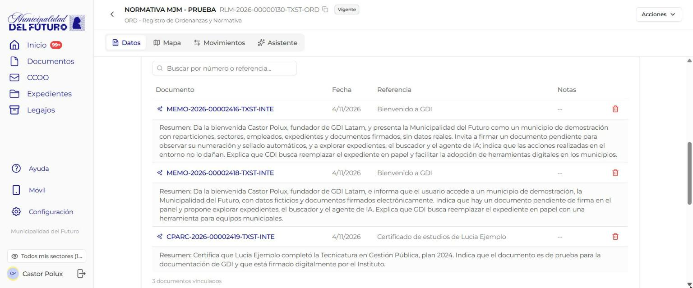
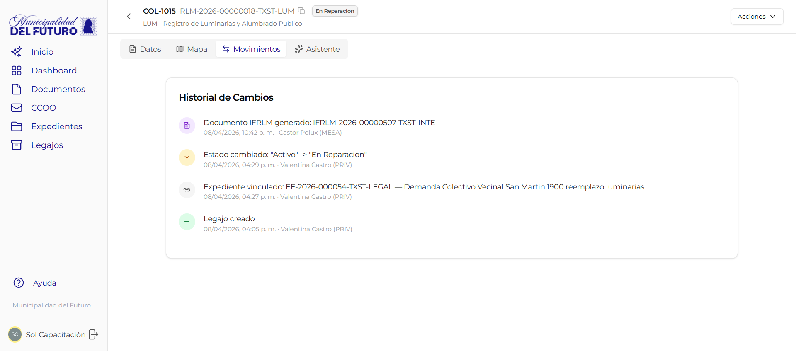

# Relaciones y vínculos

Un legajo no existe aislado. Puede vincularse a **documentos oficiales**, **expedientes** y **otros legajos** para construir una red de información conectada.

---

## Vincular documentos a un legajo

Podés asociar documentos oficiales del sistema a un legajo para respaldar la información registrada o agregar antecedentes.

### Cómo vincular un documento

1. Abrí el legajo
2. Busca la sección **Documentos vinculados**
3. Hace click en **"+ Vincular documento"**
4. Busca el documento por número o referencia
5. Confirma la vinculación

!!! example "Ejemplos de documentos vinculados"
    - Resolución de habilitación vinculada al legajo del comercio
    - Plano aprobado vinculado al legajo de la obra
    - Acta de inspección vinculada al legajo de una luminaria

Los documentos vinculados quedan listados en el legajo con su número oficial, tipo y fecha.

### Buscar entre los documentos vinculados



La tabla de **Documentos vinculados** muestra 20 documentos por página. Debajo de la tabla figura el total, por ejemplo: *"45 documentos vinculados · página 1 de 3"*. Con las flechas pasás a la página anterior o a la siguiente.

Para encontrar un documento puntual:

1. Escribí en el buscador *"Buscar por número o referencia..."*. Sirve una parte del número o de la referencia, por ejemplo `00000150` o `habilitación`.
2. La tabla muestra solo los documentos que coinciden, de todas las páginas.
3. Para volver a la lista completa, tocá la **X** del buscador.

Si ningún documento coincide, la tabla dice *"No hay documentos que coincidan con la búsqueda"*.

!!! example "Ejemplo"
    El legajo de un comercio de la Municipalidad del Futuro tiene 45 documentos vinculados. Para encontrar la resolución de habilitación, Martín Ruiz escribe `RESOL` en el buscador y ve solo las resoluciones.

---

## Vincular expedientes a un legajo

De la misma manera, podés asociar expedientes electrónicos al legajo.

### Cómo vincular un expediente

1. Abrí el legajo
2. Busca la sección **Expedientes vinculados**
3. Hace click en **"+ Vincular expediente"**
4. Busca el expediente por número o referencia
5. Confirma la vinculación

!!! tip "Vinculación bidireccional"
    Al vincular un expediente a un legajo, la relación queda visible tanto desde el legajo como desde el expediente. No es necesario vincular desde ambos lados.

---

## Relaciones entre legajos

Podés crear relaciones entre legajos para representar conexiones lógicas. Esto es útil cuando múltiples legajos están relacionados entre sí.

### Tipos de relación

| Tipo | Código | Significado | Ejemplo |
|------|--------|-------------|---------|
| **Padre** | `parent` | El legajo actual es parte de otro legajo mayor | Una luminaria es parte de un circuito de alumbrado |
| **Hijo** | `child` | Otro legajo es parte del legajo actual | El circuito de alumbrado contiene varias luminarias |
| **Relacionado** | `related` | Los legajos tienen vinculación temática | Dos comercios en el mismo edificio |
| **Reemplaza** | `replaces` | El legajo actual sustituye a otro anterior | Nueva habilitación que reemplaza a la vencida |
| **Hermano** | `sibling` | Los legajos están al mismo nivel dentro de un grupo | Dos locales del mismo centro comercial |
| **Primo** | `cousin` | Los legajos tienen una relación indirecta | Obras en la misma manzana de distintos titulares |

### Cómo crear una relación

1. Abrí el legajo desde el que querés crear la relación
2. Busca la sección **Legajos relacionados**
3. Hace click en **"+ Agregar relación"**
4. Selecciona el **tipo de relación**
5. Busca el legajo destino por número o nombre
6. Confirma la relación

!!! info "Relaciones unidireccionales"
    Las relaciones se crean en una sola dirección: desde el legajo actual hacia el legajo destino. Si necesitás que la relación sea visible desde ambos lados, crea una relación en cada legajo.

!!! example "Ejemplo: Red de relaciones de un circuito de alumbrado"
    ```
    Circuito de Alumbrado Zona Centro (padre)
    ├── Luminaria LED #4521 - Rotonda Belgrano (hijo)
    ├── Luminaria LED #4522 - Av. Mitre y San Martin (hijo, hermano de #4521)
    └── Luminaria LED #4523 - Plaza Central (hijo, hermano de #4521 y #4522)
    ```

---

## Historial de cambios



Cada legajo mantiene un **historial completo** de todas las acciones realizadas sobre el. El historial registra:

| Evento | Que se registra |
|--------|----------------|
| Creación | Fecha, usuario que creó el legajo |
| Edición de campo | Campo modificado, valor anterior, valor nuevo, usuario, fecha |
| Verificación | Campo verificado, documento de respaldo, verificador, fecha |
| Cambio de estado | Estado anterior, estado nuevo, usuario, fecha |
| Vinculación | Tipo de vínculo (documento, expediente o legajo), elemento vinculado, usuario, fecha |
| Generación de IFRLM | Número del informe generado, usuario, fecha |

### Cómo consultar el historial

1. Abrí el legajo
2. Busca la pestaña o sección **Historial**
3. Se muestra una lista cronológica de todos los eventos

!!! tip "Auditoría completa"
    El historial no se puede editar ni eliminar. Cada acción queda registrada de forma inmutable, lo que garantiza la trazabilidad completa del legajo para fines de auditoría.
