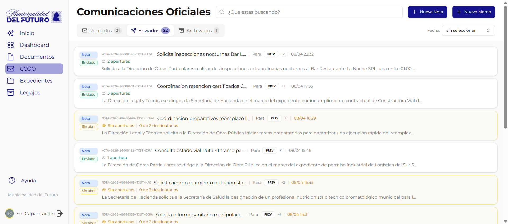

# Memos

Los **Memos** son comunicaciones internas privadas **persona a persona**. A diferencia de las [Notas](../notas/index.md) (que se envían entre sectores), los memos se dirigen a **usuarios individuales** y tienen tracking de lectura.

!!! video "Video tutorial"
    **GDI — Panel CCOO: gestión de Notas y Memos**

    <div class="video-embed"><iframe src="https://www.youtube-nocookie.com/embed/lWYjNqkUO78?list=PLRIZqApsdJ12JCSzhUxaZ73AheVHUEpDq" title="GDI — Panel CCOO: gestion de Notas y Memos" loading="lazy" allow="accelerometer; autoplay; clipboard-write; encrypted-media; gyroscope; picture-in-picture; web-share" allowfullscreen></iframe></div>


---

## Memo vs Nota

| Aspecto | Memo | Nota |
|---------|------|------|
| **Destinatarios** | Usuarios individuales | Sectores |
| **Visibilidad** | Solo las personas involucradas | Todo el sector destinatario |
| **Tracking** | Se registra quién abrió y cuando | Se registra quién abrió y cuando |
| **Archivado** | Cada usuario archiva independientemente | Cada usuario archiva independientemente |

---

## Modalidades de destinatario

Al crear un memo se asignan destinatarios en tres modalidades:

| Modalidad | Descripción | Obligatorio |
|-----------|-------------|:-----------:|
| **Para (TO)** | Destinatarios principales del memo | Sí (mínimo 1) |
| **CC** | Usuarios en copia, reciben el memo para su conocimiento | No |
| **CCO (BCC)** | Usuarios en copia oculta. Reciben el memo pero los demás destinatarios no los ven | No |

!!! warning "No podés enviarte un memo a vos mismo"
    El sistema no permite que el remitente se incluya como destinatario.

!!! info "CCO: solo visible para el remitente"
    Los destinatarios en copia oculta solo son visibles para quien envió el memo. Los destinatarios TO y CC no pueden ver quiénes están en CCO.

---

## Bandeja de Memos



La bandeja organiza los memos en tres pestañas:

| Pestaña | Contenido |
|---------|-----------|
| **Recibidos** | Memos donde sos destinatario (TO, CC o CCO) |
| **Enviados** | Memos que creaste y firmaste |
| **Archivados** | Memos que moviste al archivo |

### Indicadores visuales

- Los memos **no leídos** se muestran con un borde de color y badge "Sin abrir"
- Cada pestaña muestra un **contador** con la cantidad de memos
- El menú lateral muestra un **badge** con la cantidad de memos no leídos

### Búsqueda y filtros

Podés buscar memos por número oficial, asunto o contenido. También filtrar por fecha:

- Hoy
- Ayer
- Últimos 7 días
- Últimos 30 días
- Rango personalizado (fecha desde / fecha hasta)

---

## Crear un Memo

1. Desde la bandeja de memos, presiona **"Nuevo Memo"**
2. Se abre el editor de documentos con el tipo **MEMO** preseleccionado
3. Redacta el contenido del memo. Si necesitás una imagen, usa el botón de imagen de la barra del editor (ver [Insertar una imagen](../documentos/crear-editar-documento.md#insertar-una-imagen))
4. Agrega los destinatarios:
    - Selecciona usuarios para **Para** (mínimo 1)
    - Opcionalmente agrega usuarios en **CC** y **CCO**
5. Asigna firmantes (generalmente vos mismo)
6. Inicia el proceso de firma

!!! tip "Los destinatarios se validan al firmar"
    Al iniciar la firma, el sistema verifica que todos los destinatarios sigan activos en el sistema. Si algún usuario fue desactivado, se muestra un error.

---

## Flujo de un Memo

```
Crear documento tipo MEMO (con destinatarios Para/CC/CCO)
    |
    v
Editar contenido + asignar firmantes
    |
    v
Proceso de firma (igual que cualquier documento)
    |
    v
Firma completada -> Memo visible para los destinatarios
    |
    v
Destinatarios ven el memo en su bandeja "Recibidos"
    |
    v
Remitente puede ver tracking de aperturas
```

---

## Secciones de esta guía

| Página | Descripción |
|--------|-------------|
| [Memo Enviado](memo-enviado.md) | Vista del remitente: PDF, destinatarios y tracking de aperturas |
| [Memo Recibido](memo-recibido.md) | Vista del receptor: PDF, resumen IA, archivar |
