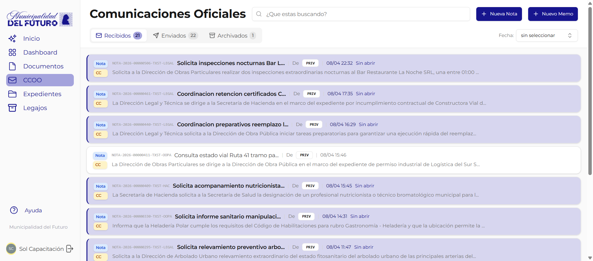

# Notas

Las **Notas** son un tipo especial de documento que funciona como memorandos o comunicaciones internas oficiales entre sectores del organismo. A diferencia de otros documentos, las notas incluyen **destinatarios** (sectores) y un sistema de **tracking de aperturas** que permite al remitente saber quién leyó la comunicación.

!!! video "Video tutorial"
    **GDI — Panel CCOO: gestión de Notas y Memos**

    <div class="video-embed"><iframe src="https://www.youtube-nocookie.com/embed/lWYjNqkUO78?list=PLRIZqApsdJ12JCSzhUxaZ73AheVHUEpDq" title="GDI — Panel CCOO: gestion de Notas y Memos" loading="lazy" allow="accelerometer; autoplay; clipboard-write; encrypted-media; gyroscope; picture-in-picture; web-share" allowfullscreen></iframe></div>


---

## Qué es una Nota

Una nota es un documento oficial con las siguientes particularidades:

| Característica | Descripción |
|----------------|-------------|
| **Destinatarios** | Sectores del organismo a los que se dirige la comunicación, en modalidades Para, CC y CCO |
| **Proceso de firma** | Pasa por el mismo proceso de firma que cualquier otro documento |
| **Envío automático** | Al completarse la firma, el sistema envía la nota automáticamente a los sectores destinatarios |
| **Tracking de aperturas** | El remitente puede ver quién abrió la nota y cuando |
| **Número oficial** | Recibe un número con formato `NOTA-{ANO}-{SECUENCIAL}-{TENANT}-{DEPTO}` |

---

## Modalidades de destinatario

Al crear una nota se asignan destinatarios en tres modalidades:

| Modalidad | Descripción | Obligatorio |
|-----------|-------------|:-----------:|
| **Para (TO)** | Sectores destinatarios principales de la comunicación | Sí (mínimo 1) |
| **CC** | Sectores en copia. Reciben la nota para su conocimiento | No |
| **CCO (BCC)** | Sectores en copia oculta. Reciben la nota pero los demás destinatarios no pueden ver que la recibieron | No |

---

## Bandeja de Notas



La bandeja de notas organiza las comunicaciones en tres pestañas:

| Pestaña | Contenido |
|---------|-----------|
| **Recibidas** | Notas dirigidas al sector del usuario (como Para o CC/CCO) |
| **Enviadas** | Notas creadas y firmadas por el sector del usuario |
| **Archivadas** | Notas que el usuario movio al archivo para mantener limpia la bandeja de recibidas |

---

## Flujo de una Nota

```
Crear documento tipo NOTA (con destinatarios Para/CC/CCO)
    |
    v
Editar contenido + asignar firmantes
    |
    v
Proceso de firma (igual que cualquier documento)
    |
    v
Firma completada -> Envio automatico a destinatarios
    |
    v
Nota aparece en bandeja "Recibidas" de los sectores destino
    |
    v
Remitente puede ver tracking de aperturas
```

---

## Crear una Nota

Para crear una nota, se utiliza el flujo de creación de documentos seleccionando el tipo **NOTA**. Consultar la guía completa en [Crear y Editar Documento](../documentos/crear-editar-documento.md), prestando especial atención a la sección **Destinatarios (solo para tipo NOTA)**.

El cuerpo de la nota admite imágenes. Se insertan con el botón de imagen de la barra del editor. Ver [Insertar una imagen](../documentos/crear-editar-documento.md#insertar-una-imagen).

---

## Secciones de esta guía

| Página | Descripción |
|--------|-------------|
| [Nota Enviada](nota-enviada.md) | Vista de una nota desde la perspectiva del remitente: PDF, destinatarios y tracking de aperturas |
| [Nota Recibida](nota-recibida.md) | Vista de una nota desde la perspectiva del receptor: PDF, destinatarios, resumen IA y botón archivar |
