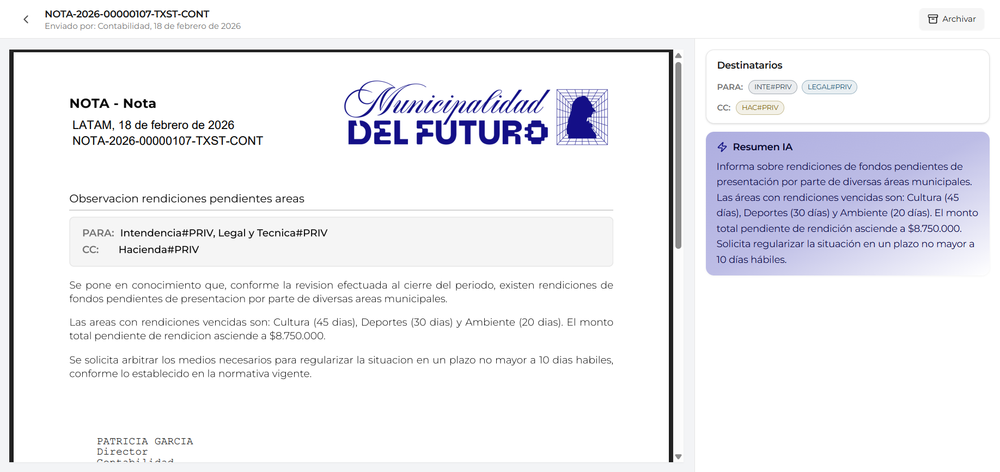

# Nota Recibida

Esta pantalla muestra el detalle de una nota desde la perspectiva del **receptor** (un sector que fue incluido como destinatario). La vista es similar a la de nota enviada, pero con diferencias clave: no incluye la sección de aperturas y agrega un botón para **archivar** la nota.

---

## Header

En la parte superior de la pantalla se muestra la información de identificación de la nota y el botón de archivo.

| Elemento | Descripción | Ejemplo |
|----------|-------------|---------|
| **Breadcrumb** | Flecha de retorno (`<`) con el número oficial de la nota para volver a la bandeja | `< NOTA-2026-00000107-TXST-CONT` |
| **Remitente** | Sector que envió la nota y fecha de envío | *Enviado por: Contabilidad, 18 de febrero de 2026* |
| **Botón Archivar** | Botón en la esquina superior derecha con icono de archivador | `Archivar` |

---

## Diferencias con la nota enviada

| Aspecto | Nota Enviada | Nota Recibida |
|---------|:------------:|:-------------:|
| **PDF con contenido** | Sí | Sí |
| **Panel Destinatarios** | Sí | Sí |
| **Panel Aperturas** | Sí | No |
| **Panel Resumen IA** | Sí | Sí |
| **Botón Archivar** | No | Sí |

La diferencia principal es que el receptor **no puede ver** quién más abrió la nota (sección de aperturas), ya que esa información es exclusiva del remitente.

---

## PDF de la nota

El área central muestra el documento PDF con los mismos elementos que en la vista de nota enviada:

| Elemento | Descripción |
|----------|-------------|
| **Membrete** | Encabezado oficial con el tipo "NOTA - Nota" |
| **Referencia** | Título descriptivo de la nota (ej: *Observación rendiciones pendientes áreas*) |
| **Recuadro de destinatarios** | Bloque con los sectores destinatarios en modalidad PARA y CC |
| **Cuerpo** | Contenido completo de la nota |
| **Firma** | Nombre, cargo y sector del firmante (ej: *PATRICIA GARCIA / Director / Contabilidad*) |

---

## Botón Archivar

El botón **"Archivar"** se encuentra en la esquina superior derecha de la pantalla, identificado con un icono de archivador.

| Propiedad | Valor |
|-----------|-------|
| **Ubicación** | Esquina superior derecha del header |
| **Acción** | Mueve la nota de la pestaña "Recibidas" a la pestaña "Archivadas" |
| **Reversible** | Si. Desde la pestaña "Archivadas" se puede desarchivar la nota |

!!! info "Para qué sirve archivar"
    Archivar una nota no la elimina ni la oculta permanentemente. Simplemente la mueve a la pestaña **"Archivadas"** de la bandeja de notas para mantener organizada la bandeja de recibidas. La nota sigue siendo accesible en cualquier momento.

---

## Panel lateral

A la derecha del PDF se encuentra el panel lateral con dos secciones.

### Destinatarios

Muestra los sectores a los que fue dirigida la nota, agrupados por modalidad:

| Modalidad | Descripción | Ejemplo |
|-----------|-------------|---------|
| **PARA** | Sectores destinatarios principales | `INTE#PRIV`, `LEGAL#PRIV` |
| **CC** | Sectores en copia | `HAC#PRIV` |

### Resumen IA

Tarjeta violeta con un resumen automático del contenido de la nota, generado por inteligencia artificial. Ofrece una visión rápida del contenido sin necesidad de leer el PDF completo.

---

## Preguntas frecuentes

??? question "Puedo saber quién más recibio esta nota?"
    Sí. La sección de destinatarios en el panel lateral muestra todos los sectores que fueron incluidos como PARA y CC. Los destinatarios en CCO no son visibles.

??? question "Al archivar una nota, se notifica al remitente?"
    No. Archivar es una acción local que solo afecta la organización de la bandeja del receptor. El remitente no recibe notificación.

??? question "Puedo responder a una nota recibida?"
    No directamente desde esta pantalla. Para responder, se debe crear una nueva nota dirigida al sector remitente desde el flujo de creación de documentos.

??? question "Qué pasa si archivo una nota por error?"
    La nota se mueve a la pestaña "Archivadas" donde puede ser consultada y desarchivada en cualquier momento.

??? question "El remitente puede ver que abrí la nota?"
    Sí. Al abrir una nota recibida, la apertura se registra automáticamente y el remitente puede verla en la sección de aperturas de su vista de nota enviada.
